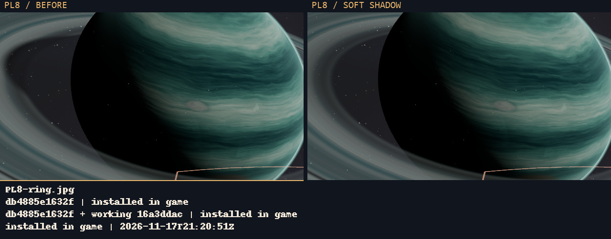
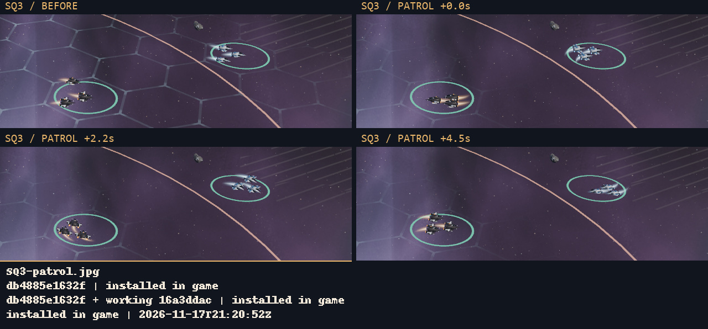
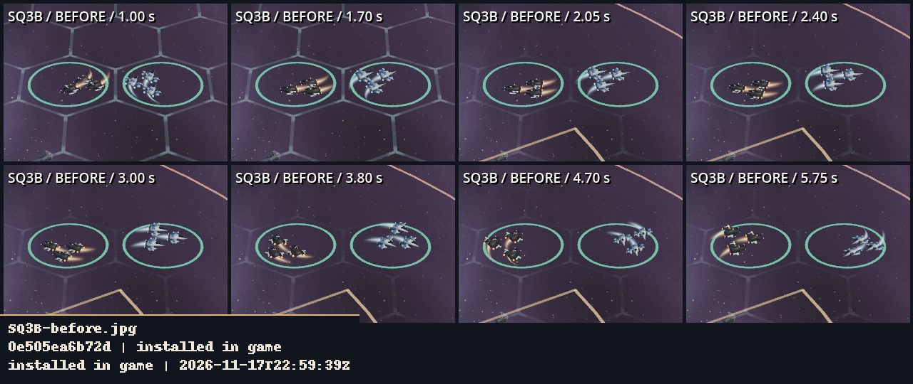
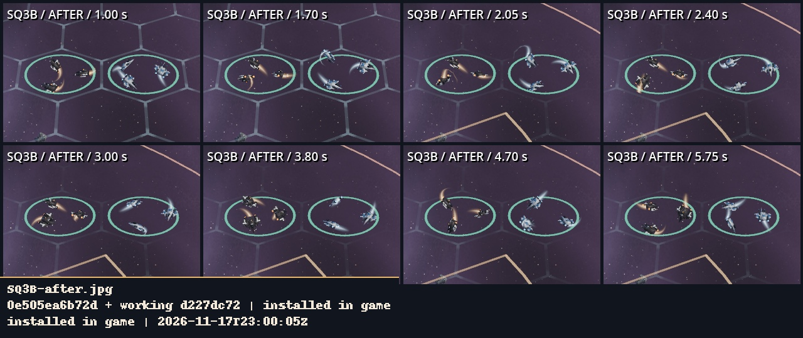
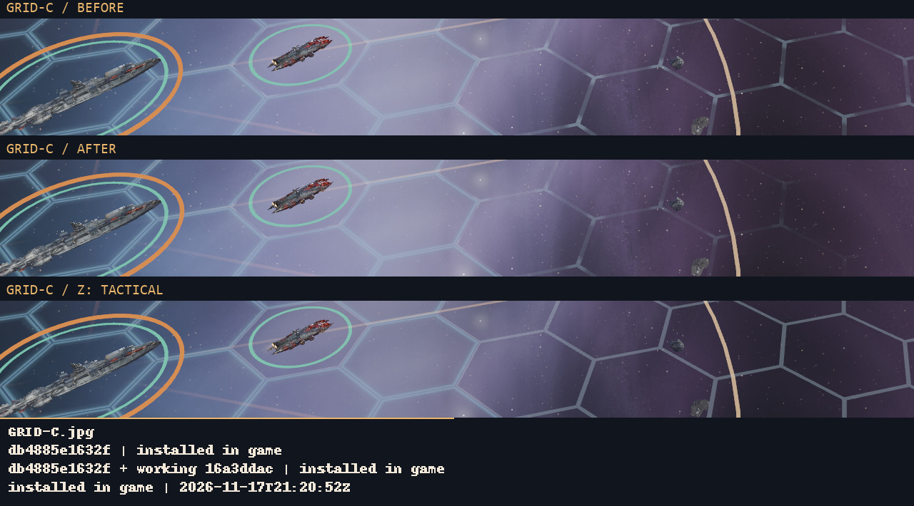

# Battle look, Nov 17 (issue 1005)

Before and after use the same storm map (seed 4103, ringed planet 7), camera at battle zoom 170, and 1:1 crops from 1920x1080 on the RTX 5080. Before is main at `db4885e1`; after is the stamped working revision.

## PL8: Ring shadow

The line on the left of the ring came from the planet's shadow. The ring is a single mesh and uses the same sun direction as the globe, but its shadow went from black to fully lit in 0.06 planet radii. The new shader spreads the transition and keeps some light in the deepest shadow. The ring bands stay visible through it.

## SQ3: Parked flight

Each craft used to weave less than one world unit sideways around a fixed spot in the formation. The two parked wings now turn around their own hexes about once every 8.5 seconds. The three full-size craft stay in one arrowhead and bank together. Each has its own small drift, roll, and lit engine. The green rings show that the hex anchors stay still. The Chorus keeps its six-craft wedge, with the middle row raised to fit the turn.

### SQ3B: Independent parked flight

The first pass turned the whole arrowhead with one heading. SQ3B gives each craft a different loop, direction, and pace. The craft bank with their own turns, spread and close up again, and take turns climbing through a roll. Look at the Hegemony fighter at 2.05 s and the Sunward bomber at 4.70 s. The engine glow stays on the hull; each trail bends behind its own craft. The rings show the fixed hex anchors. A climbing craft can project above its ring even while its hull stays inside the hex footprint. Chorus keeps six craft on two staggered tiers. Wings use their existing formation between hexes.

Both strips use the default r170, beta 0.98 battle camera and identical times and 1:1 crops from 1920x1080. [Capture script](sq3b_capture.gd).

## GRID-C: Cinematic fade

`6ffcda5c` widened Look C's ship fade from 28-118 to 55-175 world units, then extended it to 280 at wide views. That left plain hexes across much of the battle frame, including the nebula. `a9751182` removed the far ticks but kept the wider range. C was still the default; the near-uniform grid was visible with tactical mode off. The restored 28-118 range now ends in an actual cutoff. The older Today look also loses its 30% far-grid floor. The cursor still lights its local patch, and Z still brings back the whole grid.

