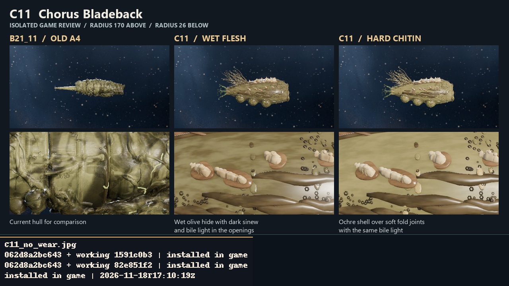

# Chorus and Glasswright finish review

Refs #1058. The finish review uses an isolated Godot project. The two hulls still need Ryan's approval for the shared build.

## Run 5 finishes

- **C11 Bladeback / B21_11.** Fine growth lines, striations and pits give the
  broad shingled plates a grain. The plates are more matte, vary from ochre to
  dark brown and darken toward their trailing ridges. Wet joints and throats
  keep a little shine.
  [Build sheet](../../ship_pipeline/build_sheets/chorus_C11/README.md) |
  [Source manifest](../../ship_pipeline/build_sheets/chorus_C11/manifest.json) |
  [Chorus stack](../../../tools/blender/kits/chorus/stack.py)
- **CD5 The Unfinished / I8_37.** D uses light smoke that deepens in thick glass
  and at grazing angles. E clears more of the glass and scatters more ice-blue
  light near the core. Both use the mid smoke grey frames and thin guides.
  Small sharp highlights and a thin rainbow fringe follow the rims. Both use
  the same checked export, whose baked material gives the tinted fallback.
  [Build sheet](../../ship_pipeline/build_sheets/ithar_CD5/README.md) |
  [Source manifest](../../ship_pipeline/build_sheets/ithar_CD5/manifest.json) |
  [Glasswright stack](../../../tools/blender/kits/ithar/stack.py) |
  [Recipe](../../../tools/recipe/ships/ithar_CD5.json)

Both use two 4096-pixel atlases baked at 64 OptiX samples and exported as
2048-pixel game maps. C11's sheet supplies one new paint coordinate per shell
plate. CD5's sheet supplies the run 4 geometry and authored interior.

Each sheet uses matching cameras and sky. It shows both sides at radius 170
and radius 26 under today's battle light and the cool edge light from 1137.
The cool edge light is a preview. The CD5 sheet also shows the plain glass
rod and sphere for each glass finish and a preview of the tinted fallback.

- [C11 run 5 beside A4 and run 4](C11_finish_run5.jpg)
- [CD5 D and E beside A4, run 3 B and run 4](CD5_finish_run5.jpg)

D is my pick for CD5. The inner frame reads at battle distance and the light
smoke still makes the hull outline easy to follow. In both variants the core
reads pale blue-white.

### Run 5 export and damage checks

Both passed the six-view surface check, the Stage 6 LOD bench, the Stage 7
hard-point and planted-fault checks, and the isolated install and readback.
The readback found all 22 C11 and 26 CD5 hard-point and turret nodes. The mean
cached albedo error was below 0.43 levels per channel on all four maps.

| Export | GLB triangles | GLB surfaces | Stage 6 draws, 20 full-detail copies at 1080p |
| --- | ---: | ---: | ---: |
| C11 / B21_11 | 184,980 | 14 | 130 |
| CD5 / I8_37 | 222,082 | 14 | 90 |

The exports match run 4 in vertex positions, triangle indices, node
transforms and authored damage data. The wound and wreck checks passed on
both. C11 has two tears and 13 machines. CD5 has six fractures and eight
machines. Both wrecks had zero split machines and zero interior triangles
outside their matching wreck piece. The separate intact-hull ray count for
CD5 still flagged 199 triangles. The run 4 cross-section check placed all 45
flagged corners inside the same geometry.

CD5 r3 started at 461,770 triangles and 334 unjoined pieces. Run 5 groups the
same 114 input meshes as run 4, including the shortened guides.

The C19_51 fixture was rebuilt from the A16 sheet with the current Stage 7
exporter. The compressed fixture and the GLB inside it are byte-identical to
the previous copy. Only the source hash changed. The Godot fixture check found
zero split machines and zero protruding interior triangles.
[Fixture record](../../../godot/fx/test/fixtures/C19_51_unbaked.sheet.txt)

Standing checks returned 74 passes and two known baselines.

### Run 5 Scene 207 cost at 1080p

The isolated 24-ship storm battle puts C11 in the Chorus Spitter's slot and CD5
in the Glasswright Lancet's slot. It uses battle source `559a5ff6` and installed
ship manifest SHA-256
`0d36262838aade769d7ef6304fb1ecae54947c4891e3901629a03daf8658a7cf`.
Godot 4.7.2 uses Forward+, fitted shields, 4x MSAA, full mesh detail and vsync off
on the RTX 5080. Each case warms up for 180 frames and measures at least 720
frames and eight seconds. [Scene 207 sampling method](../../../contrib/codex/perf_1118/README.md)

The installed hull snapshot counts 185,208 triangles for C11 and 222,178
for CD5, with 16 surfaces each, including damage geometry.

| CD5 finish in the same scene | Frame median | Frame p95 | Frame p99 | Worst frame | GPU median | Visible + shadow draws |
| --- | ---: | ---: | ---: | ---: | ---: | ---: |
| D, clear with light smoke | 3.48 ms | 9.34 ms | 11.80 ms | 64.37 ms | 2.63 ms | 473 + 313 |
| E, clearer with more core glow | 3.72 ms | 5.59 ms | 7.54 ms | 65.77 ms | 2.64 ms | 473 + 313 |
| Baked tinted fallback | 4.12 ms | 6.17 ms | 8.35 ms | 72.15 ms | 2.71 ms | 476 + 313 |

Three solo GPU sessions ran all three cases in different orders. The table
uses the middle session statistic for each column except the worst frame,
which is the largest individual sample. All nine frame medians passed the
12.5 ms gate. The highest was 7.16 ms. Both D and E kept all five glass
surfaces active after the volleys. CD5 fits the measured flagship budget.

## Run 4 finishes

- **C11 Bladeback / B21_11.** Eight broad, low shoulder bands per side shingle
  from bow to stern. A raised rear lip hangs over a dark fold, with small
  plate-to-plate shifts in the same ochre-brown tone.
  [Build sheet](../../ship_pipeline/build_sheets/chorus_C11/README.md) |
  [Source manifest](../../ship_pipeline/build_sheets/chorus_C11/manifest.json) |
  [Chorus stack](../../../tools/blender/kits/chorus/stack.py)
- **CD5 The Unfinished / I8_37.** Run 3 B's smoke and clear reflections cover
  charcoal fittings and one ice-blue core. Four dim filaments follow the hull
  and stop at the shatter joints. Rainbow colour comes from grazing edges and
  bright glints. The baked fallback uses neutral grey.
  [Build sheet](../../ship_pipeline/build_sheets/ithar_CD5/README.md) |
  [Source manifest](../../ship_pipeline/build_sheets/ithar_CD5/manifest.json) |
  [Recipe](../../../tools/recipe/ships/ithar_CD5.json) |
  [Glass shader](../../../tools/blender/kits/ithar/blown_glass.gdshader)

The 1280 by 720 sheets show A4, Run 3 and Run 4 from both sides at radius
170 and 26. CD5 uses Run 3 B and includes a plain rod and sphere under each
glass finish in the same battle light. The older A4 reverse views use a
darker sky. C11's bands are visible in the battle views. CD5's core reads
pale blue-white up close, and the dim guides are easiest to see there.

- [C11 comparison](C11_finish_run4.jpg)
- [CD5 comparison and glass reference](CD5_finish_run4.jpg)

### Run 4 export and damage checks

Both builds passed the six-view surface check, Stage 6 LOD bench, Stage 7
hard-point check and planted-fault checks, isolated ShipView readback and
cache map comparison. Both used two 4096-pixel atlases at 64 OptiX samples
and exported 2048-pixel game maps.

| Export | GLB triangles | GLB surfaces | Stage 6 draws, 20 full-detail copies at 1080p |
| --- | ---: | ---: | ---: |
| C11 / B21_11 | 184,980 | 14 | 130 |
| CD5 / I8_37 | 222,082 | 14 | 90 |

The Godot damage probes found zero split machines and zero interior triangles
outside the matching wreck pieces on both exports. C11 has 13 machines and
two tears. CD5 has eight machines and six fractures. CD5's separate ray count
against the whole unbroken hull flagged 199 triangles, down from 316 in Run
3. A cross-section check placed all 45 distinct flagged corners inside the
authored outline. The installed hull snapshot, including damage geometry,
counted 185,208
triangles and 16 surfaces for C11 and 222,178 triangles and 16 surfaces for CD5.

CD5 r3 had 461,770 triangles and 334 unjoined pieces. Run 4's bake grouped
114 input meshes into the exported surfaces. Removing the groove slivers,
silver runs and braided guides accounts for most of the reduction.

Standing checks returned 74 passes and two known baselines.

### Run 4 Scene 207 cost at 1080p

The isolated project put C11 in the Chorus Spitter's slot and CD5 in the
Glasswright Lancet's slot in the same 24-ship scene. It used battle source
`3b616ac3` and installed manifest SHA-256
`06a9d9125b289c194695e91e8d9137bf8b497dd15933ed17b02a01528095dc9d`.
Three separate Godot 4.7.2 processes ran on the RTX 5080 under solo GPU claims.
Each timed both finishes using Forward+, fitted shields, 4x MSAA, full mesh
detail and vsync off. Each case warmed up for 180 frames and measured at
least 720 frames and eight seconds. The smoked finish kept all five glass
surfaces after the volleys.

| Finish in the same scene | Frame median | Frame p95 | Frame p99 | Worst frame | GPU median | Visible + shadow draws |
| --- | ---: | ---: | ---: | ---: | ---: | ---: |
| Run 4 smoked glass | 3.58 ms | 5.69 ms | 7.27 ms | 77.43 ms | 2.67 ms | 478 + 313 |
| Baked neutral fallback | 3.52 ms | 8.47 ms | 10.76 ms | 62.61 ms | 2.71 ms | 474 + 313 |

Both finishes passed the **12.5 ms median gate** in every session. The table
uses the middle of the three session statistics except for the worst frame,
which is the largest recorded sample. CD5 fits the measured flagship budget.
[Scene 207 sampling method](../../../contrib/codex/perf_1118/README.md)

## Run 3 finishes

- **C11 Bladeback / B21_11.** The chitin has overlapping shoulder plates with raised
  rear lips and broad growth ridges. Soft olive hide shows in the gaps. Ochre and
  olive vary between the plates, and finer grain shows at radius 26.
  [Build sheet and changes](../../ship_pipeline/build_sheets/chorus_C11/README.md) |
  [Manifest](../../ship_pipeline/build_sheets/chorus_C11/manifest.json) |
  [Chorus stack](../../../tools/blender/kits/chorus/stack.py)
- **CD5 The Unfinished / I8_37.** A is clear enough to see the light guides and
  frames, with a bright rim and sharp glints. B uses smoked glass and the same
  chamfers. C puts stronger colour separation at grazing edges and glints.
  The blended blue glass in the exported GLB provides the lower-quality finish.
  [Build sheet and changes](../../ship_pipeline/build_sheets/ithar_CD5/README.md) |
  [Manifest](../../ship_pipeline/build_sheets/ithar_CD5/manifest.json) |
  [Recipe](../../../tools/recipe/ships/ithar_CD5.json) |
  [Glass shader](../../../tools/blender/kits/ithar/blown_glass.gdshader)

The CD5 strands are capped at the ends. The sealed glass surface takes its
optical thickness from the finish. The decks, frames and braided light guides
are real geometry. Separate compartments leave their joints clear for the six
authored shatter paths. C11 keeps its own organs, bone hoops and two tears.
Both bakes use two 4096-pixel atlases at 64 OptiX samples. Stage 7 writes
2048-pixel game maps.

The 1280 by 720 sheets put A4, run 2 and run 3 side by side at radii 170 and 26.
The headings and crops match across the columns. The archived A4 and run 2
captures have a darker reverse-side background. The three run 3 options share
the current Look Bench nebula. Each CD5 option has a rod and sphere in the same
light. The three turntables show one orbit each at radius 58.

- [C11 comparison](C11_finish_run3.jpg)
- [CD5 comparison and tinted fallback](CD5_finish_run3.jpg)
- CD5 turntables [A clear](CD5_run3_A_turntable.webp), [B smoked](CD5_run3_B_turntable.webp),
  [C prism](CD5_run3_C_turntable.webp)

### Run 3 export and damage checks

Both ships passed the six-view surface check, the Stage 6 LOD bench, the Stage 7
hard-point check and planted-fault checks, and the isolated ShipView readback.
Godot's cached albedo was checked against the exported hull and parts maps.
The authored-interior probe exercised wounds and breaks on both exports.

The wreck check found **zero protruding triangles** and **zero split machines**
on either ship. C11 has 13 machines and two seams. CD5 has eight machines and
six seams. CD5 still records 316 triangles in the separate whole-hull ray count.
A cross-section check on the unpainted export found all 87 distinct flagged
corners inside the authored outline at their stations.

| Export | Triangles | GLB surfaces | Stage 6 draws, 20 full-detail copies at 1080p |
| --- | ---: | ---: | ---: |
| C11 / B21_11 | 196,716 | 14 | 130 |
| CD5 / I8_37 | 385,086 | 24 | 170 |

CD5's 385,086 triangles include 21,504 in the three turning optics. The source
r3 export had 461,770 triangles and 334 unjoined pieces. The deck and light-guide
joints raise the piece count to 360 before export. Those pieces share 24 GLB
surfaces. The 256,768-triangle capital from the original
Scene 207 is a reference. The binding flagship budget is the measured frame time.
[Scene 207 reference](../ship_pipeline/bench207/README.md) |
[Rulebook section 3](../../RULEBOOK.md#3-pc-and-tools)

The A16 fixture record was stale on this branch. A fresh export with the branch
exporter matched the existing fixture's decompressed GLB byte for byte. The record
uses the current source hash and the existing compressed file. It passed the
record check and the Godot wreck check.
[Fixture record](../../../godot/fx/test/fixtures/C19_51_unbaked.sheet.txt)

Standing checks returned 74 passes and two known baselines.

### Run 3 Scene 207 cost at 1080p

The isolated project uses battle source `eb6b7371` and the installed ship
manifest SHA-256 `44caaa5251ec9decc70ec9eabce5749f0c80060740f110abbd7aa9f860cf903b`.
C11 takes the Chorus Spitter's slot and CD5 takes the Glasswright Lancet's
slot in the same 24-ship scene. The probe uses issue 1070's sampling method.
Three separate Godot 4.7.2 processes ran under solo GPU claims on the RTX 5080
with driver 617.42.
Each process ran A, B, C and the baked fallback in a different order, with
180 warm-up frames followed by at least 720 frames and eight measured seconds.
The scene used Forward+, fitted shields, 4x MSAA, full mesh detail and vsync
off. Each full finish still had five glass surfaces after the volleys and
damage. The baked fallback uses the same export and lit scene.
[Issue 1070 method](../../../contrib/codex/perf_1118/README.md)

The installed hull snapshot counted **196,944 triangles and 16 surfaces** for
C11, and **385,182 triangles and 26 surfaces** for CD5, including damage geometry.

| CD5 finish | Frame median | Frame p95 | Frame p99 | Worst frame | GPU median | Visible + shadow draws |
| --- | ---: | ---: | ---: | ---: | ---: | ---: |
| A clear | 4.25 ms | 7.14 ms | 10.06 ms | 78.21 ms | 2.74 ms | 477 + 303 |
| B smoked | 4.45 ms | 7.43 ms | 10.56 ms | 71.93 ms | 2.74 ms | 483 + 323 |
| C prism | 3.89 ms | 6.92 ms | 10.25 ms | 64.01 ms | 2.74 ms | 483 + 323 |
| Baked tinted fallback | 3.94 ms | 6.44 ms | 9.56 ms | 64.26 ms | 2.80 ms | 485 + 323 |

All four finishes passed the **12.5 ms median frame budget** in each session.
The medians, percentiles and draws are the middle of the three session
statistics. Worst frame is the largest sample from any session. The largest
frame spikes are still visible in the worst-frame column. The smoke in B keeps
the glass outline easiest to follow while the guides and frames show through.

## Run 2 pictures

The columns show A4, run 1 and run 2. Each side uses the same Look Bench nebula, headings and camera radii across the three
columns. CD5's battle views are scaled together to fit the old ship's tall outline. The close views are matched crops.

- [C11 / B21_11 comparison](C11_finish_run2.jpg)
- [CD5 / I8_37 comparison and lower-quality glass](CD5_finish_run2.jpg)
- [CD5 turntable, one six-second orbit at radius 58](CD5_glass_turntable.webp)

## Run 2 finish method

- **C11 Bladeback / B21_11.** Olive and ochre hard chitin follows the build sheet's overlapping shell shapes. The ship's own
  occlusion masks darken the joints. Broad, curved growth ridges carry the sheen at distance. Fine growth lines and grain
  go into the tangent-space normal map. The softer folds, tissue and weapon throats keep their wet finish.
  [C11 build sheet](../../ship_pipeline/build_sheets/chorus_C11/README.md) |
  [Manifest](../../ship_pipeline/build_sheets/chorus_C11/manifest.json) |
  [Chorus stack](../../../tools/blender/kits/chorus/stack.py)
- **CD5 The Unfinished / I8_37.** The full glass finish reflects the battle's live nebula and panorama. The surface bends the
  image of the sky and inner light behind it, with red and blue bending by different amounts. The optical film shifts colour
  with the viewing angle. The old saturated patches become softer, near-white light sources. At lower quality, the baked
  blue-violet tint and the inner lights provide colour without the screen copy.
  [CD5 r3 build sheet](../../ship_pipeline/build_sheets/ithar_CD5/README.md) |
  [Manifest](../../ship_pipeline/build_sheets/ithar_CD5/manifest.json) |
  [Glasswright stack](../../../tools/blender/kits/ithar/stack.py) |
  [Glass shader](../../../tools/blender/kits/ithar/blown_glass.gdshader) |
  [CD5 recipe](../../../tools/recipe/ships/ithar_CD5.json)

The build sheets supply every part and damage seam. C11 still uses a scratch recipe with `bake: stack` for this review.
CD5's Stage 7 export carries the tinted PBR maps. The isolated capture and timing scenes opt into the full shader on CD5's
translucent atlas surfaces. The bake uses the existing silver frame, authored breaks and inside mesh. C10 v7 follows Ryan's
pick in a later run. [Review helper](../../../tools/blender/kits/ithar/glass_review.gd)

Both finishes use two 4096-pixel atlases at 64 OptiX samples, exported to 2048-pixel game maps. On the sampled C11 hull
atlas, the middle 80 percent of roughness spans 0.24-0.64 in run 2 and 0.24-0.43 in run 1. The 90th-percentile normal-map
XY displacement from flat went from 1.6 to 20.6 levels on the same 8-bit scale.

## Run 2 export and install checks

Both ships passed the six-view surface check, Stage 6 LOD bench, Stage 7 hard-point and planted-fault checks, and isolated
ShipView readback.
The GLBs carry the same mesh buffers as run 1. The installed hull and parts albedo maps matched their current JPEGs within
0.49 levels per channel in the cache sample, including with run 1's editor imports present. The isolated cache uses the
raw-texture fix tested in issue 1082.

| Ship | Export triangles | GLB surfaces | Stage 6 draw calls, 20 full-detail copies at 1080p |
| --- | ---: | ---: | ---: |
| C11 / B21_11 | 208,646 | 14 | 130 |
| CD5 r3 / I8_37 | 461,770 | 24 | 170 |

The authored-interior probe passed on both ships. The separate wreck check again found one protruding triangle on C11
and 296 on CD5, with zero split machines out of 13 and eight respectively. These are the same wreck counts as run 1.
The visual review uses the authored geometry. A build-sheet fix is still needed before a shared install.

The C19_51 fixture was rebuilt from the A16 sheet and exported with `unbaked=1`. The regenerated GLB had the same SHA-256 as
the decompressed fixture, so the compressed bytes stay in place. The record now matches the Stage 7 exporter. Its Godot
seam check found zero split machines and zero protruding interior triangles.
[C19_51 fixture record](../../../godot/fx/test/fixtures/C19_51_unbaked.sheet.txt)

Standing checks had one timeout while the first review import and bake were running. The timed-out tree effects check
passed on its own at 154 seconds. Across those runs all 67 checks passed and two known baselines repeated.

## Run 2 Scene 207 cost

The full glass passed the 12.5 ms gate at **11.71 ms frame time at 1080p** and **6.01 ms GPU time at 4K**. The full
shader drew five glass surfaces. Switching only those surfaces from baked glass to the full shader changed median GPU
time by -0.10 ms at 1080p and -0.04 ms at 4K in this scene. Paired GPU differences ranged from -0.16 to -0.06 ms at
1080p and -0.09 to -0.04 ms at 4K.

The isolated run 1 review project (`a9346414` battle code, cache fix `30a23ce4`) used the current Scene 207 probe with the
same roster for every trial. C11 and CD5 occupied the Chorus Spitter and Glasswright Lancet slots so the battle drew both
ship codes. All 12 trials held exclusive access to the RTX 5080. The machine used a Ryzen 7 5800X and NVIDIA driver 617.42.
Godot 4.7.2 ran Forward+ with fitted shields, 4x MSAA, vsync off and full mesh detail. The 4K scene rendered at 2x in a
1920 by 1080 window. Each setup ran three sessions, alternating order, with 120 warm-up frames and 720 timed frames.
Installed ship manifest SHA-256 `32045761e260a6f32cad3d2901256d827041d368981f596ea6214270e5f1faec`.

Each cell reports the median, p95, p99 and worst frame in ms. Percentiles are the middle of the three session results.
The worst is the largest frame sample across the three sessions.

| Drawn resolution and glass | Frame | GPU | Render CPU | Main process monitor |
| --- | --- | --- | --- | --- |
| 1080p, baked fallback | 12.23 / 23.62 / 378.50 / 1604.54 | 2.74 / 3.27 / 3.44 / 3.90 | 2.78 / 5.15 / 5.52 / 11.27 | 27.24 / 982.22 / 1009.20 / 1602.10 |
| 1080p, full glass | 11.71 / 21.06 / 223.24 / 923.11 | 2.65 / 3.25 / 3.41 / 3.89 | 2.54 / 4.83 / 5.37 / 295.88 | 36.88 / 373.82 / 387.31 / 920.18 |
| 4K, baked fallback | 9.87 / 19.12 / 171.21 / 953.63 | 6.05 / 6.75 / 7.34 / 7.97 | 2.44 / 4.23 / 4.61 / 5.22 | 35.89 / 178.50 / 841.72 / 953.03 |
| 4K, full glass | 9.15 / 13.37 / 23.52 / 384.75 | 6.01 / 6.62 / 6.76 / 6.92 | 2.54 / 3.55 / 4.00 / 9.81 | 34.14 / 89.00 / 89.00 / 383.76 |

The second 1080p session went over the frame gate with both materials (13.92 ms fallback, 13.95 ms full). Timing tails
were uneven, especially in the main process monitor. The first rendered frame after applying the full glass took 108 ms
from assignment to post-draw on its first 1080p scene. The later 1080p full-glass starts took 10.4 and 6.9 ms.

In the first scene's installed hull snapshot, C11 counted 208,874 triangles across 16 surfaces. CD5 counted 464,673
triangles across 27 surfaces, including damage surfaces. Its 334 unjoined build-sheet pieces become 24 GLB surfaces,
including the three turning optics. CD5 is above the old capital reference of 256,768 triangles and within the binding
frame budget. Median full-glass scene draws were 487 visible plus 323 shadow at 1080p, and 481 plus 323 at 4K.
[Scene 207 reference](../ship_pipeline/bench207/README.md) | [Rulebook section 3](../../RULEBOOK.md#3-pc-and-tools)

## Run 1 record

The run 1 sheets compare the old A4 hulls with the finished build-sheet hulls in the isolated Godot review project.
The upper row is radius 170 at 1080p native pixel size. The lower row is a close crop at radius 26. The camera, ship heading,
sky and battle lights match across the columns.

### C11 Bladeback

Wet flesh has dark olive sinew and a wet shine across the hide. Hard chitin puts ochre shell on the large curved surfaces
and leaves the joints and throats soft. Both keep the bone crests and the bile-green light from the sheet.
The two finishes are close in colour at radius 170. The close view shows a smoother hide than the concept.

### CD5 The Unfinished

Polished glass follows the six twisted strands. The silver veins and frame are solid. Amber leads the stored light beneath
the glass, with violet and green between it and a pale bloom in the drive optics.
The star highlight is clear in the close crop and the reflected sky is faint. Turning off sky reflection changed mean RGB
by 0.55 of 255 in the crop. Turning off directional specular as well changed it by a further 10.63. The stored light reads as
individual slivers. The approved concept has a denser wash of colour through the glass.

### Method

- C11 uses the accepted cruiser sheet and its existing material zones. For the two review bakes, the scratch ship entry
  selects `bake: stack` and `CHORUS_FINISH` selects `flesh` or `chitin`. The C10 v7 rollout follows Ryan's pick.
  [C11 build sheet](../../ship_pipeline/build_sheets/chorus_C11/README.md) ·
  [C11 manifest](../../ship_pipeline/build_sheets/chorus_C11/manifest.json) ·
  [C10 v7 build sheet](../../ship_pipeline/build_sheets/chorus_C10/README.md)
- CD5 uses the accepted R298 r3 design with a new `ithar_CD5` recipe entry. The bake uses the sheet's rolled-glass attribute,
  geometry masks and the shared albedo, roughness and normal bakes. The solid frame and translucent glass share the atlas.
  The two lances, three turning optics, stern drives, light slivers and authored fracture paths come from the r3 sheet.
  [CD5 build sheet](../../ship_pipeline/build_sheets/ithar_CD5/README.md) ·
  [CD5 manifest](../../ship_pipeline/build_sheets/ithar_CD5/manifest.json) ·
  [CD5 recipe](../../../tools/recipe/ships/ithar_CD5.json)

Both stacks use clean procedural colours and surface relief. Both use the authored inside geometry. The bakes use
two 4096-pixel atlases at 64 samples, then Stage 7 writes 2048-pixel game maps. The proof uses the GPU queue and a separate
copy of the Godot build. The shared install follows approval.

The isolated install refreshes Godot's editor imports before rebuilding the ship cache. The first C11 readback
verified the new mesh and hard points while the cached albedo still matched the old imported JPEG. The refreshed import
is part of the review capture and cost run.

### Export and damage checks

Both C11 options and CD5 passed the six-view surface check, the Stage 6 LOD export and Godot bench, the Stage 7 hard-point
and broken-export checks, and the isolated install readback. The runtime authored-interior probe passed for all three.
The CD5 export carries seven breach points and six authored seams. Stage 7 now tries same-side spacing when the side
projection alone makes an otherwise clear opposite-side breach point look crowded.

| Export | Triangles | GLB surfaces | Stage 6 draw calls, 20 copies at 1080p |
| --- | ---: | ---: | ---: |
| C11 wet flesh | 208,646 | 14 | 130 |
| C11 hard chitin | 208,646 | 14 | 130 |
| CD5 r3 | 461,770 | 24 | 170 |

CD5 has 440,266 main mesh triangles and 21,504 in three turning optics. The 24 surfaces include those optics. The
build sheet's 334 unjoined pieces collapse into these material surfaces in the export.

The separate destruction check preserved all eight CD5 machines and all 13 C11 machines, with zero split on either hull.
Its interior containment check failed. Both C11 finishes have one triangle outside its own broken piece, matching the
earlier unpainted C11 export. CD5 has 296 there, compared with 294 on the unpainted r3 contract. The review keeps the
authored geometry and tear paths. The breakup finding needs a build-sheet pass before the shared install.

The standing Node suite finished with 67 passes and two known baselines. The corrected CD5 export also passed its
broken-export and turret checks.

### Scene 207 cost

The isolated scene used the same 24-unit roster in every run. The Chorus Bladeback and The Unfinished took the
Chorus Spitter and Glasswright Lancet slots so the test actually drew both target codes. Each row uses three
sessions on the RTX 5080 in Forward+, with 120 warm-up frames and 720 timed frames per session.

| Isolated install | 1080p frame median | 4K GPU median | 1080p scene draws, visible + shadow |
| --- | ---: | ---: | ---: |
| Old A4 for both | 7.17 ms | 5.91 ms | 487 + 326 |
| C11 wet flesh, old Glasswright A4 | 5.71 ms | 5.91 ms | 491 + 326 |
| C11 hard chitin, old Glasswright A4 | 6.25 ms | 5.85 ms | 489 + 326 |
| C11 hard chitin and CD5 r3 | 6.88 ms | 6.10 ms | 480 + 303 |

The CD5 install added 0.25 ms at 4K against the same chitin run with the old Glasswright A4. After the scene warm-up,
CD5 counted 463,012 hull triangles and 27 surfaces, including damage surfaces. That is above the original Scene 207
capital reference of 256,768 triangles. At full detail, CD5 passes the binding flagship budget of 12.5 ms on both
readings. [Scene 207 reference](../ship_pipeline/bench207/README.md) · [Rulebook section 3](../../RULEBOOK.md#3-pc-and-tools)
