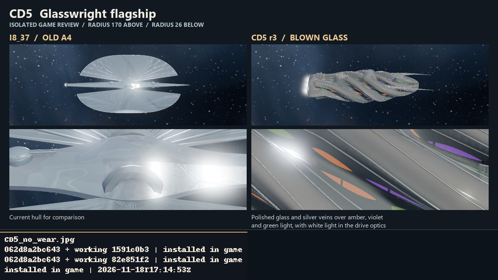

# Chorus and Glasswright finish review

Refs #1058. The two sheets compare the old A4 hulls with the finished build-sheet hulls in the isolated Godot review project.
The upper row is radius 170 at 1080p native pixel size. The lower row is a close crop at radius 26. The camera, ship heading,
sky and battle lights match across the columns.

## C11 Bladeback

Wet flesh has dark olive sinew and a wet shine across the hide. Hard chitin puts ochre shell on the large curved surfaces
and leaves the joints and throats soft. Both keep the bone crests and the bile-green light from the sheet.
The two finishes are close in colour at radius 170. The close view shows a smoother hide than the concept.

## CD5 The Unfinished

Polished glass follows the six twisted strands. The silver veins and frame are solid. Amber leads the stored light beneath
the glass, with violet and green between it and a pale bloom in the drive optics.
The star highlight is clear in the close crop and the reflected sky is faint. Turning off sky reflection changed mean RGB
by 0.55 of 255 in the crop. Turning off directional specular as well changed it by a further 10.63. The stored light reads as
individual slivers. The approved concept has a denser wash of colour through the glass.

## Method

- C11 uses the accepted cruiser sheet and its existing material zones. For the two review bakes, the scratch ship entry
  selects `bake: stack` and `CHORUS_FINISH` selects `flesh` or `chitin`. The C10 v7 rollout follows Ryan's pick.
  [C11 build sheet](../../ship_pipeline/build_sheets/chorus_C11/README.md) ·
  [C11 manifest](../../ship_pipeline/build_sheets/chorus_C11/manifest.json) ·
  [C10 v7 build sheet](../../ship_pipeline/build_sheets/chorus_C10/README.md)
- CD5 uses the accepted R298 r3 design with a new `ithar_CD5` recipe entry. The bake uses the sheet's rolled-glass attribute,
  geometry masks and the shared albedo, roughness and normal bakes. The solid frame and translucent glass share the atlas.
  The two lances, three turning optics, stern drives, light slivers and authored fracture paths come from the r3 sheet.
  [CD5 build sheet](../../ship_pipeline/build_sheets/ithar_CD5/README.md) ·
  [CD5 manifest](../../ship_pipeline/build_sheets/ithar_CD5/manifest.json) ·
  [CD5 recipe](../../../tools/recipe/ships/ithar_CD5.json)

Both stacks use clean procedural colours and surface relief. Both use the authored inside geometry. The bakes use
two 4096-pixel atlases at 64 samples, then Stage 7 writes 2048-pixel game maps. The proof uses the GPU queue and a separate
copy of the Godot build. The shared install follows approval.

The isolated install refreshes Godot's editor imports before rebuilding the ship cache. The first C11 readback
verified the new mesh and hard points while the cached albedo still matched the old imported JPEG. The refreshed import
is part of the review capture and cost run.

## Export and damage checks

Both C11 options and CD5 passed the six-view surface check, the Stage 6 LOD export and Godot bench, the Stage 7 hard-point
and broken-export checks, and the isolated install readback. The runtime authored-interior probe passed for all three.
The CD5 export carries seven breach points and six authored seams. Stage 7 now tries same-side spacing when the side
projection alone makes an otherwise clear opposite-side breach point look crowded.

| Export | Triangles | GLB surfaces | Stage 6 draw calls, 20 copies at 1080p |
| --- | ---: | ---: | ---: |
| C11 wet flesh | 208,646 | 14 | 130 |
| C11 hard chitin | 208,646 | 14 | 130 |
| CD5 r3 | 461,770 | 24 | 170 |

CD5 has 440,266 main mesh triangles and 21,504 in three turning optics. The 24 surfaces include those optics. The
build sheet's 334 unjoined pieces collapse into these material surfaces in the export.

The separate destruction check preserved all eight CD5 machines and all 13 C11 machines, with zero split on either hull.
Its interior containment check failed. Both C11 finishes have one triangle outside its own broken piece, matching the
earlier unpainted C11 export. CD5 has 296 there, compared with 294 on the unpainted r3 contract. The review keeps the
authored geometry and tear paths. The breakup finding needs a build-sheet pass before the shared install.

The standing Node suite finished with 67 passes and two known baselines. The corrected CD5 export also passed its
broken-export and turret checks.

## Scene 207 cost

The isolated scene used the same 24-unit roster in every run. The Chorus Bladeback and The Unfinished took the
Chorus Spitter and Glasswright Lancet slots so the test actually drew both target codes. Each row uses three
sessions on the RTX 5080 in Forward+, with 120 warm-up frames and 720 timed frames per session.

| Isolated install | 1080p frame median | 4K GPU median | 1080p scene draws, visible + shadow |
| --- | ---: | ---: | ---: |
| Old A4 for both | 7.17 ms | 5.91 ms | 487 + 326 |
| C11 wet flesh, old Glasswright A4 | 5.71 ms | 5.91 ms | 491 + 326 |
| C11 hard chitin, old Glasswright A4 | 6.25 ms | 5.85 ms | 489 + 326 |
| C11 hard chitin and CD5 r3 | 6.88 ms | 6.10 ms | 480 + 303 |

The CD5 install added 0.25 ms at 4K against the same chitin run with the old Glasswright A4. After the scene warm-up,
CD5 counted 463,012 hull triangles and 27 surfaces, including damage surfaces. That is above the original Scene 207
capital reference of 256,768 triangles. At full detail, CD5 passes the binding flagship budget of 12.5 ms on both
readings. [Scene 207 reference](../ship_pipeline/bench207/README.md) · [Rulebook section 3](../../RULEBOOK.md#3-pc-and-tools)
