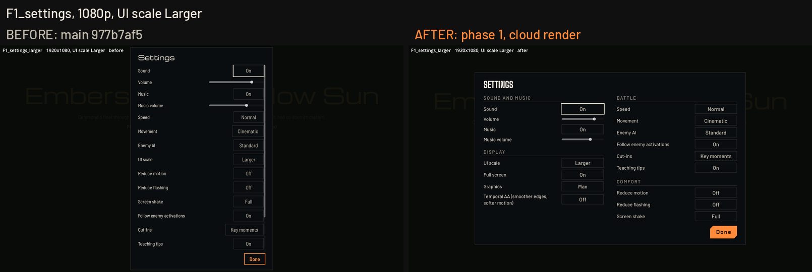
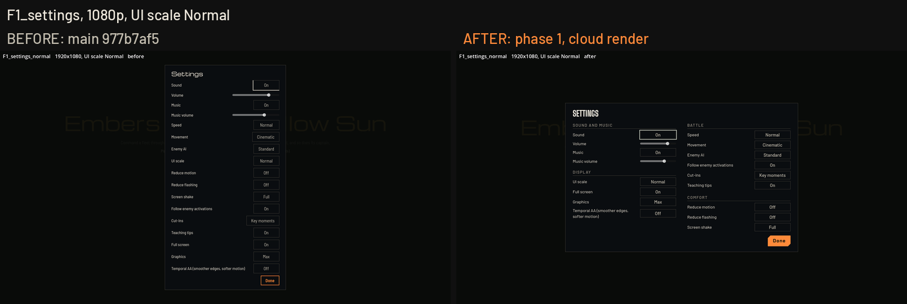
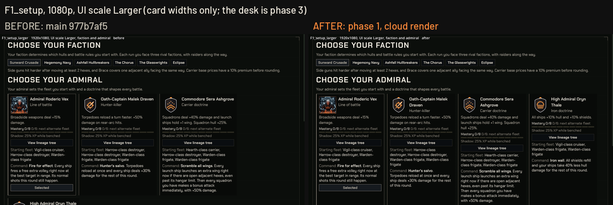
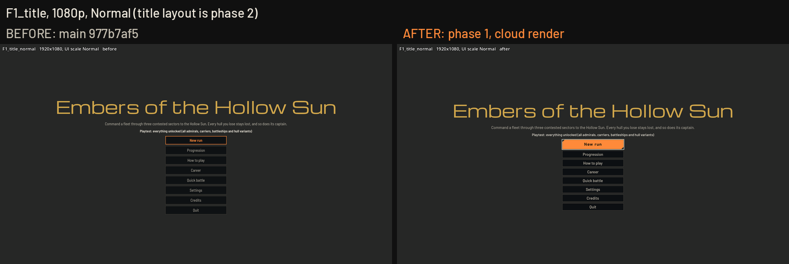

# Issue 1217 phase 1: the orders kit, front-end sounds, Esc and scale

Stage: built and checked in the cloud (not installed on the PC yet, not accepted by Ryan). Each picture is before (main
977b7af5) and after (this branch), rendered through the real main scene with no showcase battle.

Retake: `xvfb-run -a godot --rendering-driver opengl3 --path godot --resolution 1920x1080 --script
res://ui/test/front_end_shots.gd -- <out dir> [tag]` (on the PC, drop xvfb-run and the driver flag).
