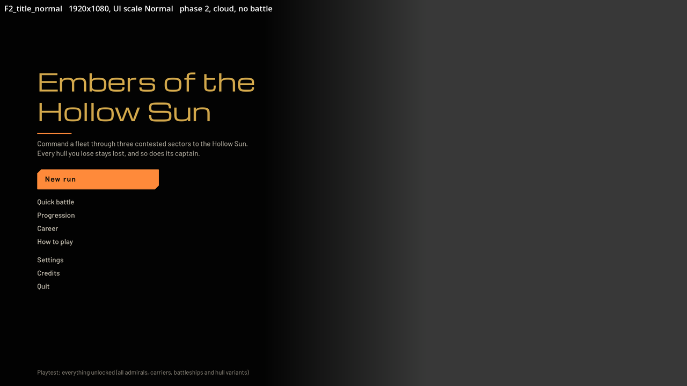
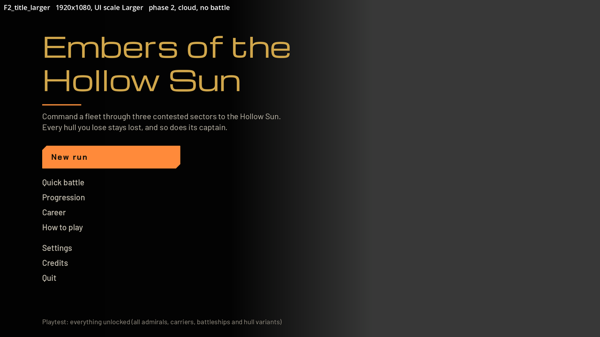
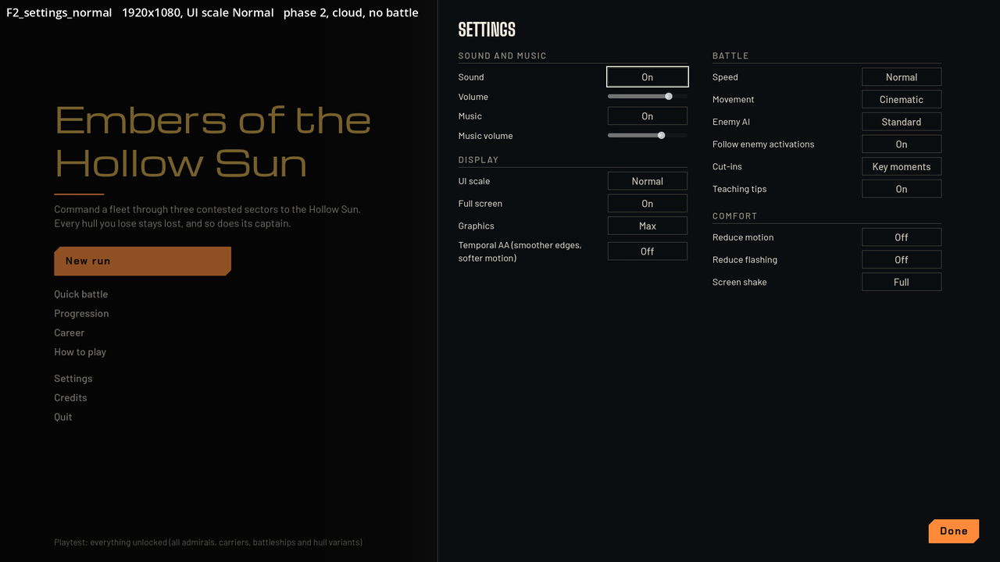
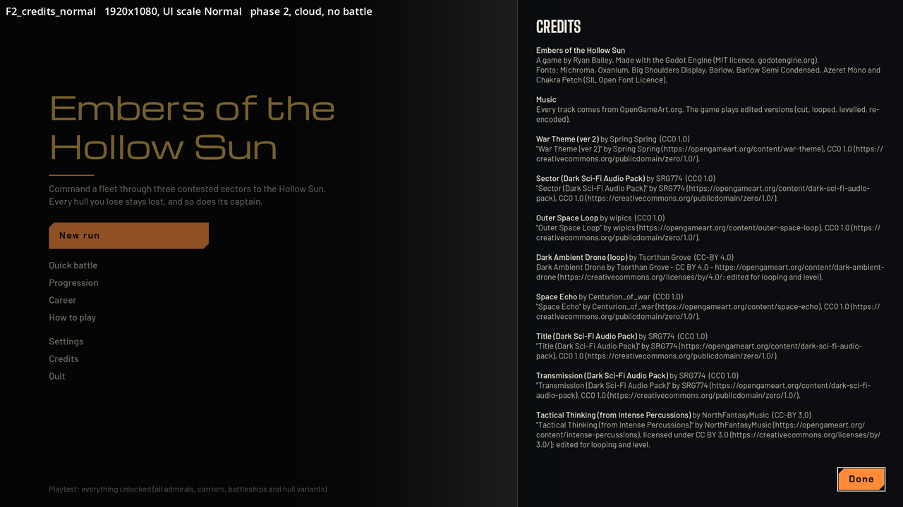

# Issue 1217 phase 2: the title screen

Stage: built and checked in the cloud, no battle behind it (the cloud has no built ships). The final pictures with the live
title battle come from the PC (`/mnt/project-files/pc/1217/OPUS1217_FRONTEND.bat`, through the Board).

- Left column on the orders-sheet veil: the gold wordmark (kept, R: gold stays unless Ryan says otherwise), an ember rule, the
  tagline, one ember action (Continue run when a save exists, else New run), then quiet links in two groups, the playtest
  note in the bottom corner.
- Settings and Credits are drawers from the right edge over a light dim (0.45, was 0.93), so the menu and the battle stay in
  view; a click on the dim, Esc or Done closes them; they slide in unless Reduce motion is on.
- The title battle cycles its enemy through the five other factions with built ships (was Hegemony or Ashfall only).

