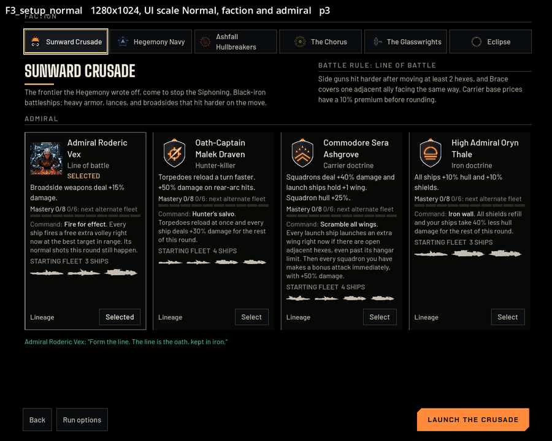
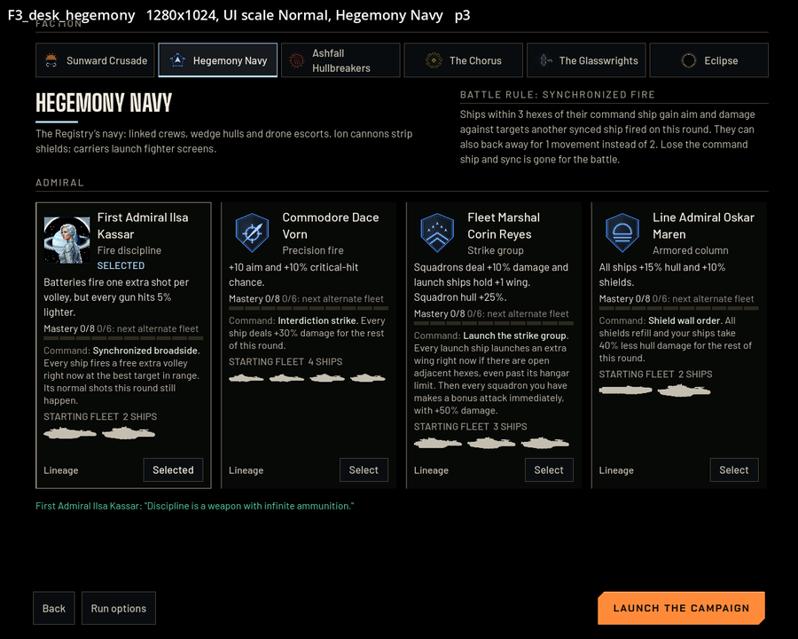
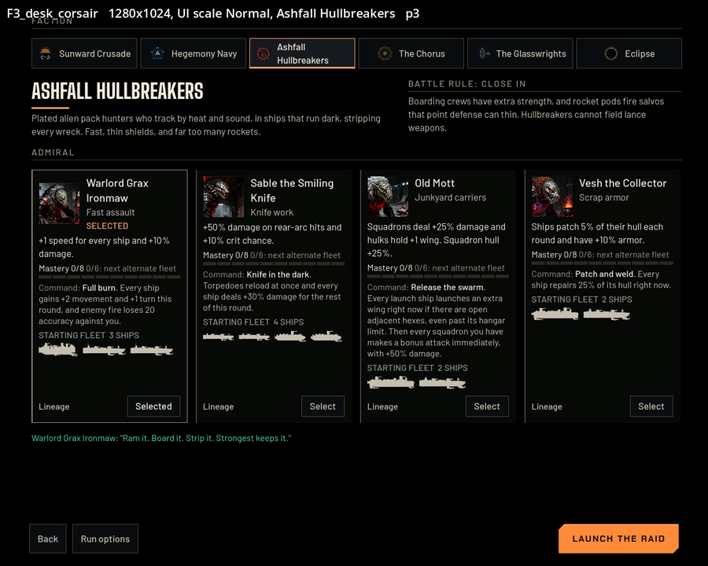
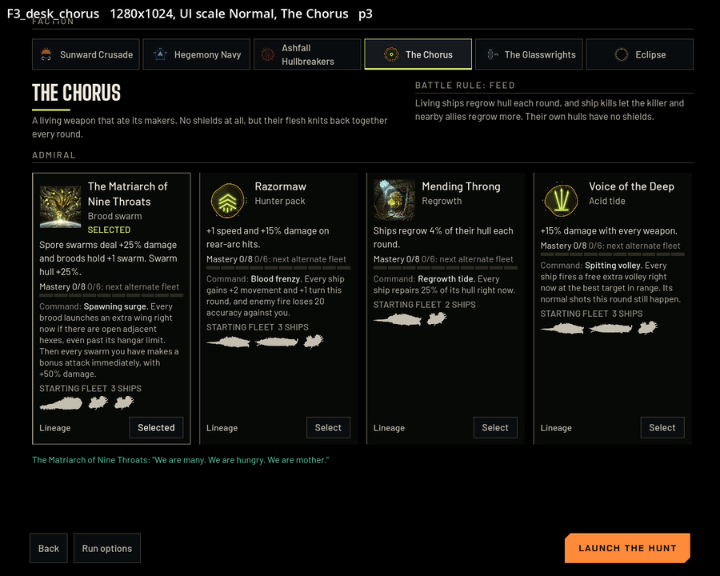
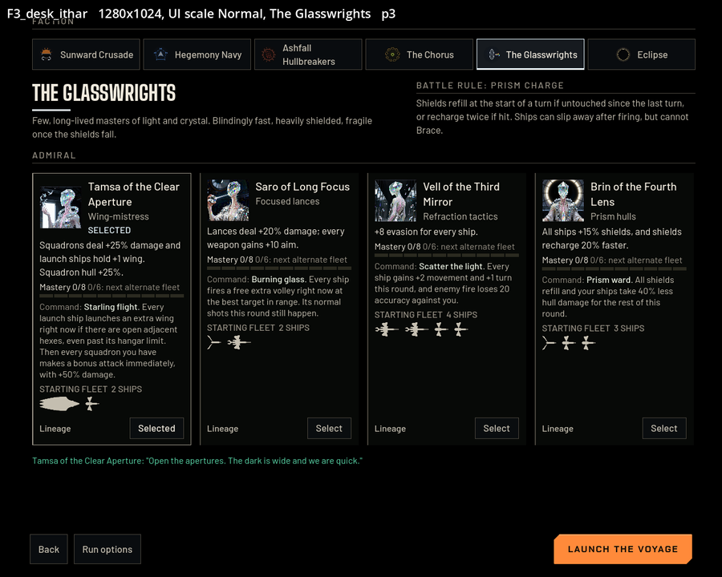
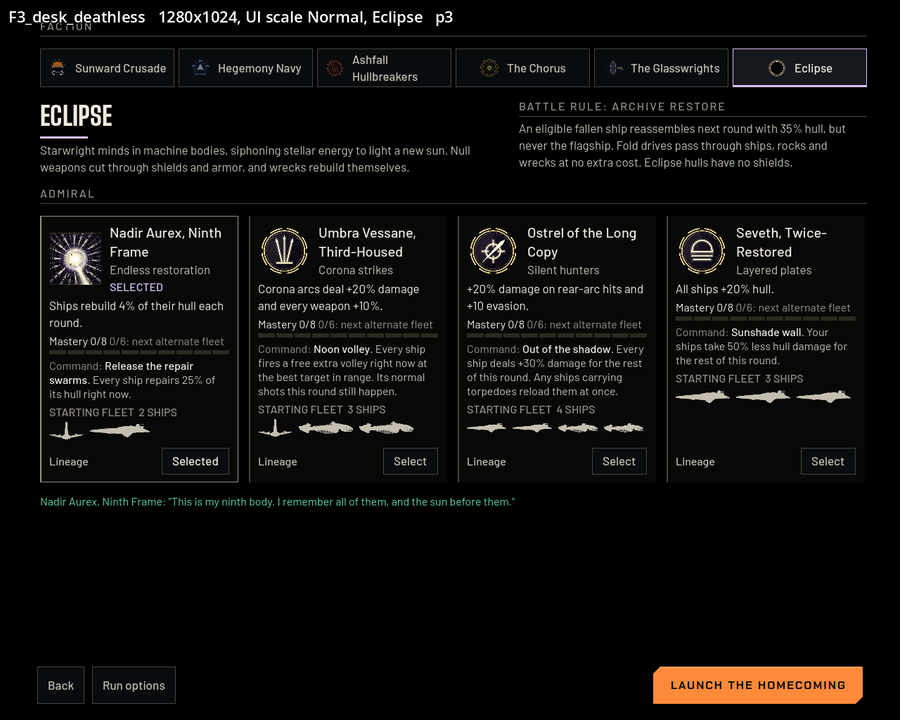
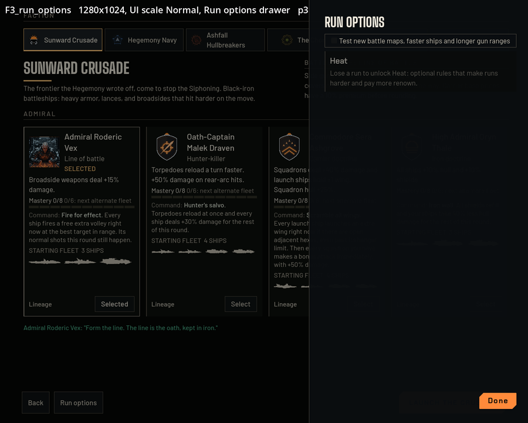
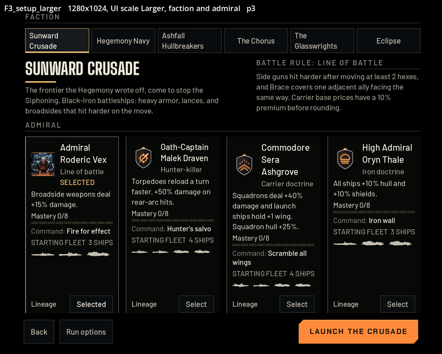

# Issue 1217 phase 3: the faction and admiral desk

Stage: built and checked in the cloud (Godot 4.7.2, OpenGL under a virtual screen). Ship silhouettes are the KEEL icons.

- One desk instead of a long stacked page: a strip of six faction tabs (crest, name, the picked one underlined in its
  engine colour), the faction's name, blurb and battle rule side by side, then the four admirals as equal cards in one row.
- Each card: portrait, name, doctrine, SELECTED or LOCKED, the ability, the mastery bar, the Command, the starting fleet as
  ship silhouettes (names on hover), and a foot with Lineage on the left and Select or Unlock on the right.
- A fixed bar at the bottom: Back, Run options (it names what is on), and one ember Launch button.
- Run options (alternate fleet, alternate Command, Heat, test maps) moved into a drawer from the right; Esc or Done closes it.
- Picking a faction plays a short preview of its music.
- At UI scale Larger on a short screen the cards go compact: smaller portraits, the Command name only (full text on hover),
  the mastery count only (next unlock on hover). Names never break mid-word: the font shrinks a step instead.
- Moved, not removed (R177): fleet ship names, the heir line and the next mastery unlock are on hover; the long Command text
  is on hover in compact mode only.

