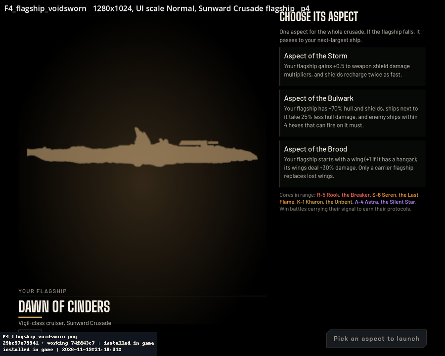
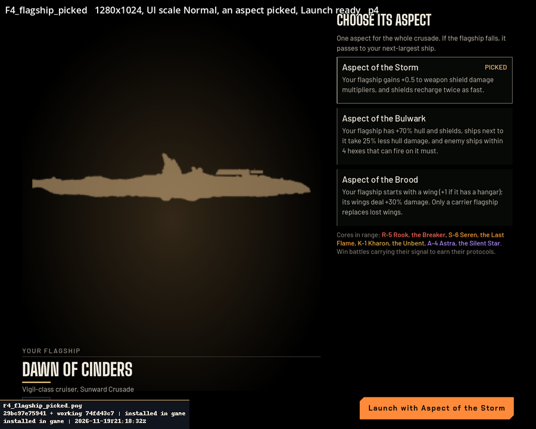
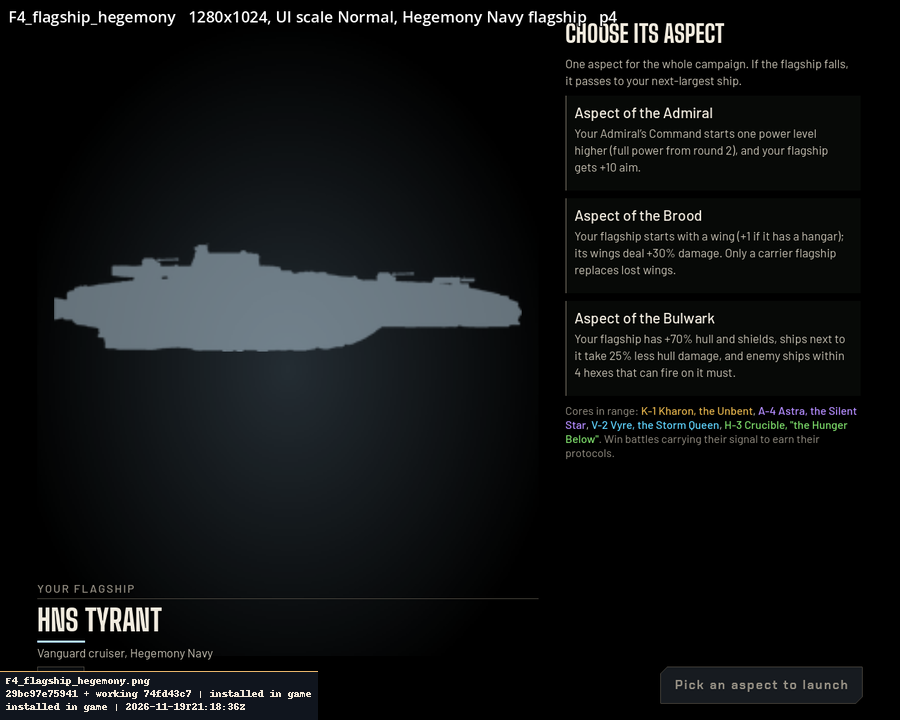
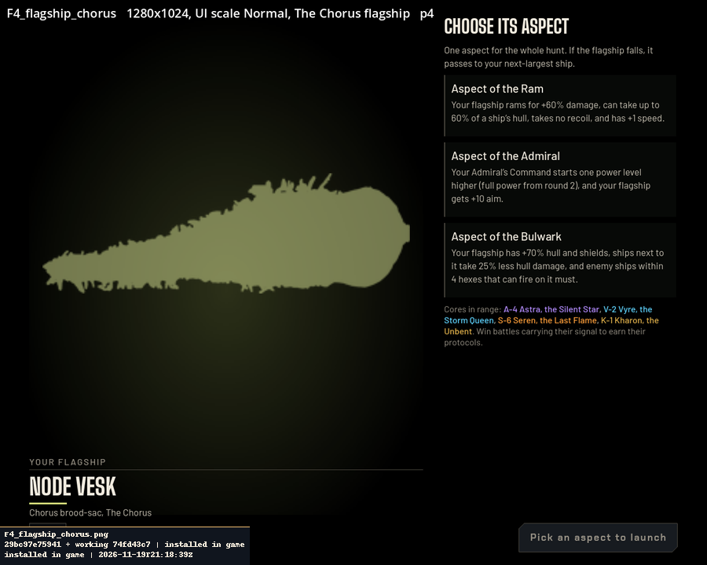
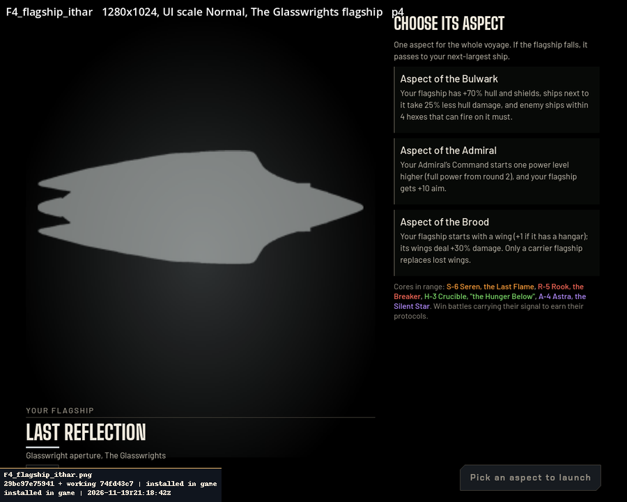
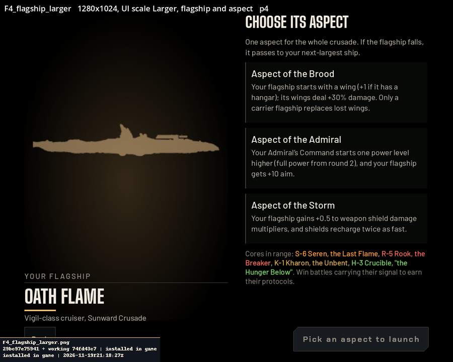

# Issue 1217 phase 4: the flagship podium

Stage: built and checked in the cloud (Godot 4.7.2, OpenGL under a virtual screen). The cloud has no built ships, so the
ship is the KEEL outline stand-in. The live, slowly turning 3D flagship pictures come from the PC
(`/mnt/project-files/pc/1217/OPUS1217_FRONTEND.bat opus/issue-1217-p4`, through the Board).

- Its own screen, as Ryan chose. Left: the flagship, big, turning slowly over a soft glow in its engine colour (still under
  Reduce motion), with a name plate: its name, hull class and faction.
- Right: the aspect offers as cards; a click (or Enter) picks one and marks it PICKED. Below them: a patron's gift, Heat,
  and the cores in range (each core's theme on hover).
- The bar: Back on the left, one ember Launch on the right. Launch waits for a pick and then names it.
- Back (and Esc) is a rules action in both twins (`backToSetup`): it drops the unplayed new run, its save and its run count,
  and returns to the desk with the faction, admiral and run options kept.

