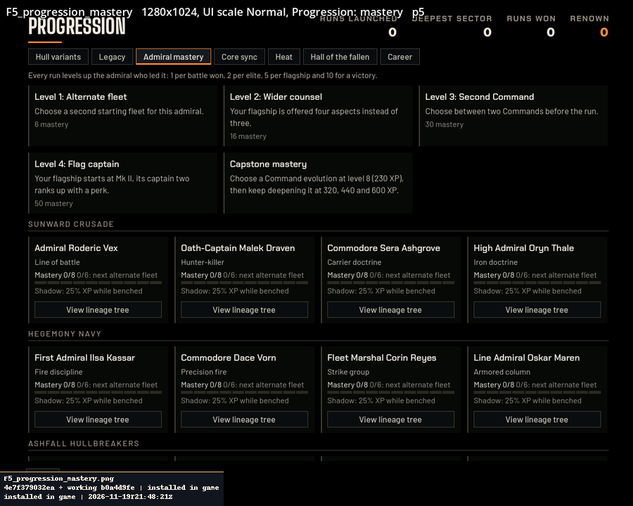
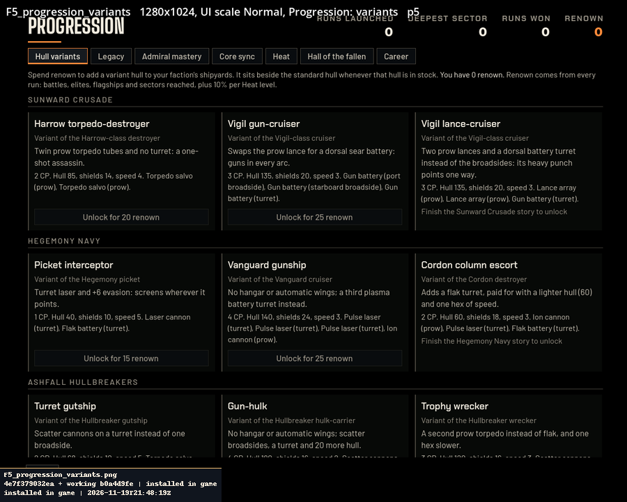
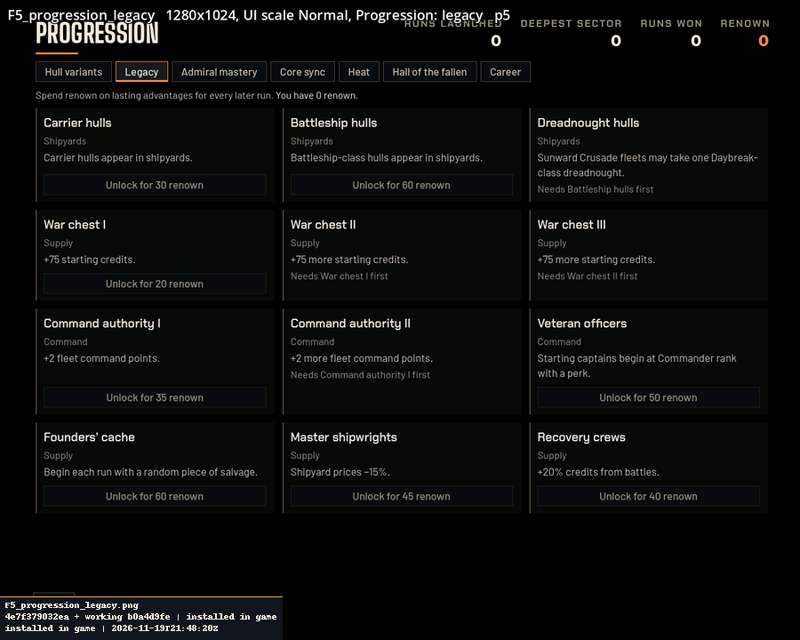
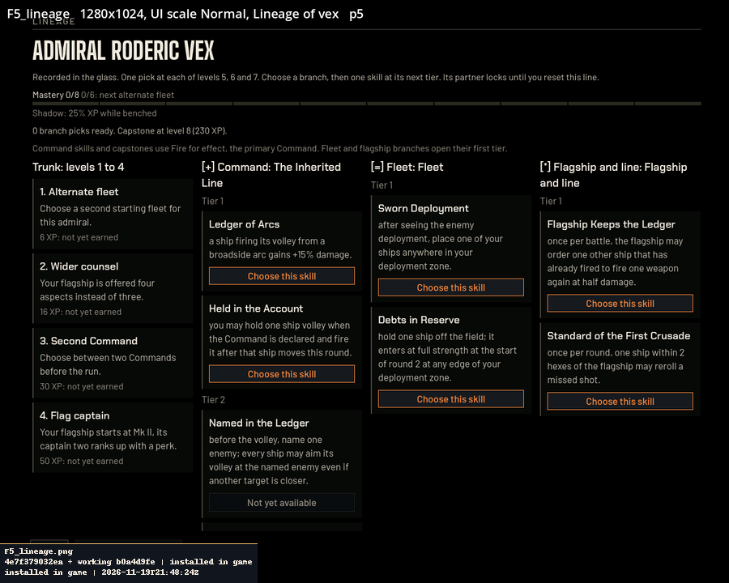
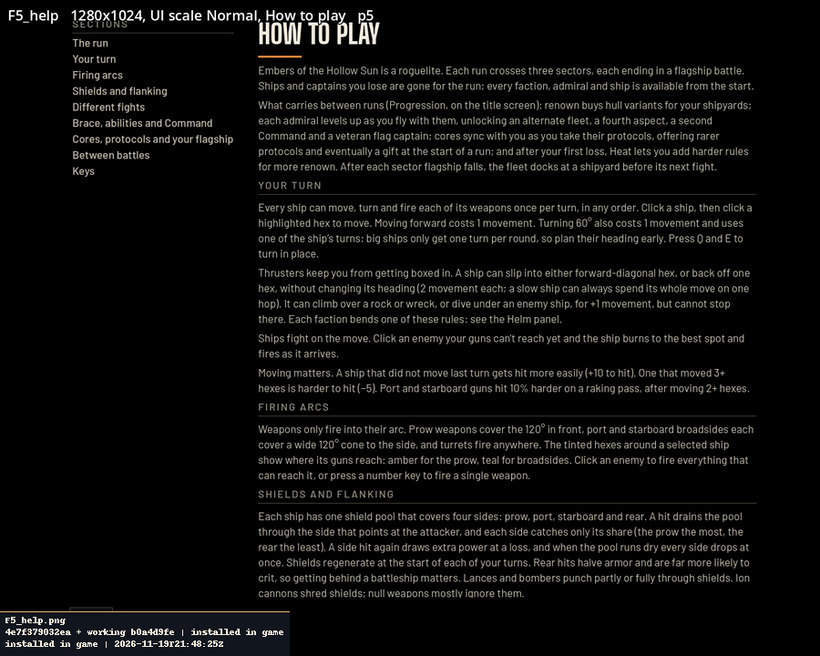
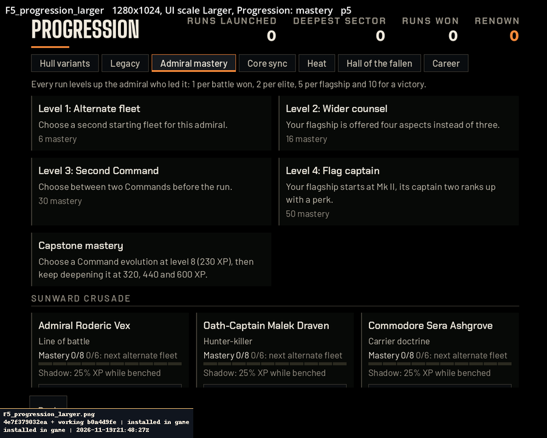
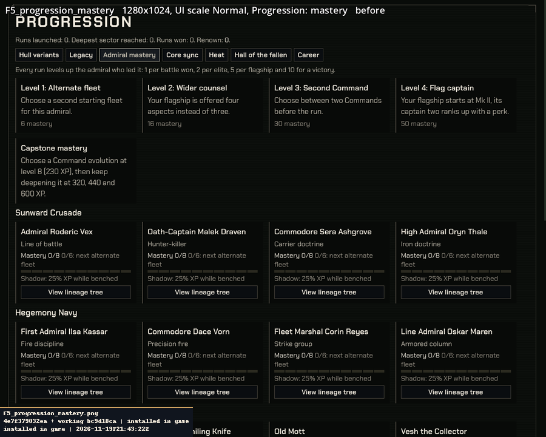

# Issue 1217 phase 5: Progression, Lineage and How to play on the kit

Stage: built and checked in the cloud (Godot 4.7.2, OpenGL under a virtual screen). `before_*` pictures are the same pages
on the phase 4 branch.

- All three pages sit in the desk's frame: the ledger veil, one centred column, and a fixed bar at the bottom with Back
  (Lineage adds Reset line there). The Back buttons that sat at the end of each long page moved into that bar.
- Progression: a big heading beside four numbers (runs launched, deepest sector, runs won, renown in ember), kit tabs with
  an ember underline on the open one, faction names as section heads, and every card row on one grid: one width, one
  height per row, Unlock and View lineage buttons lined up at the card foot. A faction's four admirals share one row.
- Lineage: section head, the admiral's name as the heading, the trunk and the three branches as four equal columns.
- How to play: an index of the sections on the left (each link jumps to its section), the text in one readable column
  under kit section heads.
- On the PC: `tools/pc/jobs/frontend_ui_check.bat` runs the check, the pictures at 1080p and 4K, and one contact sheet per
  screen group.

