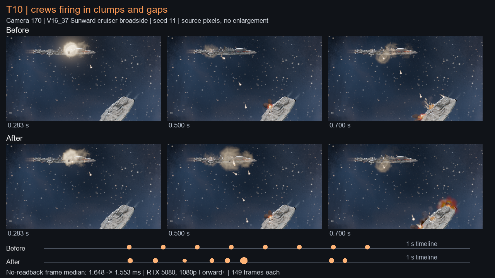

# T10: volleys with clumps and gaps

Refs #823. Built on main bcbddf10, which includes issue 815 through PR 834.
This completes the weapon half of cinematic audit item 10 and R193.

## What changed

`godot/fx/fx_weapons.gd` now makes a cosmetic pattern from the FX seed and
volley number. Timing, stroke size, brightness and spread vary inside a salvo.
The pattern is independent of particle counts and frame stepping. Full salvos
have one randomly placed stroke at 1.6 times normal size; one- and two-shot
weapons get that accent only sometimes. Each weapon keeps its existing charge
and travel speed, with its ripple span varied by 15 percent in either direction.

This also covers autocannon chatter, scatter pellets, prism packets, flak,
rocket groups and strike-craft bursts. Surface hits cluster within their sampled
section and are traced back onto visible plating. A failed spread ray keeps the
original surface point. Shield hits still use the real shield surface. Misses,
point defence, damage records, muzzle selection and turret lead remain intact.
The battle already schedules its individual gun cues from these fire times.
No sound, rules, save or faction data changed. Existing flash-area booking and
reduced flashing handle the larger strokes.

The other files are reproduction tools and evidence under this kit folder:
`capture_t10.py`, `check_t10.gd`, `measure_t10.gd`, `make_t10.py` and `t10/`.

## The picture and measurements

The eight-shot Sunward cruiser broadside uses V16_37 and H9_23, the real PC
hulls, at camera 170, seed 11, 1920 x 1080, Forward+, RTX 5080. Both versions
were run twice, with the second pass retained. Each pass also warms its rows.
The final captures report zero warnings and zero late shaders after warm-up.

| Measurement | Before | After |
|---|---:|---:|
| Gaps between shots | 80 ms each | 31 to 206 ms |
| Tracer width floor at 1080p | 4 px each | 3.41 to 6.40 px |
| Tracer intensity parameter | 8 each | 6.63 to 9.76 |
| Broadside bench step median, no image readback | 1.648 ms | 1.553 ms |
| Bench step p95, including worker waits | 150.331 ms | 160.078 ms |
| Longest bench step, including worker waits | 1158.726 ms | 1059.107 ms |

Each timing sample contains 149 frames. The bench deliberately waits for damage
workers before advancing its fixed clock; those waits cause the large tails in
both versions. These are bench step measurements, not a new result for the
binding #207 scene gate. The separate 20-ship destruction probe measured
1.846 ms average, 3.562 ms p99 and 4.965 ms maximum across 660 frames.

The width and intensity values come from submitted production particle data,
not estimated bloom extents. Baseline strokes were read separately through the
same real-hull public volley and checked against the baseline source hash.
The camera-170 crops keep source pixel size. These are varying strokes and
muzzle flashes, rather than a new impact-size ladder row.

See [reduced flashing](t10_calm_strip.png), the [motion preview](t10_motion.gif),
[measurements](measurements.json), [baseline particle readout](before_strokes.json)
and [check summary](checks_summary.json).

All linked pictures and recordings are also saved where the Board can read them:
`C:\Users\rcbai\Downloads\voidsworn_test\board\issue-823\shots\`.
The raw kept captures are in `before/` and `final/` there; warm passes are kept
separately. The original audit reference is
`docs/shots/cinematic_audit/top10/t10_shots_on_a_metronome.jpg`.

## Checks

- Standing checks: exit 0, 56 PASS and 2 KNOWN, no FAIL or SKIP. The known rows
  are findings_tests and oracle_drift_guard, within their existing baselines.
- Full rules parity: PASS, 281 scenarios, 30,000 PRNG draws, 316,090 math values,
  three threat maps and the worker-thread/hard-stop check.
- Godot load: 197 scripts and 11 scenes, zero failures.
- T10 check: 25 weapon IDs, exact same-seed fire times and submitted tracer
  data, different-seed variation, unchanged firing rhythm across quality and
  reduced flashing, repeatable spread on visible plating. Full salvos contain
  one standout stroke across 100 seeded volleys.
- Full `godot/fx/test/check_destruction.bat`: exit 0, including both GPU probes.
  The real-hull spawn guard records all 33 pictures with zero stray and zero
  measured errors. Blocker coverage: 120 battles and 3068 hexes, zero failures.
- Round-3 recipe regression: 112 cases, zero failures. Real public point-defence
  fixture: zero failures; intercepted bodies disappear, misses and rolled hits
  remain flying. Turret check: PASS, zero failures.
- `git diff --check` and the changed-file em-dash scan pass.

The unchanged spawn guard emits `spawn_frame` metadata warnings despite its
passing result; Godot headless runs also report the PC certificate-store warning.
Early fixtures lacked some cached hulls. Those caches were supplied and the
affected checks rerun successfully. No game source was changed for the fixtures.

The full #207 gate and cameras 60/26 were not rerun: this issue requests the
camera-170 broadside and a frame-time reading. No binding performance-gate pass
is claimed. Visual acceptance remains the Board's and Ryan's. No commit or push.

## Reproduce

With an imported project containing the real PC hull caches, run the kit's
`capture_t10.py --project PATH --out PATH` twice per version. Run
`check_t10.gd` headless against that project. For a baseline particle readout,
set `T10_MEASURE_OUT` to a JSON path and optionally `T10_WEAPON_SCRIPT` to the
baseline `fx_weapons.gd`, then run `measure_t10.gd` headless.

Compose the kept results with `make_t10.py --before BEFORE --after AFTER
--before-strokes BASELINE_JSON --out OUTPUT`. Logs and generated drivers stay
in TEMP. The accepted look-bench baseline is unchanged.
