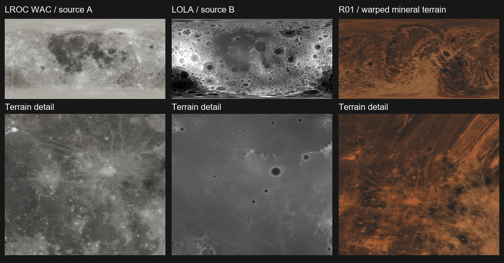

# R01, issue 369: first rocky candidate

Prepared, not ready to merge. The production board hook, GPU captures, 4K gate,
scale verdict and Ryan's first-planet approval are still pending. No other planet
type was made. Gas and ice giant shaders and bakes are unchanged.



The source comparison is also saved at
`C:\Users\rcbai\Downloads\voidsworn_test\board\issue-369\shots\R01_sources.jpg`.
This is a texture comparison, not a battle capture or a claim of visual approval.

## What is prepared

- `godot/world/rocks/r01/`: an 8192 by 4096 colour, packed relief and roughness set.
  The two independent public-domain datasets are NASA LROC WAC colour and LRO LOLA
  laser altimetry. Both describe the Moon in the originals. Broad maria are removed
  from the colour input, both fields are warped independently in sphere space,
  mixed, rotated and recoloured. The result still needs Ryan's recognition check.
- `godot/world/world_planet.gd`: the R01 installer, relief lighting, roughness sheen,
  separate moving cloud shell, matched moving ground shadows, and the existing air
  glow shell configured for R01. The data and loader check can install these nodes;
  their GPU appearance has not been checked.
- `godot/world/world_bake.gd`: shared worker loading and mip generation for authored
  maps. The two runtime maps are shared by materials, including cloud shadows.
  The standalone roughness picture is an output for review, not a third GPU map.
- `godot/world/world_rocks.gd`, `scan_00` through `scan_07`: eight scanned CC0 rock
  shapes, with full and explicit reduced meshes. Their scan-derived cavity and
  mineral values feed the existing five biome materials. Full meshes total 513970
  unique triangles; reduced meshes total 20089. These are asset counts, not frame
  counts or a performance pass. Instances smaller than 1.5 units keep rockgen meshes.
- `godot/world/rocks/LICENCE_369.md`, `SOURCES_369.json`, `scans.json`, `r01/bake.json`:
  credits, current terms, dates, source and output hashes, and bake methods.

Every new downloaded source file has a credit and date before conversion. The
licence ledger lists 34 inputs and all 19 derived asset files. Raw downloads and
logs remain in TEMP. No assets, caches or PC files were deleted.

## Scope gap and continuation

The actual board planet uses `godot/render/board.gd` and
`godot/ui/campaign/map3d_shaders.gd`, not the backdrop's world_planet shader. The
brief's allowed write list excludes those files. `tools/pc/jobs/planet369_board.patch`
contains the four-line board hook, restricted to its first rocky look. It passes
`git apply --check`, but was not applied. Approval to include board.gd was asked
in chat and has not arrived. The production board planet is therefore unchanged.
Applying this hook needs no campaign shader edit. The campaign sector captures
are context checks; this first-planet job does not roll R01 out to that screen.

The capture probe can install the candidate in a real battle without applying
the production patch. No GPU run was started: RULEBOOK 3.4 and the task require
a confirmed GPU window and an issue go file. The PC's status was asked in chat;
no confirmation arrived and `board/issue-369/go.txt` is absent. The palette scope
picks are also pending. R01 uses the recommended rust/charcoal prototype palette.

After those decisions:

1. Apply the reviewed board patch if that scope is approved.
2. The Board supplies `board/issue-369/go.txt` for the confirmed GPU window.
3. Run `tools/pc/jobs/planet369_bench.bat` through the PC queue and watchdog.
   It copies PC-built hulls before import, makes two before and after runs, and
   stops on placeholders. Keep run2. Camera 170 comes first at true pixel size;
   the 60 and 26 views inspect the planet cap from its surface height. Top-down
   and planet pictures show the full frame at 1280 by 720.
4. Inspect all pictures, the cloud motion pair, class scale, the sector map,
   `R01_metrics.json`, and `gate/scene_gate.json`. The probe uses the real scenario
   constructor and the #207 fleet inputs to make 20 ships. It reports an extra
   planet-scene measurement at 4K; the original #207 gate is run separately at
   1080p and 4K, three sessions per mode. Watch memory with those ships present.
5. Present this first planet to Ryan and wait for his verdict before making others.

The bench launcher and probe parse check pass, but the GPU launcher has not had
its required end-to-end PC run. They are prepared jobs, not a proven capture route.
One still per scanned rock and a class-labelled scale sheet remain to be captured.

## Measurements and checks

- Offline 8K CPU remix: 27.15 seconds on the final run. Script retained at
  `tools/pc/jobs/planet369_remix.py`; launcher is `planet369_remix.bat`.
- Headless cold map decode plus mip generation: 414 ms colour, 670 ms packed data.
  These are CPU loader readings, not GPU bake, frame or upload cost. Actual GPU
  memory and cold upload cost remain unmeasured.
- `planet369_download.bat` and `planet369_remix.bat`: real PC runs succeeded.
- `planet369_check.bat`: PASS. Actual GLBs load, reduced meshes have fewer
  triangles, full meshes have unit radius and scan data; the 8K maps have mipmaps,
  real height variation and clear/cloudy samples; R01 installs; ground and clouds
  share the same map. It checks dust geometry through the real batch path.
- All 19 derived file hashes match their manifests.
- Godot 4.7.2 headless parse of the capture probe: PASS.
- `git diff --check` and production patch applicability: PASS.
- Required `node contrib/opus/tools/run_all_checks.js` on Node 22: 47 PASS,
  2 KNOWN baseline rows, 1 FAIL. The failure is the existing missing issue-710
  files below. `git cat-file -e HEAD:<path>` confirms both are absent at HEAD.

```
FAIL a path named in an entry document does not exist: docs/playbooks/scale.md
FAIL a path named in an entry document does not exist: godot/render/test/scale_check.gd
FAIL: 2 entry document problem(s)
```

## Provisional scale rows, pending issue 710 and pictures

No scale table or scale_check exists in this checkout. These rows report existing
game numbers, not a visual pass or a new scale ruling. The R01 package preserves
unit-radius meshes and the board's real scenario radius.

| Item | World size | Relative to frigate length | Source | Status |
|---|---|---|---|---|
| Frigate | length 10.4 | 1 | hull_table CLS_LEN times SHIP_K | Reference |
| Destroyer | length 15.2 | 1.46 | hull_table | Reference |
| Cruiser | length 23.2 | 2.23 | hull_table | Reference |
| Carrier | length 26.4 | 2.54 | hull_table | Reference |
| Battleship | length 33.6 | 3.23 | hull_table | Reference |
| Super-dreadnought | length 49.6 | 4.77 | hull_table | Reference |
| R01 full scan | normalized radius 1 before instance scale | varies by instance | scans.json and GLBs | Data check passes |
| Board planet for real R=8 scenario | diameter 250, centre y=-97.5, cap height 27.5 | diameter 24.04 | battle.js planetEdge and board.gd | Needs battle and map verdict |
| Largest backdrop rocks | existing placement and angular-size law | varies with depth | world.gd fields and _backdrop_scale | Needs scale sheet |

R247's judgement that the planet is vast and the biggest rocks dwarf a frigate
is not certified by these numbers. It remains a picture check at cameras 170 and
60, top-down and on the sector map, against issue 710 when it lands.

Impact sweep (R129): world.gd, blocker_visuals.gd and world_living.gd callers read
the same rock API and normalized scale; no save schema, rules, ids or oracle data
changed; no oracle copies needed refresh. The production UI/board path remains
pending the scope patch. GitHub still runs the existing standing, ASCII, parity
and Godot check jobs; the task-specific data check is a separate PC job, outside
the Godot test directory. Outside review on issue 256 is still required.

Refs #369. No commit or push was made.
