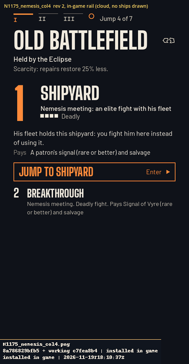
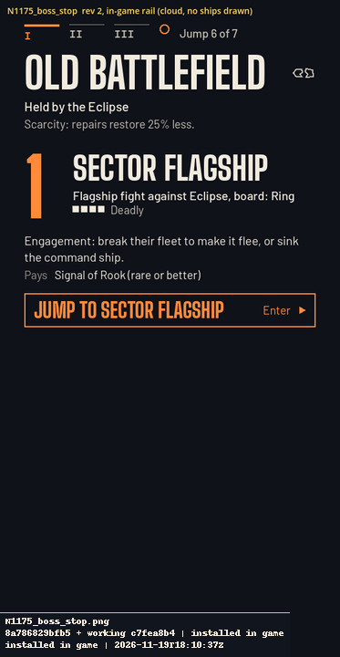

# Issue 1175: the Nemesis meeting can no longer be dodged, and boss stops show their fight

## What changed

1. **No dodge.** While the sector's Nemesis is unmet, every column 4 stop is his meeting, whatever its type (fight, elite,
   event, shipyard, drydock or field repairs). Before, only battle and elite stops counted, so a route through a quiet column 4
   stop reached the rest stop and the flagship without the meeting the map text calls certain. `nemNodeIs` changed the same way
   in `godot/campaign/campaign.gd` and `campaign_run.js`; entering such a stop opens his fight (an elite Nemesis battle). The
   stop's own use (the shop, the repairs, the event) is lost to that fight; the route row says so ("His fleet holds this
   shipyard: you fight him here instead of using it.") and says what his fight pays. The hunt clock is unchanged.
2. **The map shows it.** The 3D map's red diamond, the route rows (open and closed) and the danger reading now mark rest and
   event stops in column 4 too (`map3d.gd`, `map_intel.gd`, `campaign_view.gd`, `campaign_ui.gd`). The browser map already
   printed the tag from `nemNodeTag`.
3. **Boss stops show their fight.** `genSector` rolls the flagship fight's objective and board shape (`bossEncounter`) in both
   codebases, after the region and board fitting, so the board is the one the fight always used. The fight reads them from the
   stop (`campaign.gd` battleScreen, `campaign3d.js`); an old save without them still rolls at the fight. The flagship row says
   e.g. "Flagship fight against Eclipse, board: Ring" and "Engagement: break their fleet to make it flee, or sink the command
   ship."; the browser map prints the objective name under the boss stop.
4. **Trial label.** "Test map package" shows on the orders rail only while the issue 1050 map trial is on
   (`map_trial_save_test.gd` now checks the label is absent when off).

## Checks (cloud, Godot 4.7.2.stable.official.ed1daf0bf, Node 22.23.5)

| Check | Main before | This branch |
|---|---|---|
| `nem_dodge_test.gd` (3,000 seeded sectors, 1,000 each of sectors 1 to 3) | 2,346 dodgeable (78.2%) on `ec807cc1`; 2,377 (79.2%) on the 1176 route-choice map | **0 of 3,000**; every column 4 stop tagged; every boss stop has objective and board |
| `node/nem_dodge.js` (browser twin, same seeds) | same counts as Godot | **0 of 3,000**, boss roll digest 223565217, identical to Godot |
| Meetings played (in `nem_dodge_test.gd`): a column 4 shipyard, drydock, field and event each open his fight; a win returns to the map with the stop done and him met; the boss fight uses its stop's objective and board | n/a | PASS |
| Campaign parity, `run_parity_campaign.sh 1 30` | PASS | **PASS, 30 of 30**, cross-twin hand-off PASS |
| Nemesis scenarios, Nemesis read, map read-only (`run_nem_scenarios.sh`) | PASS | **PASS** (219 records, 119 read-only checks) |
| `map_trial_save_test.gd`, `run_resume_test.gd`, `load_all.gd` | PASS | **PASS** |
| Godot rules parity, headless check list, standing checks | | see the pull request body |

## Changed records and other tests

- Campaign parity is a live comparison of the two twins, so there are no saved campaign records to refresh. The boss roll moves
  the random numbers after `genSector` in both twins alike; every seeded run still matches step for step.
- The moved numbers sent seed 19 through a path the twins disagreed on before this change: leaving a column 0 shipyard by the
  fleet screen's Back to map, then Save and quit, then Continue. The browser opens the map; Godot reopened the shipyard
  (issue 1125's yard resume). Godot now remembers whether the save was taken inside the yard (`saved_in_yard`, kept in the save
  file beside the run, old saves count as inside) and reopens the yard only then. `run_resume_test.gd` check 8 (yard doctrine
  reload) still passes.
- `run_resume_test.gd` check "5 legacy: paid sector 3 boss" compared a fixed old save's credits with a freshly seeded run's
  credits; the boss roll moved the seeded run's credits (534, was at most 404). That cross comparison was coincidence, not the
  point of the check, which still proves Continue does not pay the boss twice.

## Reload replays the same meeting (Artoo, PR 1197)

Every column 4 stop now carries a battle seed (`nodeSeeds` in `campaign.gd` and `campaign3d.js`), like a fight stop, so a
Nemesis fight at a shipyard, drydock or field replays the same fight after a reload. Old maps get the seed the first time the
map opens, and it is saved at once. `nem_dodge_test.gd` checks it for a new map and an old map (rest stop saved with no seed):
opening the save twice from different random states, and closing mid-fight then Continue, give the same seed, objective, board
and enemy ships. With the seed rule switched off the same check fails (three different fights). Campaign parity still matches
on all 30 seeds, so both twins seed alike.

The outside check also led to: the route row for his fight at a rest or event stop now names what it pays (a patron's signal,
rare or better, and salvage: rewardFlow's fallback for a stop with no reward of its own), the flagship stop keeps its own name
when the fleet is on it, and an old save taken inside a column 4 shipyard reopens the yard as before.

## Pictures (cloud, orders rail only, no ship drawn)

The 3D map needs the built ships (`godot/gen`, PC only); these show the real orders rail from `campaign_ui.gd`.

Retake: `godot --path godot --resolution 1920x1080 --script res://campaign/test/nem_col4_shots.gd -- <out dir>` (needs a window;
in the cloud, under `xvfb-run` with `--rendering-driver opengl3`).
