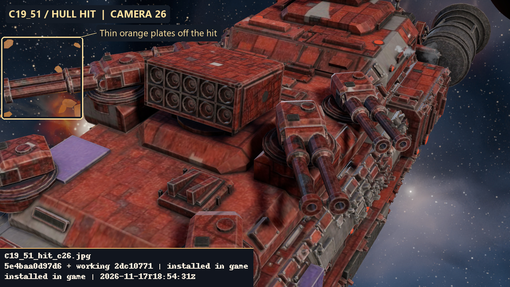
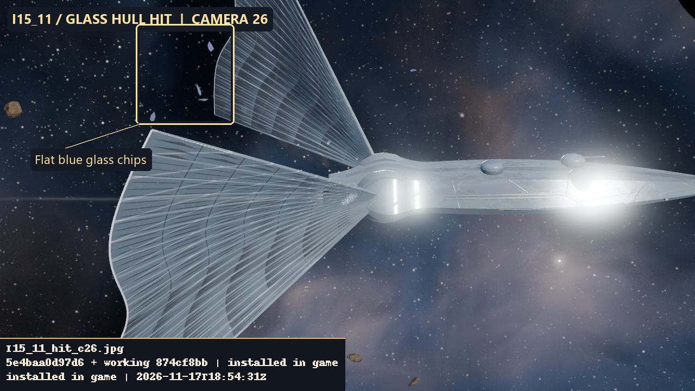
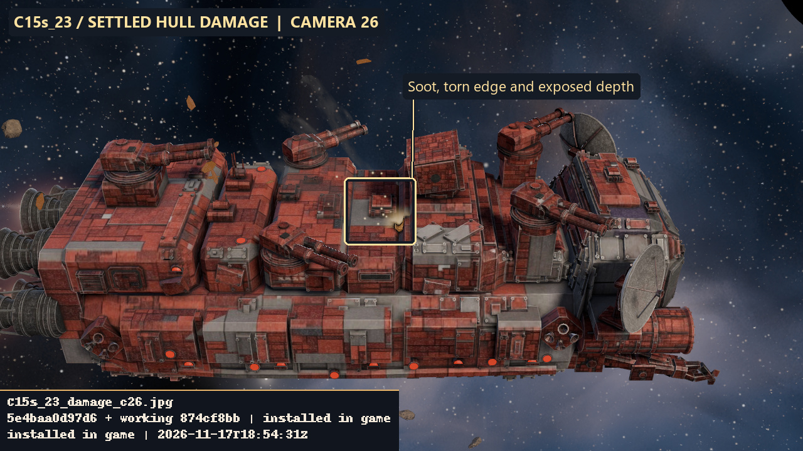
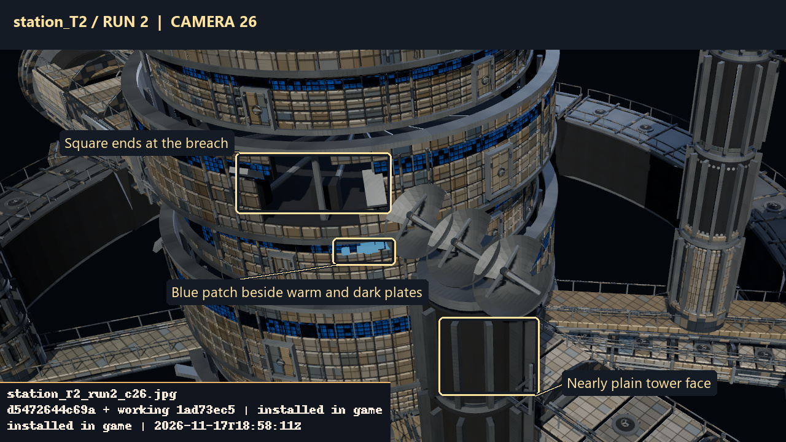

# Paint and debris audit

Start with the hull-hit chips, then fix how the shared paint stack carries colour across a module. The chips already spin and cool, but each is a thin six-point shape with colour spread across its face. The station shows the same kind of disconnect at a different scale. A small accent can make sense for a module, but its neighbours should still read as part of the same machine. Keep the Hullbreakers' approved scavenged armour and use their own colour range for that check. The changes below are proposals for Ryan to pick from.

## 1. Hull hits and damaged ships





The C19_51 frame is 0.35 seconds after a macro volley lands. The I15_11 frame uses the same production hit routine aimed at an exposed surface, about 1.15 seconds after contact, so the drifting chips are visible against space.

**Cause.** [fx_weapons.gd](../../../godot/fx/fx_weapons.gd) `_impact`, `_shell_hit`, `_throw_debris` and the heavy-hit helpers share a contact point, a skip cone and a count by weapon. Within that cone, the plate's direction, speed, life, size and spin are independently picked. `hit_plate` and `_hit_plate_shape` in [fx.gd](../../../godot/fx/fx.gd) feed the R303 pool of bent six-point pieces. That mesh has two opposing fans and open edges. It has no side-wall surface to catch the hit light. `SHARD` in [fx_shaders.gd](../../../godot/fx/fx_shaders.gd) gives metal a single colour and uniform cooling emission, and Glasswright chips a fixed blue base with view-dependent emission. The floor of eight pixels at the normal battle camera keeps those flat silhouettes easy to see. The same basic shape is used for metal and glass. Chorus splash has its own procedural tissue sprites. Light flak has sparks and pocks.

**Shared fix.** Reuse the bounded particle pool with a small family of closed, thick, bent plates, jagged structural fragments and fracture-specific glass shards. Group a few heavier fragments around the torn edge, blow smaller fragments down the skip direction, and give the rest a slower drift. Let some pieces tumble slowly and others spin. Carry two surface classes per piece, worn outside paint and fresh, hot fracture edge. Sample the hit light and cool the edge onto the surviving material. Give tissue a torn membrane/fibre family where it becomes visible solid matter. Keep sparks and gas as short procedural effects. Use the screen-space floor on a few pieces per burst and let the smaller chips fade with distance.



**Damage surface.** `fx_breach.gd` `_surface`, `_throat`, `_walls`, `conduits` and `spines` reconstruct the wound from the actual hull and attach the broken details at the lips. These details share a break. The A4 damage GLB's `damage.py` `materials` and the recipe stacks' `inside_material` supply plain lining at depth. `fx_breach.emitters` and `fx_ship._build_damage_emitter` use card or streak geometry for small moving emitters. Feed a shared interior trim and roughness tile to permanent exposed panels, and place broken ribs and cables on the same wound frame used by the ejecta. Keep the outside base material on the live deformation. [Live breach](../../../godot/fx/fx_breach.gd) · [A4 damage exporter](../../../tools/blender/a4/damage.py) · [Damage emitters](../../../godot/fx/fx_ship.gd)

## 2. Station T2 run 2



**Cause.** Issue 975 run 2 `production_finish.py` `island_tones` hashes each connected island separately. `plate`, `plate2` and `frost` go to blue, warm alloy, grey and pale bands with probabilities 12%, 26%, 24% and 38%. That predicts **72%** of independent pairs choose unlike families before weather, calculated as `1 - sum(share²)`. The painted export measures 604 of 10,336 same-material neighbouring pairs at ΔE76 ≥18. The harshest problem is concentrated. `T2_painted_hpanel` is 110 of 756 pairs (14.6%), and `T2_painted_hgrey` is 480 of 3,675 (13.1%). Their 90th-percentile jumps are 20.16 and 20.12. The moving `T2_painted_dark` has an albedo spread of 1.83 despite a mapped surface. Two marker-light materials have constant colour by purpose. The sampled paint densities across the main surfaces are high (roughly 812 to 920 texels per model unit by surface p10). That separates the broad dark/smooth read from a general shortage of station resolution.

**Geometry and local scale.** `hegemony_station/parts.py` `damaged_drum` adds two peeled teeth with one `self.box` apiece, and adds broken rods on the top tear. `_observation_window` builds one large curving pane. The run 3 brief identifies the run 2 pane as a flat blue patch. The source, `production_finish.glass_materials`, draws a 0.25-unit room grid and `production.uv_and_masks` box-projects a repeating two-unit tile. The failure is how the same small-window treatment reads when it covers the full observation pane. The density summary covers surfaces. The pane needs a face-level UV check before any change to atlas resolution. [Station parts](../../../tools/blender/kits/hegemony_station/parts.py) · [Run 2 glazing](https://github.com/rcbailey12/voidsworn/blob/41b22284b4edccc82ba8cde3156efa4f425ac72e/tools/blender/kits/hegemony_station/production_finish.py) · [Run 2 UV projection](https://github.com/rcbailey12/voidsworn/blob/41b22284b4edccc82ba8cde3156efa4f425ac72e/tools/blender/kits/hegemony_station/production.py)

**Shared fix.** Choose colours by assembly, then by surface duty, then apply slight local variation on the existing geometry. Let wear and soot follow an actual opening or an edge. Place blue on functional glazing and deliberate accent panels. Use common world-scale tiling on large panels with a second restrained detail scale, and a reflectance/transmission treatment for large panes. Drive torn panels, bent ribs and smaller pieces from the break location so a loose piece has a visible reason to be there. Issue 975 run 3 owns the station implementation. This row uses its run 2 reference.

## 3. Ships and part kits

The share figures are configured selection weights on eligible paint cells, before geometry, wear, and blend masks change visible area. Mesh-neighbour ΔE values come from the installed GLBs. Painted cells inside one continuous surface can contribute to the UV/flatness readings while yielding zero mesh pairs on that surface.

| Faction and evidence | Where the choice happens | What to carry into a shared fix |
| --- | --- | --- |
| Ashfall Hullbreakers, [C19_51](C19_51_c26.jpg) | [hullbreakers/stack.py](../../../tools/blender/kits/hullbreakers/stack.py) `panel_nodes`, `armour_families` and `configure_size`, with [shared/paint_stack.py](../../../tools/blender/kits/shared/paint_stack.py) `_grid`, `patchwork` and `zone_material`. R228/R240 deliberately call for irregular size, rows and paint, with dark seams and worn edges. Current armour picks 48% rust, 37% blood, 6% gunmetal and 1.5% small scrapes, with the remaining cells taking base and small-only picks limited to the small grid. The larger trophy layer has a 32% seed share before the cluster mask, grey/violet 65/35. `parts.py` hangar-mouth edge teeth are intentional attached pieces, and `configure_size` changes the craft route. | Preserve varied patch sizes and the rust/blood hierarchy. Tie a visible repair or trophy cluster to its shell region, use seam geometry to anchor it and measure the palette inside each region. Keep machinery and deep bay walls in separate quieter roles. One ordinary bright edge across a whole bay competes with the repair. |
| Hegemony Navy, [H4_11](H4_11_c26.jpg) | [hegemony/stack.py](../../../tools/blender/kits/hegemony/stack.py) `module_bands` reads module bounds and `panel_nodes` selects 10% hull / 8% parts for a darker step of the same steel tone. Module bands and fixed grids provide structure, and the 5% overlay is clipped to the bands. `zone_material` still mixes an island term into the base (`island_tone=.10`, `plate_var=.07`). `parts.py` `module_panels`, `_lance_turret` and `engine_bell` build ordered modules. | Keep levels tied to the module and one narrow steel family, including gun roofs and nozzles. Check each exposed part material independently, to catch abrupt parts that the hull-wide average can hide. |
| Sunward Crusade, [V1b_r_23](V1b_r_23_c26.jpg) | [voidsworn/stack.py](../../../tools/blender/kits/voidsworn/stack.py) `panel_nodes` puts 56% of eligible hull cells and 42% of part cells in three close iron families, with the rest taking that zone's pair. Flat decks use nested triangles and compound faces/parts use a smaller aligned grid. `zone_material` starts with `.50` island tone and `.22` plate variation, overwritten where a full-strength panel layer applies. `parts.py` `panels`, `_sear_turret`, `rocket_rack` and `engine_bell` have their own ordered detail. V1b_r_23 is a legacy A4 bake, with `bakemat4.build`'s 0.82–1.14 hull-cell value multiplier. | Set the residual island contribution by purpose, particularly partial blends on machinery and recesses. Keep the triangular read on the new paint route and bring older hulls onto it when their asset is due for a review. |
| Eclipse, [D22_23](D22_23_c26.jpg) | [eclipse/stack.py](../../../tools/blender/kits/eclipse/stack.py) `panel_nodes` hashes colour on a fixed aligned lattice. Weights total 84% hull (81% where lilac cannot land), 71% parts (68% without lilac). `zone_material` uses `.15` island tone, `.10` plate variation, with mirrored island seeds. `parts.py` `panels`, `even_panels`, `gun`, `engine_bell` and `lay_panels` have ordered arrays. The D22_23 A4 bake has the independent 0.84–1.12 cell multiplier from `bakemat4.build`. | Retain the dead-even seams and geometry, keep strong lilac or metal changes on planned bands, and link baseline value across an assembly. This is where a per-cell choice can be orderly in shape and still step too far in colour. |
| Glasswrights, [I8_37](I8_37_c26.jpg) | The installed A4 models use their own bake and CD5 uses a bespoke sheet. [a4/bakemat4.py](../../../tools/blender/a4/bakemat4.py) `build` uses a 0.95–1.04 independent cell multiplier on the old hull, then uses independent crystal cells at 0.74–1.20 plus a hue term. Broad radial sail stripes sit on a continuous curve. The installed sail material has a base and roughness map, with no normal or occlusion slot. The separate [CD5 sheet](../../../tools/blender/build_sheets/ships/ithar_CD5.py) `material_setup`, `strand_coordinate` and `skin` already use continuous parameter fields and baked colour roles for light, glass and flowing pearl. | Build the Glasswright surface around the glass's flow and thickness, including lens parts, with the CD5 fields as a working example. On the A4 sails use physical-scale optical detail and test the texel footprint through foreshortening. Retain coherent radial lines and narrow spectral edges. |
| Chorus, [B16_23](B16_23_c26.jpg) | The installed ships use the legacy production bake. [a4/bakemat4.py](../../../tools/blender/a4/bakemat4.py) `build` independently multiplies hull cells by 0.80–1.15 before adding continuous flesh mottle, veins and folds. That can make unrelated patches cut across a flow. [chorus/parts.py](../../../tools/blender/kits/chorus/parts.py) `spinal`, `sac`, `gun`, `scar`, `chitin` and `rocket_rack` build anatomy and physical material support. The current build sheets use [build_sheets/kit.py](../../../tools/blender/build_sheets/kit.py) `mat` for flat preview zones and C10 `flesh_relief` for continuous geometry. | Bake membrane, veins and roughness from anatomical landmarks such as a sac, chitin growth or a tear. Let related organs share underlying colour. Use the sheet's 3D relief as input for the materials and export a production surface for the whole grown kit. |

**Shared cause across the metal kits.** `zone_material` starts from the independent island term for any stack that enters it. `patchwork` calls each faction's own panel hook. The Hullbreakers opt into the warped grid. Sunward, Hegemony and Eclipse supply ordered layouts, while the independent base term still shows through the uncovered or partly blended areas of every metal stack. `run` unwraps separate hull and parts atlases and exports albedo/ORM on both, with a normal bake only on the hull. [export7.py](../../../tools/recipe/export7.py) enforces that inventory. A broad plate on a rack, turret, throat or spire can therefore have colour variation and very little relief in the game. Use the same surface hierarchy for hull and fittings, and give wide fittings the right repeated detail scale, shared part-normal detail when it reads, and an explicit material role for light, deep recess and hidden interior. Check the triangle density distribution in each major module and mark where the map visibly softens. Total atlas resolution can hide a problem on one face.

The strongest measured ship case is the Hegemony parts atlas. **H4_11 parts** have 127 of 667 high-jump pairs (19.0%), p90 22.48. Its hull has zero of 3,893 at that level, p90 6.18. **H10_23 parts** have 60 of 292 (20.5%), p90 25.59. The matched view and `surface_findings.csv` narrow the review to housings and fittings. Inspect which boundaries are planned finish changes before assigning a cause to each pair. Hullbreakers C19_51 and C15s_23 also carry parts atlases without normals, so the first shared parts trial should cover a clean Navy fitting and a salvaged one. [Surface measurements](surface_findings.csv)

**Salvaged shape and placement.** `hullbreakers/plating.py` `patchwork` varies real plate size and angle, shuffles a palette quota for each face, and adds laps and welds. The face quota gives the assembly a defined mix while single plates can still have high-contrast neighbours. The older `dress4.py` `dress_corsair` and `trophy_plates` scatter plates, fittings and clamps with surface, clearance and tack-down rules. The `loose` argument lets war-barge trophies occupy more of the deck and flanks. Seated pieces can look like stuck-on squares at close range. Review a repair cluster as a unit with brackets or welds. `blocker_visuals.outline` and `ShipView.setup` use boxes to mark rule cells and missing assets respectively. [Hullbreaker plating](../../../tools/blender/kits/hullbreakers/plating.py) · [A4 fittings and trophies](../../../tools/blender/a4/dress4.py)

## 4. Shields, deaths and the board

| Item | Cause and what to change |
| --- | --- |
| [H9_23 shield hit](H9_23_shield_c26.jpg) and [break](H9_23_shield_break_c26.jpg) | [fx_ship.gd](../../../godot/fx/fx_ship.gd) `_build_shield`/`_shield_skin` and [fx_shaders.gd](../../../godot/fx/fx_shaders.gd) `SHIELD` give the surface a fitted hull envelope and an analytic contact ripple. This makes it coherent and keeps it free of texture stretch. `shield_break` throws Hegemony hex sprites and Glasswright prismatic glints with independent direction/start/life, and Sunward arcs or Hullbreaker fizz at random offsets. Some read as flat emblems beside a real shell. Collapse neighbouring surface cells from the contact sector in a band, moving the few free glints with the tear. Retain each faction's approved rest treatment. |
| [H4_11 death and wreck](H4_11_death_c26.jpg) | [fx_death.gd](../../../godot/fx/fx_death.gd) `shard_mesh` already makes sides and notches on the physics shards and marks their hot edges. `_spawn_debris_inner` picks among four shape variants in each size band, launches around a plane with individual spin, and attaches one debris shader. `_cut`, `_piece_mesh`, `_seal_piece` and `_throw_frags` carry forward real hull pieces. Flat interior/cap materials and separately thrown small fragments can still read as plain slices. Sample fragment orientation and material from the local break. Keep the closed small-shard silhouette, carry inward ribs on larger pieces, and reuse the shared part trim underneath. `_smoke_clump`, `_smoke_one`, `_big_core` and the death atlas play a sequenced colour/flow/thickness cell on a projected card. These are textured effects. Keep angle/shape detail resolving at radius 26 on broad projected cards and add per-fragment light only where it can illuminate the break. |
| [Ion storm](storm_c26.jpg) and [nebula](nebula_c26.jpg) | [world_living.gd](../../../godot/world/world_living.gd) `_gas` uses independently sized, placed, phased cards in height bands, tied together by one terrain mask. `_fog_patch` adds a shared world-space field on the max fog route. `_bolts`, `_jag`, `_ribbon` and `_start_storm_burst` produce a branching fixed-pose ribbon and a staggered burst, so the fork shape and cadence have structure. The close risk is a broad softly sampled card on the reduced route, or a wide optically flat veil at the closest zoom. In [ion_storm.gd](../../../godot/world/ion_storm.gd), use the same continuous patch field and event timing for colour and detail on both quality routes, with no extra bright pulses. `world.gd`'s older cloud billboards are a fallback route and should reuse the same local scale when touched. |
| [Terrain debris](terrain_debris_c26.jpg) and [rock control](terrain_rock_c26.jpg) | [world_living.gd](../../../godot/world/world_living.gd) `_debris` groups pieces into 2–3 clumps per hex, picks 3–6 wreck pieces and chooses each piece's type, axis and small hot variant independently. It already uses six real meshes via `_shard_meshes`. In [wreck_kit.py](../../../tools/blender/wreck_kit.py), `fragment`, `section` and `sponson` build rectangular strips, decks and mounting plates into those chunks. Their GLBs lack image maps and the runtime `WRECK_SHADER` adds procedural wear and heat. `hull_debris.gd` `gather`, `cut` and `meshes` substitute sections of actual ships. `blocker_visuals.hulk_fallback` groups the same kit meshes. `a4_props.hulk` uses a soot override, and `board._hulk` and `_station` can still fall back to solid-colour legacy models. `world.debris_field` and `world_living.add_debris_rocks` produce the legacy rock-only scatter for today/holo. Pick a parent wreck silhouette for each clump and draw matching broken ribs, seams, hull paint and small torn plates from it. Keep rock shapes on rock terrain and retain the soft dust. |

For terrain controls, `world.gd` `dead_star` and `world_living.gd` `_well` use an analytic lens, radial disc and orbiting dust. `world.gd` `wisps` and `cloud_hexes` use procedural gas masks on cards. The planet uses the planet bake and a spherical mapping. These paths cover atmospheric and lens effects. The debris paths are in the table. For other projected effects the same close review applies. `fx_weapons.gd` `_staged_hit` and the weapon atlas route feed flow and thickness along with colour to the impact cards. The brief asks for soft or stretched areas to be called out. At the marked hit the bright body is broad and softer than the solid ejecta. Compare flash and body separately at radius 26 against the existing projected size and phase timings before increasing bake resolution. [World](../../../godot/world/world.gd) · [Living terrain](../../../godot/world/world_living.gd) · [Weapon effects](../../../godot/fx/fx_weapons.gd)

## 5. Review measurements and the check

The inventory covers **101 GLBs**: 36 installed base ships and props, 29 damage variants, 29 wreck variants, six board-wreck kit pieces and the station run 2 GLB. Each row carries the model SHA-256. The six hero views and effects use the PC game cache and production `ShipView`, world and effects at radius 26 and 45° FOV. The frames are 1:1 crops of 1920×1080 renders. The station crop preserves the exact run 2 source. The PC install still serves A4 hulls whose newer recipe or sheet exists in source. The pictured code identifies the installed version shown. [Model measurements](measurements.csv) · [Surface measurements](surface_findings.csv)

`paint_lint.py` reads baked glTF geometry, texture bindings, sampled atlas pixels and vertex colour. It welds seam-split vertices within each surface and looks for the closest similarly sized, same-material islands. Dedicated lights and interior lining are left out of that comparison. Albedo spread is the 90th-percentile ΔE76 distance to each surface's median sampled colour. A spread below **2 ΔE76** flags flat albedo. Missing detail means no bound base/normal/ORM map. The CSV records emissive measurements and separates them from finish flags. It also records texture density percentiles, including collapsed UVs, and small isolated quads, closed boxes or slabs by module and material. The bounds and clearance heuristic leaves a visual check for welds, very thin geometry and parts inside a larger merged mesh's bounds. [Lint](../../../tools/blender/kits/shared/paint_lint.py)

**Review threshold.** Flag a material when at least 10% of its neighbouring pairs reach **18 ΔE76**, with at least 12 measured pairs. The two flagged station materials have a p90 just above 20. The five installed Hullbreaker hulls have model-wide p90 values of 13.26 to 14.83 and pass that same pair test. R228 and R240 call for irregular patches and occasional strong trophy contrast, which this threshold allows. It is a starting review number under Rulebook 0.4. A flag localises strong jumps. A continuous painted tile can escape the mesh-island measurement. Runtime fragments are generated after GLB load and are covered by the pictures and source review. The conservative loose-piece heuristic found zero exact detached boxes, slabs or quads in these GLBs. Its planted box test finds a detached box and leaves a supported one alone. The station's visible square ends and debris-like shapes remain visual findings. [Hullbreaker rulings](../../../contrib/opus/FINDINGS.md) · [Rulebook](../../RULEBOOK.md)

```
python tools/blender/kits/shared/paint_lint.py --installed PATH_TO_GODOT_ASSETS_SHIPS --json PATH_TO_REPORT_JSON
python tools/blender/kits/shared/paint_lint.py --strict --faction hegemony PATH_TO_RUN_2_STATION_GLB
node contrib/opus/tools/run_all_checks.js
```

The default audit prints and records findings. `--strict` exits 1 on review flags. Missing inputs or unsupported data exit 2. Standing checks exercise the measurement logic. The asset audit reads the installed models on the PC.

The combined capture finished writing its frames before Godot faulted during shutdown. The separately framed impacts exited normally. All 17 review crops opened at 1280×720 and passed the provenance check.

Standing checks finished with 64 PASS and two known baseline rows. The installed-asset scan completed with 94 PC exports read. The board wreck kit added six exports, and the station run 2 strict check exited 1 as expected after finding flat albedo and two high-jump materials.
