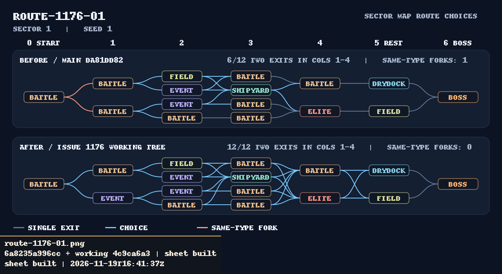
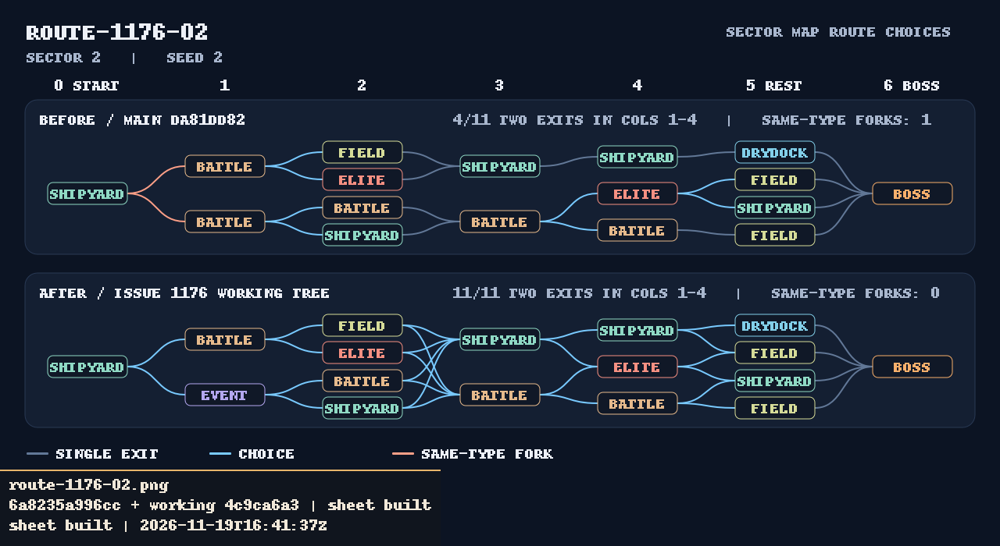
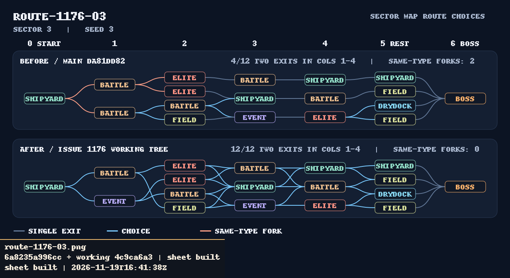

# Sector map route choices

Every stop in columns 1 to 4 offers two routes to different types of stops. The opening stop links to every stop in column 1. Column 5 offers rest stops, and every rest stop leads to the boss in column 6.

The check generated 3,000 sectors with seeds 1 to 3,000, rotating through sectors 1, 2 and 3. It counted stops with exactly two exits in columns 1 to 4 and checked every two-way fork for repeated stop types, including forks at the starting stop.

| Source | Two-exit stops, columns 1 to 4 | Same-type forks |
|---|---:|---:|
| Before, main `da81dd82` | 14,778 of 35,905 (41.16%) | 3,463 |
| After, issue 1176 | 35,905 of 35,905 (100%) | 0 |

The brief cites 58.7% for main. In this sample, 21,127 stops (58.84%) on main had one exit. All stops remained reachable in both samples. The JavaScript and Godot versions produced identical stop types and routes for all 3,000 new maps.

Campaign parity passed for seeds 1 through 30, and the first 40 steps of seed 1 matched in the separate save hand-off check. The [campaign parity record](../../../godot/campaign/test/RECORD.md) has the table checksum and save counts.

## Before and after

Each diagram shows the same seed and sector before and after the change. The labels on the stops give their types. Red lines mark repeated types at a two-way fork. Blue lines mark choices.

Run `node docs/shots/route_choice_1176/draw_maps.js <scratch-directory> da81dd82` from the repo root to redraw the SVG diagrams. To rerun the sector check, use `godot --headless --path godot --script res://campaign/test/sector_routes_test.gd`.
