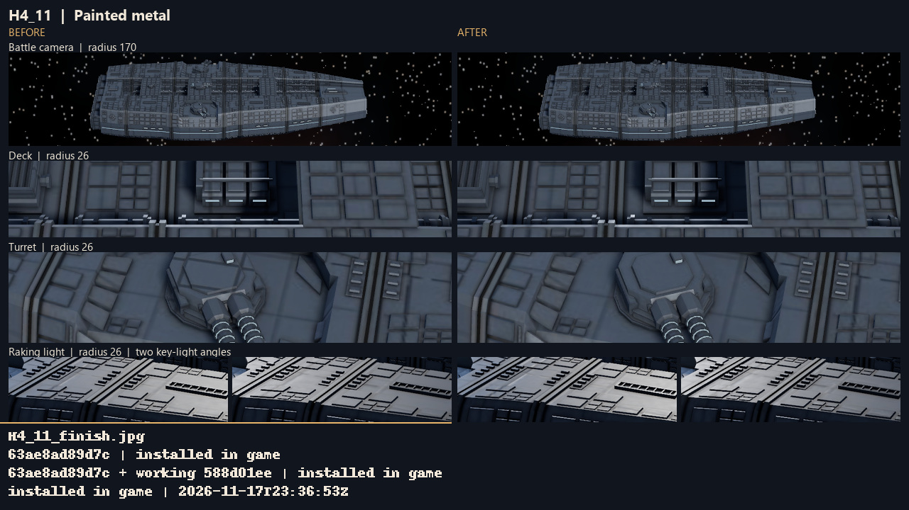
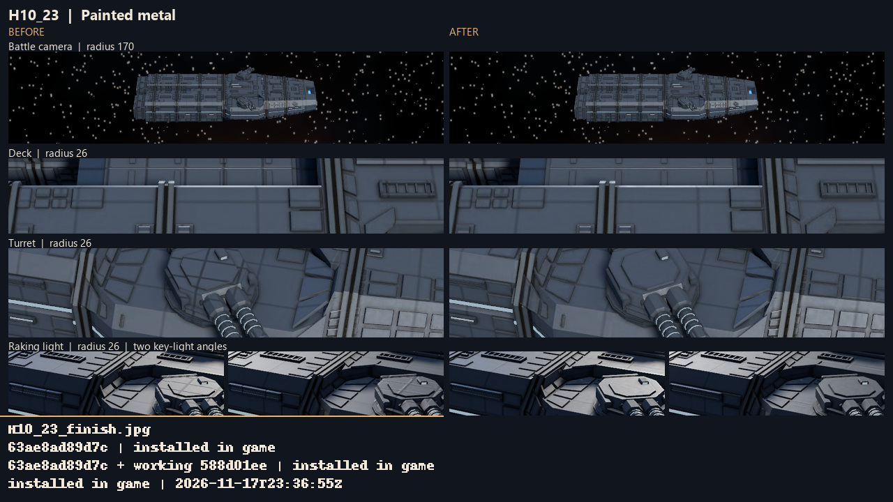
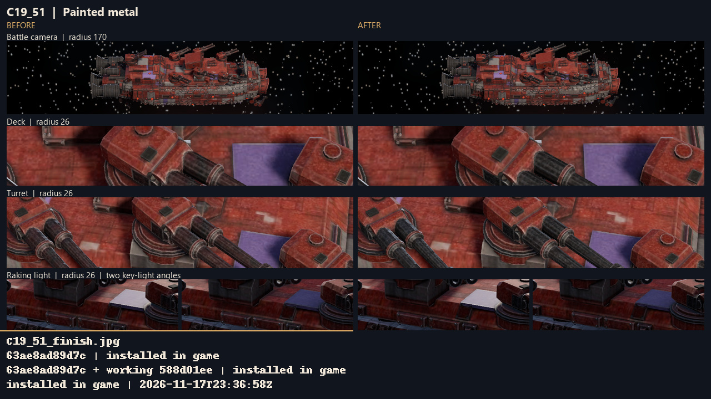

# Ship finish at close zoom

Issue #1016. Turret housings and fittings use the joints and bevels built into their own meshes. The hull keeps its panel
seams. The darker recesses, lighter exposed edges and fine normal detail use the same surface masks and scale on the
hull and fittings. Hegemony keeps the module colours from issue #1002. The Pyre-Barge keeps its rust and irregular
armour and trophy patches.

## Rebuild method

The source sheets are the [Iron Mandate](../../ship_pipeline/build_sheets/hegemony_IM5/README.md),
[Dominion](../../ship_pipeline/build_sheets/hegemony_H10/README.md) and
[Pyre-Barge](../../ship_pipeline/build_sheets/corsair_A16/README.md). The [ship manifest](../../../godot/assets/ships/manifest.json)
identifies each checked export. Stage 5 uses the existing sheet builder and two 4096-pixel atlases at 64 OptiX samples.
Stage 6 exports the LOD chain and measures its cost. Stage 7 uses 2048-pixel game maps. Stage 5 starts from the authored
sheets. The original Hegemony shape references were unavailable, so the pass used the checked stage helpers and compared
the rebuilt GLBs with the installed geometry. Each export matched its baseline triangle positions and hard points.

| Ship | Main triangles | Turning triangles | Total |
|---|---:|---:|---:|
| H4_11 | 105,500 | 8,436 | 113,936 |
| H10_23 | 53,260 | 6,504 | 59,764 |
| C19_51 | 141,728 | 11,436 | 153,164 |

The battle sky supplies the reflected environment and the key light supplies direct specular light. The export checks
that occlusion, roughness and metallic share an ORM atlas for each mesh role and that both roles carry a detail normal.
Rebaking the existing emission atlases changed the H10_23 and C19_51 JPEGs by at most two 8-bit values per channel.

## Review sheets

The before exports match issue #1002 file for file. The shared battle-light setup draws each revision through ShipView.
The battle, deck and turret rows use native pixel crops. The raking row keeps the camera fixed and changes the angle of
the same key light, with its energy and colour held fixed. Both images in that row are reduced to fit the sheet. The
revision labels are below the pictures. The Board's original three crops were unavailable in this checkout, so the
comparisons use fresh views of the called-out decks and fittings.

The dark lines across the two Navy turret lids are gone. Their bevels and mounts still define the edges. The steel-blue
finish stays subdued in the standard light. Grain and scuffs are easier to see under the grazing highlight. C19_51
shows the largest difference on the dark barrels and their worn collars.

The second fleet look bench pass covered 36 hulls across six skies. All 198 views of other ships matched pixel for
pixel. The largest mean change on the three trial ships at radius 170 was 0.70 on a 255-level scale.
[Fleet comparison](fleet_comparison.csv)

## Measurements

All six exterior atlases pass the colour-jump review before and after. The highest after rate is 6.46 percent on the
C19_51 parts atlas. Paint lint flags a material when at least 10 percent of its neighbouring pairs reach 18 dE76, with
at least 12 pairs. The flat, unmapped interior materials still appear in the audit. [Paint lint results](paint_lint.csv)

The atlas measurements sample coated texels in the exported maps. On H4_11 parts, the middle 80 percent of roughness
values widens from 0.54-0.68 to 0.56-0.86. The Hegemony parts normals have twice the median sideways variation,
with fewer strong deviations from the removed grooves. The recipe's albedo detail score for the H4_11 guns is still
0.51 of the hull. The fine grain is carried by the normal and roughness maps. [Atlas measurements](finish_maps.csv)

Switching the key between the two raking angles shifts the centre of the strongest direct highlights about 345 px on
H4_11, 271 px on H10_23 and 130 px on C19_51 in the source frames. The measurement subtracts a second capture at
each angle with the key's specular contribution disabled. [Render measurements](render_measurements.csv)

## Battle timing on the RTX 5080

The #207 engagement scene ran in Forward+ with 24 units, including C19_51. Each launch measured three sessions per
resolution, with 120 warm-up frames and 720 timed frames per session. Each value below is the median across those sessions.

| Launch | 1080p frame | 4K GPU |
|---|---:|---:|
| Before 1 | 11.17 ms | 5.91 ms |
| Before 2 | 10.70 ms | 5.92 ms |
| After 1 | 11.69 ms | 5.89 ms |
| After 2, during the playable asset import | 12.85 ms | 5.89 ms |
| After 3, 1080p repeated after the import | 10.10 ms | |

All three 1080p session medians in the final repeat were under 12.5 ms. The highest was 12.475 ms. The 4K GPU
median passed in both after launches. The six-session medians across the first two launches were 10.78 to
12.03 ms at 1080p and 5.92 to 5.89 ms of GPU time at 4K. [Scene gate measurements](scene_gate.csv)

## Checks

Stages 5 to 7, the six-view surface checks, the export fault checks and the playable ShipView readbacks passed for all
three ships. The Godot texture readbacks match the review copy on both exterior atlases of each installed ship. The
turret, install refresh and A16 death-seam checks passed. The regenerated A16 unbaked GLB matched the existing fixture
byte for byte, and the fixture input hash was refreshed.

Standing checks reported 62 passes, two known baselines and two failures. The stage 5 failure-handling check passed
all 44 cases on an isolated retry. The Windows runner self-test reported `1 == 14` and timed out on the isolated retry.
