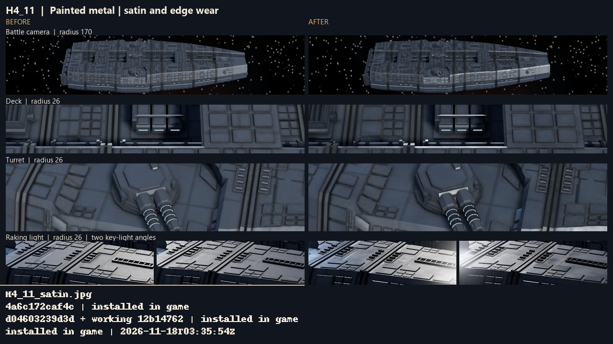
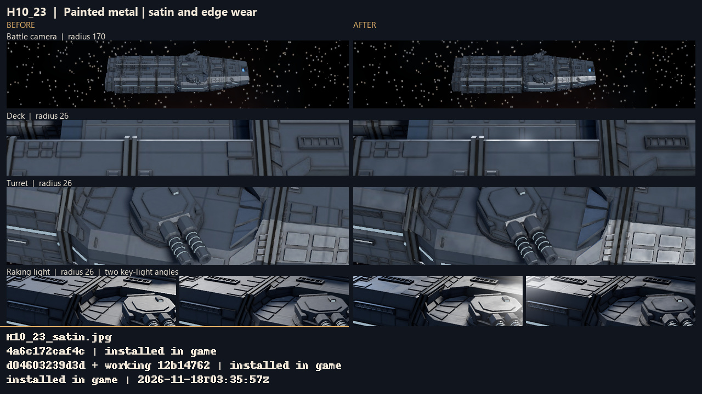
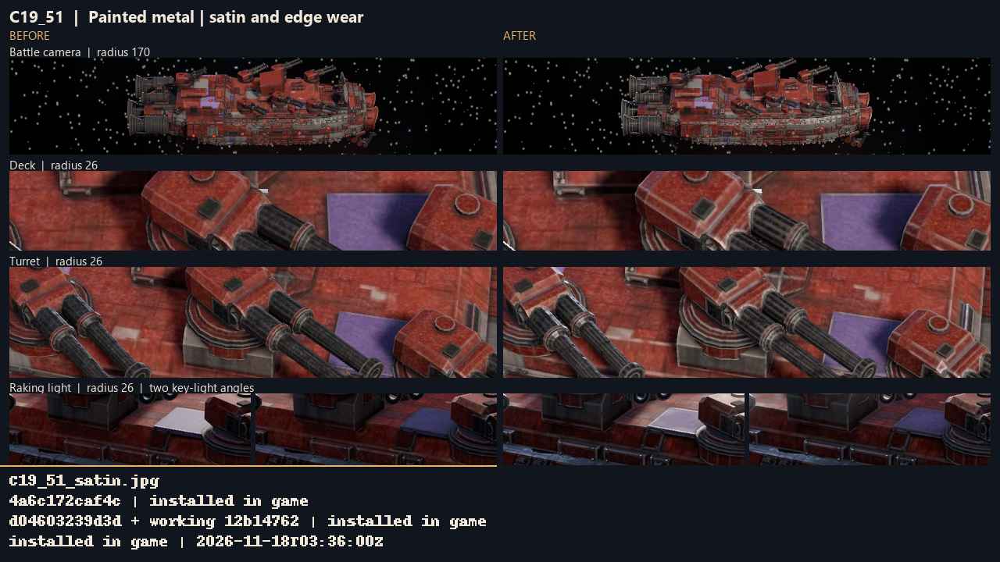

# Painted metal in battle

Refs #1016, run 2. The comparison starts at main `4a6c172`, the first pass with clean turret lids. Each review sheet uses
the same poses before and after. The top row is the radius-170 battle camera at native pixel size. The deck and turret
are radius-26 crops. The bottom row sweeps the same key light across the ship to show the finish under grazing light.

## What flattened the first pass

The exported Navy hulls had median roughness of about 0.64 and the fittings were at 0.71 to 0.72. Median metallic sat
between 0.47 and 0.48. The middle 80 percent of exposed fitting albedo spanned approximately 25 levels of luma on
both ships, against 44 to 46 on the hulls. The first pass measured the H4_11 gun's albedo detail at 0.51 of its hull.

At radius 170, turning off sky reflections changed mean RGB on the two Navy silhouettes by 0.51 and 0.49 levels out
of 255. Turning off the directional specular lights changed them by 15.82 and 14.29. Multiplying only the roughness by
0.65 gave a spread of 10.12 and 11.17 luma levels in the per-pixel change. Forcing only metallic to 0.65 gave a spread
of 3.33 and 3.55 and darkened the hulls by about nine levels on average. Roughness made the biggest difference to the
shape of the highlights. The small palette steps on the fittings also contributed to the flat close view.

## Method

The [Iron Mandate](../../ship_pipeline/build_sheets/hegemony_IM5/README.md),
[Dominion](../../ship_pipeline/build_sheets/hegemony_H10/README.md) and
[Pyre-Barge](../../ship_pipeline/build_sheets/corsair_A16/README.md) use their existing build sheets.
The Hegemony and Hullbreaker stacks bake the new finish into the same hull and fittings atlases. Navy slabs vary by
connected plate, and the modeled gaps define their edges. On both factions, the bake follows convex wear and sheltered
grime masks. The Hullbreaker keeps its irregular armour, rust and trophy colours.

The build sheets stayed as authored. Stage 5 baked two 4096-pixel atlases per ship at 64 OptiX samples. Stage 6
exported and measured the LODs. Stage 7 wrote 2048-pixel game maps and refreshed the
[ship manifest](../../../godot/assets/ships/manifest.json). The rebuilt GLBs matched the baseline byte for byte.
The finish is in the separate maps, and the A16 unbaked fixture hash still matches.

| Ship | Main triangles | Turning triangles | Main surfaces | Stage 6 draw calls, 20 copies at 1080p |
|---|---:|---:|---:|---:|
| H4_11 | 105,500 | 8,436 | 18 | 157 |
| H10_23 | 53,260 | 6,504 | 19 | 113 |
| C19_51 | 141,728 | 11,436 | 15 | 112 |

Each ship passed the six-view surface check, export and planted-fault checks. The paint lint limit is 10 percent of
adjacent pairs at 18 dE76 or higher, with at least 12 pairs. All six exterior atlases pass. The largest after rate was
8.25 percent on the Iron Mandate's fittings. The H4_11 gun albedo detail rose from 0.51 to 0.69 of the hull under
the recipe's detail measure. That ratio is still below the 0.75 review mark.
[Paint lint](paint_lint.csv) · [Map measurements](finish_maps.csv)

## Before and after in Godot

The Iron Mandate and Dominion pick up a brighter highlight along the side plating and around the collars. Their turret
lids keep the seam at the housing perimeter. The Pyre-Barge shows brighter steel around the barrels, collars, and plate
edges while the red rust and the purple trophy plates stay distinct. The Navy's flat faces remain subdued in the straight-on
light. The difference is strongest where the key light rakes across them.

| Ship | Battle crop | Ship pixels at radius 170 | Deck crop | Turret crop | Raking highlight travel |
|---|---:|---:|---:|---:|---:|
| H4_11 | 3.61 | 7.72 | 8.48 | 8.42 | 345 to 424 px |
| H10_23 | 1.74 | 8.05 | 7.86 | 10.82 | 271 to 387 px |
| C19_51 | 2.95 | 8.48 | 7.07 | 8.29 | 130 to 212 px |

The first four columns are mean absolute RGB changes in 8-bit levels. The battle crop includes the sky. The
silhouette uses pixels that differ from an empty-sky capture at the same pose by at least eight levels in one channel.
On the full crop only H4_11 reached the three-level aim. All three silhouettes exceeded it. The last column tracks
the centre of the direct highlight between two key-light angles at a fixed camera, in the original radius-26 captures.
At radius 170, turning the ship by 28 degrees under the fixed lights moved the direct highlight-centre by 110, 130 and
32 screen pixels, respectively. That measure includes the change in projection as the hull turns.
[Crop and raking measurements](render_measurements.csv) · [Battle light probes](battle_light.csv)

The Board's original crops were unavailable. These views use fresh captures of the same parts on the installed
`4a6c172` ships.

## Fleet and frame time

The second fleet bench run drew 36 hulls in six skies. All 198 views of the other hulls matched pixel for pixel.
Across the six whole fleet cells per trial ship, mean RGB differences ranged from 2.87 to 2.92 for H4_11, from 1.36
to 1.40 for H10_23, and from 2.30 to 2.35 for C19_51. These cells use their own fixed framing and include the sky.
[Fleet comparison](fleet_comparison.csv)

Scene 207 ran alone on the RTX 5080 in Forward+ with 24 units, including C19_51. The median of three 1080p frame
medians was 5.12 ms. At 4K the median GPU time was 5.80 ms. All three sessions were inside the 12.5 ms limit at
each resolution. Each session used 120 warm-up frames and 720 timed frames. [Scene gate](scene_gate.csv)

All three exports passed Godot install readback in the isolated PC review build. That install keeps review files
separate from the shared playtest's main manifest. The checked export bundles are saved in the issue output folder
under `finish_1118_exports`. The standing suite reported 65 passes and two known baselines. The turret,
install-refresh, and A16 death-seam checks passed.
