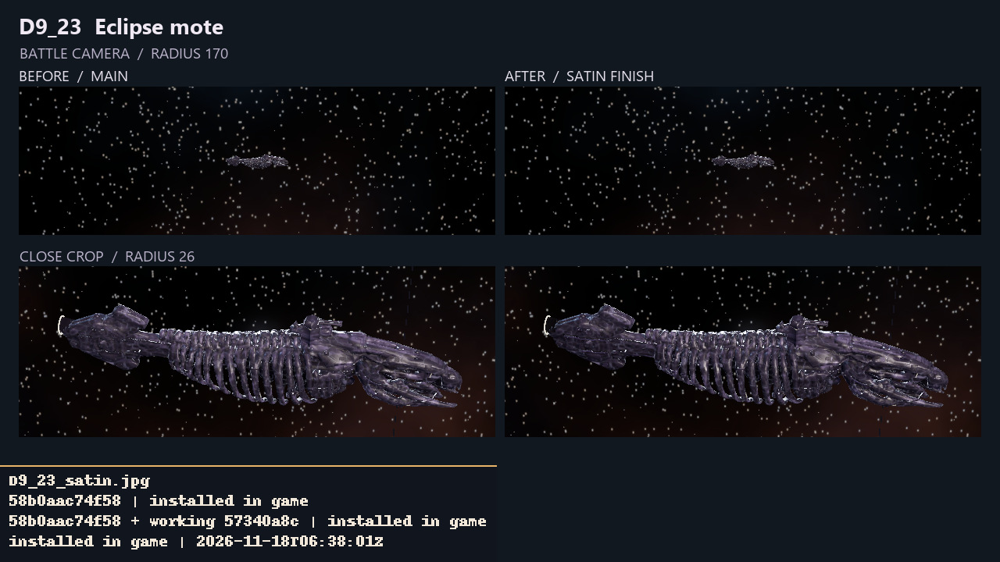
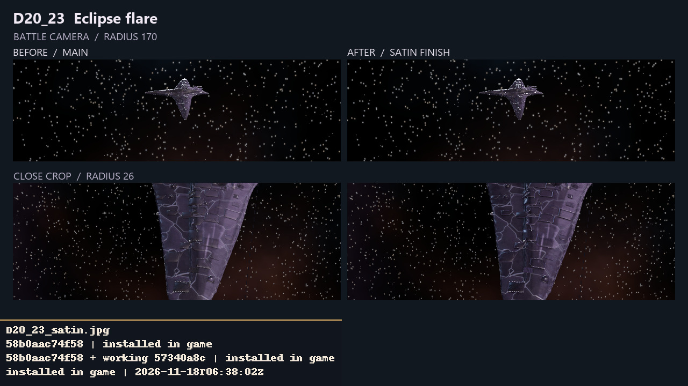
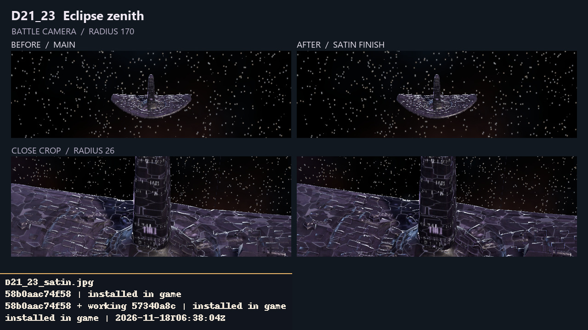
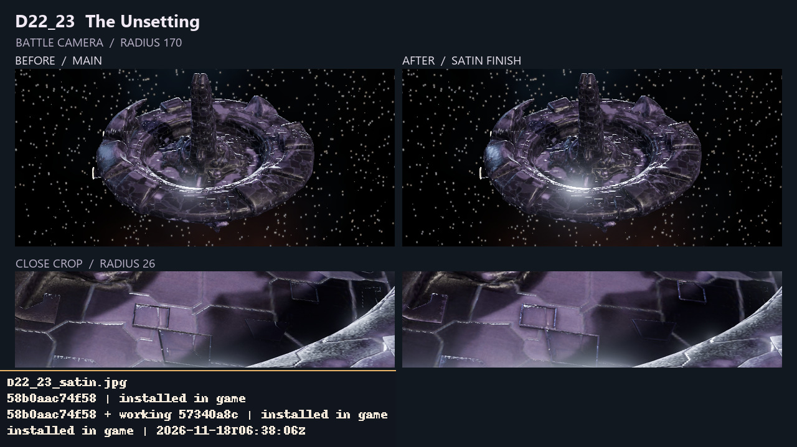

# Eclipse satin finish

Refs #1035. The comparison starts at main `58b0aac7`. Each sheet shows the same lights and poses before and after.
The top row is a native-pixel battle crop at radius 170. The second row is a matched close crop at radius 26.

## Build method

The [A4 ship definitions](../../../tools/blender/a4/ships.py) are the source for the four meshes in the
[ship manifest](../../../godot/assets/ships/manifest.json). The [E13](../../ship_pipeline/build_sheets/deathless_E13/README.md),
[E14](../../ship_pipeline/build_sheets/deathless_E14/README.md), [E12](../../ship_pipeline/build_sheets/deathless_E12/README.md)
and [E11](../../ship_pipeline/build_sheets/deathless_E11/README.md) build sheets are separate designs. This pass uses the
installed A4 geometry and the Eclipse finish in the [paint recipe](../../ship_pipeline/RECIPE.md).

Stage 5 baked the original UVs at 64 OptiX samples. The shared stack carries over the
[approved H4_11 finish](../ship_finish_1118/README.md) as a satin coat with patchy polished wear on convex edges and rougher
grime under overhangs. The Eclipse coat holds the dark violet faces around one base value. The stronger lilac and metal
bands use the original atlas. The intact hull supplies the masks, and the legacy normal contributes its seam relief with
a lower strength. The installed emissive maps are byte-identical to main.

Stage 6 passed the studio LOD bench at each ship's own class length. Stage 7 packaged twelve new JPEG maps at the original
resolutions. All base, damage and wreck GLBs matched main byte for byte, including their hard points and mesh layout.
Godot refreshed the ship cache and drew all four bundles in the isolated review build. The checked bundles are in the
issue output folder under `finish_eclipse_exports`.

| Ship | Intact triangles | Base / ORM / normal pixels per side | Manifest size change |
|---|---:|---:|---:|
| D9_23 | 45,165 | 2048 / 2048 / 2048 | -873,581 |
| D20_23 | 94,379 | 2048 / 2048 / 2048 | -479,885 |
| D21_23 | 113,787 | 2048 / 2048 / 2048 | -682,046 |
| D22_23 | 168,344 | 4096 / 2048 / 4096 | -2,323,287 |

Strict paint lint passed for all four. The largest after rate of adjacent pairs at or above 18 dE76 was
1.20 percent, below the 10 percent limit. Sampled median roughness ranged from
0.451 to 0.478 on main and from 0.384 to
0.416 after the bake.
[Paint lint](paint_lint.csv) · [Map measurements](finish_maps.csv) · [Budget details](budgets.csv)

## In Godot

| Ship | Battle hull pixels | Whole battle crop | Close crop | Direct highlight travel |
|---|---:|---:|---:|---:|
| D9_23 | 3.13 | 0.03 | 1.72 | 69.9 px |
| D20_23 | 6.86 | 0.16 | 2.20 | 94.3 px |
| D21_23 | 7.25 | 0.48 | 5.48 | 339.9 px |
| D22_23 | 8.27 | 3.07 | 8.64 | 697.9 px |

The three change columns are mean absolute RGB differences on an 8-bit scale. The hull column uses pixels that differ from
the empty sky by at least eight levels in one channel. The whole battle crop also includes the sky.
The last column measures the movement of the bright patch from the battle key as it swings 36.7 degrees at a fixed
radius-26 camera. It uses the key's rendered contribution, found by subtracting a matching frame with the key specular
disabled. The Tomb-ark shows the most visible change, with a bright glint on the near rim. The frigate changes most
clearly in the close crop, where the ribs catch finer highlights. [Render data](render_measurements.csv)

## Fleet and frame time

The second fleet run on each build drew 36 hulls in six skies. All 192 views outside the four Eclipse ships matched
pixel for pixel. [Fleet comparison](fleet_comparison.csv)

Scene 207 ran alone on the RTX 5080 in Forward+ at 1920 × 1080 with 24 units, including D20_23 and D21_23.
The median of three frame medians was **3.18 ms** against the **12.5 ms** limit. The session medians were
3.19, 3.16, 3.18 ms. Each session used 120 warm-up frames and 720 timed frames.
[Scene gate](scene_gate.csv)

The standing suite returned 66 passes and 2 known baselines. The A16 fixture hash matched.
