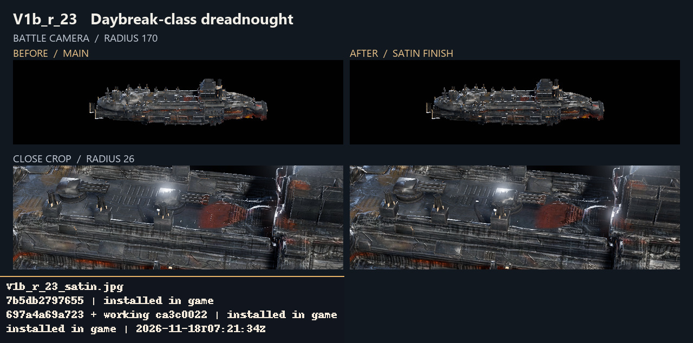
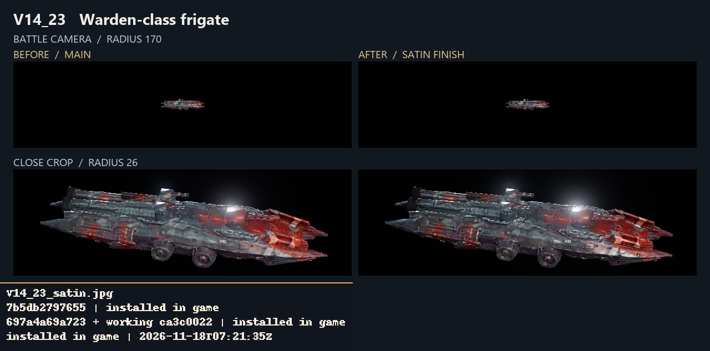
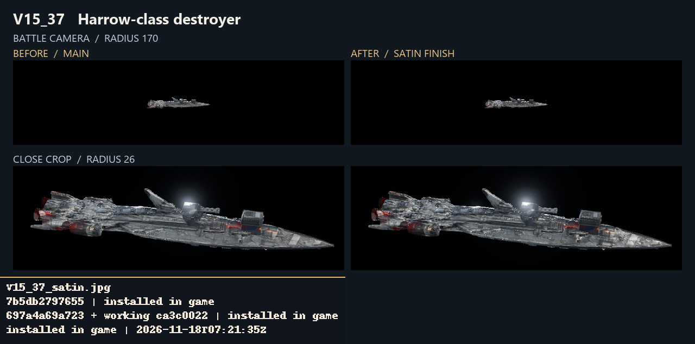
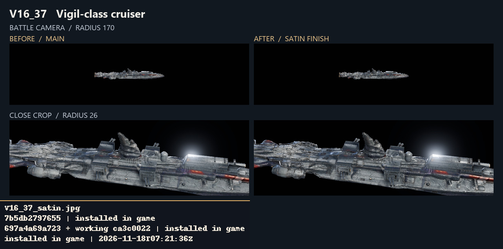
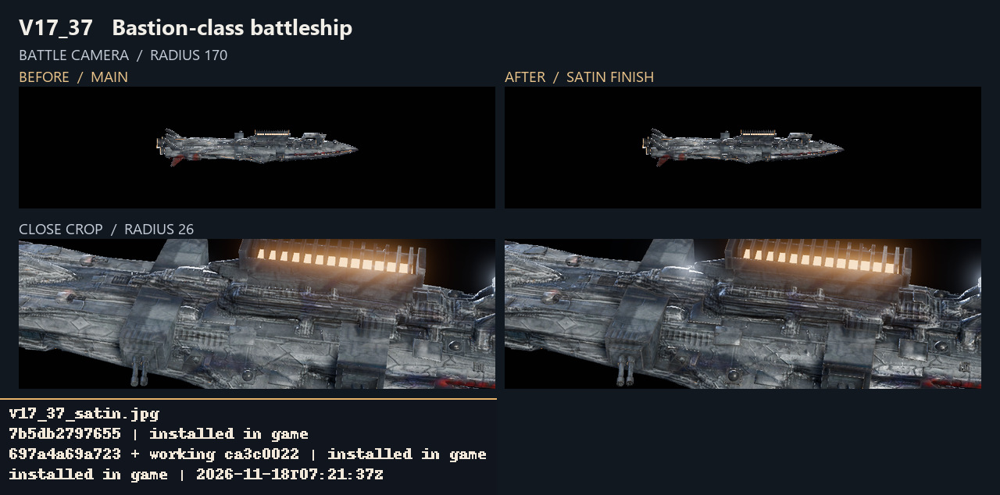
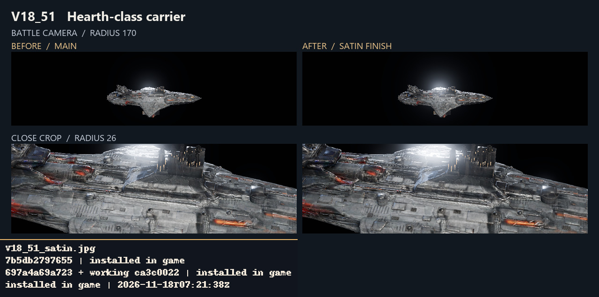

# Sunward Crusade satin finish

Refs #1036. All six Sunward ships carry the satin finish in the isolated PC review build. The before images use the
Sunward bundles from main `7b5db279`. The battle rows show radius 170 at native pixel size. The matched close crops
use radius 26. The finish takes its cues from the approved H4_11 pass. [Approved finish](../ship_finish_1118/README.md)

## Build method

The source is the installed geometry from the [A4 ship definitions](../../../tools/blender/a4/ships.py), with each source
file matched against the [ship manifest](../../../godot/assets/ships/manifest.json). The [S8 sheet](../../ship_pipeline/build_sheets/voidsworn_S8/README.md)
describes a separate Daybreak design. This pass uses the A4 Daybreak and makes no build sheet edits.

The [Sunward stack](../../../tools/blender/kits/voidsworn/stack.py) reuses the Eclipse A4 bake at 64 OptiX samples. Stage 5
reads the installed UVs, livery and relief. It steps iron tones by connected piece, wears raised edges to brighter iron and
gathers carbon soot under overhangs. The satin faces are smoother than the recesses. The bake uses the original seams and
rivets and softens the legacy normal slightly. The hidden breach and ram skins stay out of the mask bake. The original
texels provide the starting canvas for each map. [Paint recipe](../../ship_pipeline/RECIPE.md)

The six installed bundles use 18 new JPEGs at the original resolutions. The intact, damage and wreck GLBs and the
emissive maps match main byte for byte. That preserves the triangle counts, UVs, hard points, insides, and ember and
frost lights. The isolated install verified all 255 manifest files and refreshed all 36 cached ships. Godot read back all
six Sunward ships from the refreshed cache. The shared build's six bundles still match the original hashes. The checked
bundles are in the issue output folder under `finish_sunward_exports`.

| Ship | Intact triangles | Base / ORM / normal pixels per side | Bundle bytes before | Bundle bytes after | Change in bytes |
|---|---:|---:|---:|---:|---:|
| V1b_r_23 | 132,449 | 4096 / 2048 / 4096 | 48,853,541 | 46,769,698 | -2,083,843 |
| V14_23 | 76,931 | 2048 / 2048 / 2048 | 34,575,472 | 33,667,214 | -908,258 |
| V15_37 | 40,611 | 2048 / 2048 / 2048 | 31,066,961 | 30,486,165 | -580,796 |
| V16_37 | 60,341 | 2048 / 2048 / 2048 | 51,604,850 | 50,867,659 | -737,191 |
| V17_37 | 91,142 | 4096 / 2048 / 4096 | 58,214,671 | 56,531,882 | -1,682,789 |
| V18_51 | 129,915 | 4096 / 2048 / 4096 | 58,670,229 | 56,791,953 | -1,878,276 |

Strict paint lint passed for all six. The highest rate of adjacent pairs at or above 18 dE76 was 3.49 percent, below
the 10 percent limit. Sampled median roughness ranged from 0.525 to 0.533 before and 0.447 to 0.482 after.
All six passed the stage 6 studio LOD bench at their own manifest lengths. V18_51's studio LOD0 counts one fewer triangle
than the installed file. The installed GLB still matches main by hash.
[Budgets](budgets.csv) · [Paint lint](paint_lint.csv) · [Map measurements](finish_maps.csv)

## In Godot

| Ship | Battle hull RGB change | Whole battle crop RGB change | Close crop RGB change | Direct highlight travel before to after |
|---|---:|---:|---:|---:|
| V1b_r_23 | 8.69 | 1.71 | 10.30 | 423 to 448 px |
| V14_23 | 6.92 | 0.08 | 4.82 | 105 to 120 px |
| V15_37 | 6.35 | 0.09 | 2.82 | 169 to 250 px |
| V16_37 | 7.94 | 0.25 | 4.96 | 272 to 330 px |
| V17_37 | 9.25 | 0.75 | 8.97 | 294 to 331 px |
| V18_51 | 13.11 | 2.58 | 10.89 | 425 to 423 px |

The first three columns measure mean absolute RGB change in 8-bit levels. The battle hull mask selects pixels that
differ from an empty view by at least eight levels in any channel. The whole crop includes the background. The final
column tracks the centre of the brightest direct highlight as the key turns 36.7 degrees at a fixed radius-26 camera.
It uses the difference from matching frames with key specular disabled. The highlight brightened at both angles on all six.
[Render measurements](render_measurements.csv)

The Daybreak and Bastion show brighter lips on the raised panels and deeper soot between plates. The Warden and Harrow
show the smallest change at battle size. The Hearth shows the largest change, with a stronger white glint behind its
spire bank in this close view. The A4 surfaces retain more mottling than H4_11.

## Fleet and frame time

Both fleet builds kept the merged Eclipse base and changed only the six Sunward ships between builds. The second run
on each build drew 36 hulls in six skies. All 180 views outside Sunward matched pixel for pixel.
[Fleet comparison](fleet_comparison.csv)

Scene 207 included all six repainted models in its 24-unit battle. It ran alone on the RTX 5080 in Forward+ at 1920 × 1080.
The median of three frame medians was **3.20 ms** against the **12.5 ms** limit. The session medians were 3.30, 3.17 and
3.20 ms. Each session used 120 warm-up frames and 720 timed frames. [Scene gate](scene_gate.csv)

The standing suite returned 67 passes and two known baselines. The A16 fixture hash matched.
