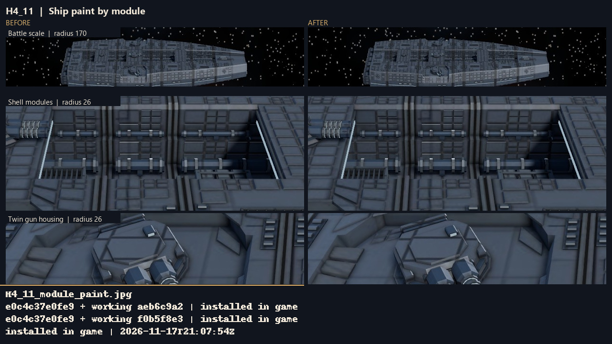
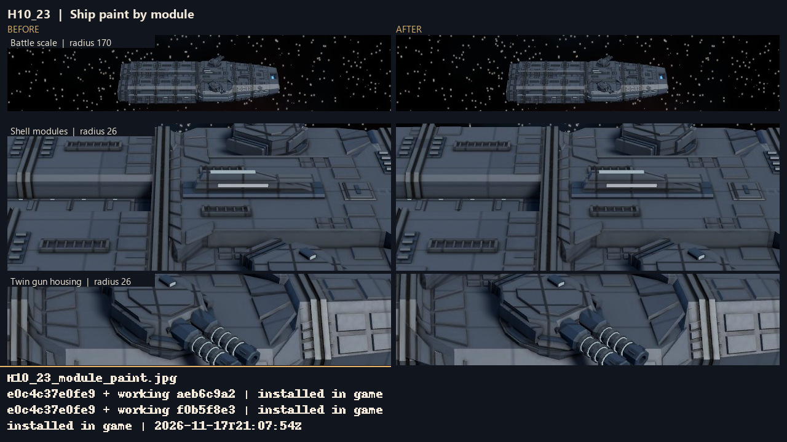
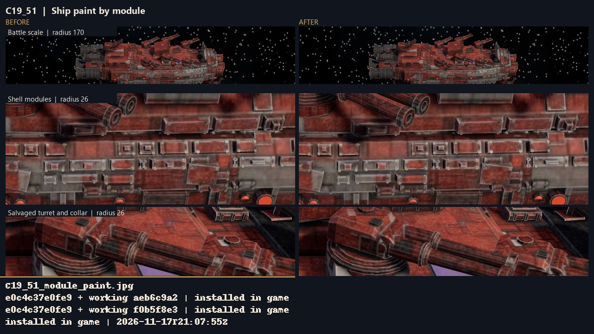

# Ship paint by module

Issue 1002, R318. Paint now starts with the shell section or fitted assembly, then follows its surface duty. The local value step
is at most 1.5 percent in either direction. The Hullbreakers still use irregular rust and dried-blood armour, worn edges and
trophy clusters. Their repair colours follow patch seams and the shell's authored joints. Fittings get the same repeated
surface detail scale and a normal map of their own.

## Method

The trial uses the [Iron Mandate](../../ship_pipeline/build_sheets/hegemony_IM5/README.md),
[Dominion](../../ship_pipeline/build_sheets/hegemony_H10/README.md) and
[Pyre-Barge](../../ship_pipeline/build_sheets/corsair_A16/README.md) sheets. The paint bake reads those sheets through the
normal build contract. The sheet fit and shape-reference stages were outside this paint pass.

The direct recipe helpers ran the stage 5 paint bake and six-view surface check, the stage 6 LOD export and solo Godot
benchmark, and the stage 7 GLB export, export check and fault self-test. The bake used 4096-pixel hull and parts atlases at
64 samples on OptiX. The game export uses 2048-pixel maps. The Hegemony launchers' original shape-reference inputs
were absent. This run used the approved sheets and the in-game comparisons for paint review.

| Code | Main mesh triangles | Turning mesh triangles | Total |
|---|---:|---:|---:|
| H4_11 | 105,500 | 8,436 | 113,936 |
| H10_23 | 53,260 | 6,504 | 59,764 |
| C19_51 | 141,728 | 11,436 | 153,164 |

The PC keeps the GLBs and their maps in the playable install. The repo's
[ship manifest](../../../godot/assets/ships/manifest.json) records the exports by hash. All three installs passed the
ShipView readback after refreshing the game cache. The installed baseline and rebuilt exports matched on triangle positions
and hard points for each ship.

## In-game comparisons

Each picture pairs the old and installed exports under the same battle lighting. The panels are native crops of 1920 × 1080
frames. The lower rows show the shell and a gun fitting at radius 26, the closest battle camera.

H4_11 and H10_23 keep their ordered seams and steel-blue palette. The clearest difference is in the fittings, where the
gun housings and nearby brackets read closer in value. C19_51 keeps the rust, darker red patches and worn edges. The repair
changes are subtle at the battle camera, with the clearest change in the finish around the turret collar.

## Paint lint

A material flags when at least 10 percent of its neighbouring pairs reach 18 dE76, with at least 12 pairs measured.

| Code | Material | Before, high pairs | After, high pairs | p90 before | p90 after |
|---|---|---:|---:|---:|---:|
| H4_11 | Hull | 0/3,893 (0.0%) | 0/3,893 (0.0%) | 6.18 | 6.05 |
| H4_11 | Parts | 127/667 (19.0%) | 6/667 (0.9%) | 22.48 | 11.08 |
| H10_23 | Hull | 81/1,453 (5.6%) | 79/1,453 (5.4%) | 15.26 | 15.25 |
| H10_23 | Parts | 60/292 (20.5%) | 8/292 (2.7%) | 25.59 | 11.03 |
| C19_51 | Hull | 84/2,112 (4.0%) | 96/2,112 (4.5%) | 14.25 | 14.63 |
| C19_51 | Parts | 19/681 (2.8%) | 34/681 (5.0%) | 13.08 | 14.94 |

C19_51's model-wide p90 went from 14.07 to 14.68, inside the range measured for the installed Hullbreakers. The three
target exports still have their existing flat and unmapped interior surface findings.

The installed scans each read 94 ship and variant GLBs. Colour jumps flagged 10 models before and eight after. The other
91 model hashes matched across the scans. The full results include counts and p90 values by model and material.
[Before scan](paint_lint_before.csv) · [After scan](paint_lint_after.csv)

Standing checks finished with 64 passes and two known baselines.

## On the next rebuild

These other installed codes have a recipe using one of the revised paint stacks.

| Stack | Installed codes |
|---|---|
| Eclipse | D20_23, D21_23, D22_23, D9_23 |
| Ashfall Hullbreakers | C13s_23, C14s_23, C15s_23, C16s_23 |
| Sunward Crusade | V1b_r_23 |
