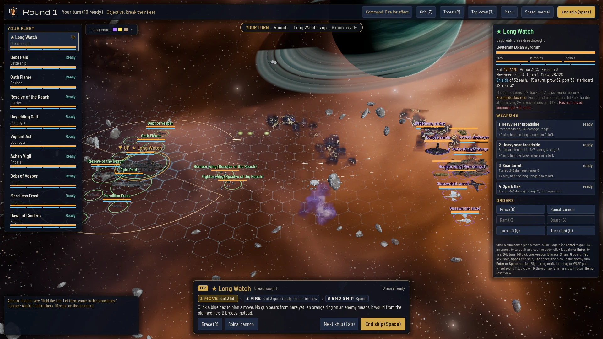

# Issue 207: the scene gate benchmark, first measurement (Nov 7, 2026)

**The answer.** The representative battle runs at **6.9 ms a frame** (median) on the RTX 5080 at 1080p, **42% of a 60 fps frame**, and the graphics card is busy for only **2.4 ms (14%)** of it. The binder is **CPU work on the main thread, not the GPU**: the game-side per-frame work of the ships on screen and their effects sets the frame time, while the graphics card's whole share (geometry, shadows, surfaces, post) is 14% of the frame. At 4K the GPU rises to 5.4 ms and the frame stays at 7.1 ms, still CPU-bound. Headroom is large: 9.7 ms of frame and 14.3 ms of GPU before 60 fps. Triangles are cheap here: the whole 20-ship fleet's 2.38M hull triangles cost about 0.8 ms of GPU, and a second full copy of every hull added 0.83 ms GPU and 0.60 ms of frame.

**The gate (Ryan, Nov 7, R116): 75 percent of the 60 fps frame, 12.5 ms**, on the frame median of this scene at 1080p and on its GPU ms with the 3D drawn at 4K. Today: frame 6.9 ms, 4K GPU 5.4 ms, so 5.6 ms and 7.1 ms of room. See "Gate" below.

**Flag you did not ask about:** about 1 frame in 100 takes 14 to 53 ms (frame p99), well past 16.7 ms, and three ship deaths push it as high as 65 ms. The GPU's own p99 stays near 3.0 ms, and with effects off the p99 falls to 9 ms, so these are effects-side CPU stalls (volley and death spawns). Medians hide them; they read as stutter. Worth a job under #210 or #212.

## The scene

The real battle scene (`godot/scenes/battle/battle.tscn`), built by `godot/bench/scene_gate.gd`:

- **20 ships in the 8/6/4/2 reporting mix** (R111 point 2): 8 frigates, 6 destroyers, 4 cruiser tier (cruiser, carrier, battleship), 2 capitals. Your side is ten Sunward Crusade hulls (Ascendant dreadnought, cathedral, penitent, reliquary, two harrows, four wardens); the enemy side is two hulls from each other faction: the Hullbreaker Pyre-Barge (C19_51, the round 4 anchor) and a raider, Hegemony interdictor and picket, Chorus spitter and drone, Glasswright blade and wisp, Eclipse harvester and jackal. Plus the four strike craft wings the carriers launch. 19 distinct hulls, 207 distinct materials.
- **Every hull at full detail, triangles uncapped** (addendum 2): every ship is its A4 kit ship (the reviewed builds the game ships, copied from the PC build, 252 of 252 files matching the manifest sha256), mesh LOD off.
- **Storm map** with 4 nebula hexes, 23 ion storm hexes and 4 rock hexes; the world's gas giant with rings and 2 moons, 165 rocks, 60 gas clouds, the baked nebula sky; board look C (cine).
- **Effects on**: a seeded running battle of each faction's own weapon looks between the battle's ships, about 2.8 volleys a second, a third of them on shields.
- **HUD up**: fleet list, ship card, action bar, name plates.
- **Gate view camera** ("engagement"): the battle camera's own angle, pulled back to frame both fleets (368 units). A first launch at the turn-start view (your fleet only, the enemy mostly off screen) is kept as `run1.json` for comparison.

## Method

The round 4 discipline: 1920x1080, Forward+ (Vulkan), MSAA 4x, vsync off, no frame cap, 120 warm-up frames after 2.5 s of effects running, 720 measured frames, GPU time from the viewport's render timer, frame time between drawn frames, draw calls and triangles from the renderer's own counters (main view and shadow passes separately). Every run is a freshly built battle. Three sessions per launch, the order reversed every other session; every change below is paired against the base run of the same session, then the median of sessions. Gate view: two launches, 6 sessions per mode. Fresh clone of this branch in `Downloads\voidsworn_test\opus207`, its own import and asset build; Godot 4.7.2-stable (official), NVIDIA driver 617.42, the GPU idle before and between launches (`pc/gpu_state.txt`).

## Results at the gate view (1080p)

| Run | GPU ms | GPU change | Frame median ms | Frame change | Frame p99 ms | Render CPU ms | Draw calls (view + shadow) | Triangles drawn (view + shadow) | Sessions, GPU spread |
|---|---:|---:|---:|---:|---:|---:|---:|---:|---:|
| Base (everything on) | 2.38 |  | 6.93 |  | 14.7 | 1.32 | 447 + 294 | 4.00M + 2.92M | 6, 6.1% |
| Shadows off | 2.10 | -0.31 | 7.03 | -0.13 | 18.6 | 1.19 | 446 + 0 | 4.00M + 0.00M | 6, 9.1% |
| MSAA 2x | 2.03 | -0.32 | 7.32 | +0.37 | 19.0 | 1.42 | 447 + 304 | 4.00M + 2.92M | 6, 6.2% |
| MSAA off | 1.77 | -0.62 | 7.29 | +0.08 | 16.3 | 1.41 | 449 + 314 | 4.00M + 2.92M | 6, 2.5% |
| Effects off | 2.03 | -0.35 | 5.18 | -1.54 | 7.2 | 1.06 | 401 + 293 | 3.87M + 2.92M | 6, 1.0% |
| Post off (SSAO, SSIL, glow) | 1.74 | -0.66 | 7.01 | -0.26 | 17.6 | 1.28 | 449 + 304 | 4.00M + 2.92M | 6, 3.7% |
| HUD off | 2.42 | +0.02 | 6.18 | -0.73 | 13.6 | 1.03 | 444 + 294 | 4.00M + 2.92M | 6, 3.2% |
| World off (planet, rocks, clouds) | 1.69 | -0.70 | 6.88 | -0.20 | 15.4 | 1.24 | 388 + 273 | 2.51M + 2.36M | 6, 3.4% |
| Ships hidden | 1.32 | -1.06 | 1.97 | -4.94 | 3.6 | 0.46 | 90 + 41 | 1.62M + 0.56M | 6, 1.3% |
| 3D at half size (quarter pixels) | 1.50 | -0.89 | 7.04 | +0.23 | 15.6 | 1.35 | 447 + 309 | 4.00M + 2.92M | 6, 3.4% |
| Fleet x2 (a copy of every hull) | 3.22 | +0.83 | 7.48 | +0.60 | 31.1 | 1.61 | 556 + 417 | 6.36M + 5.44M | 6, 3.3% |
| Three deaths during the frames | 2.50 | +0.11 | 8.00 | +0.46 | 42.2 | 1.59 | 476 + 327 | 4.26M + 3.18M | 6, 3.9% |
| Floor (board and sky only) | 0.58 | -1.80 | 0.92 | -6.01 | 1.4 | 0.14 | 2 + 0 | 0.01M + 0.00M | 6, 0.5% |

Reading it:
- **Frame is CPU-bound.** The frame median sits 4.5 ms above the GPU time. Render CPU (the engine preparing draws) is only 1.3 ms; the rest is game-side work on the main thread.
- **The ships' own logic is most of it.** Hiding the 20 ships cuts the frame by 4.9 ms but GPU by only 1.1 ms, while drawing a second copy of every hull (no logic, no effects) adds just 0.60 ms of frame. So about 4.3 ms of the frame is game-side work done every frame for each ship on screen (ship views, their effects and animation: scripts and the updates they drive), not drawing. The turn-start view agrees: with the enemy mostly off screen the same scene runs 5.5 ms a frame on 2.5 ms of GPU.
- **Effects:** 1.5 ms of frame, 0.4 ms of GPU, and 607 MB of video memory (atlases).
- **HUD:** 0.7 ms of frame, nothing on the GPU.
- **GPU side:** post (SSAO, SSIL, glow) 0.7 ms, world (planet, rocks, clouds) 0.7 ms, MSAA 4x 0.6 ms over off (0.3 ms over 2x), shadows 0.3 ms, board and sky alone 0.6 ms.
- **Pixels:** drawing the 3D at a quarter of the pixels saves 0.9 ms GPU, so about 49% of GPU time scales with pixels. Measured at 1440p: 3.1 ms GPU; at 4K: 5.4 ms GPU, frame 7.1 ms.

## The binder, in #207's terms

- **Shadow / surface / post: not binding.** Together about 1.6 ms of GPU, inside a GPU total of 2.4 ms against a 16.7 ms frame.
- **Geometry submission: not binding.** 6.9M triangles drawn per frame (main view 4.0M plus shadow passes 2.9M) on 447 + 294 draw calls. A second copy of all 2.38M hull triangles cost 0.83 ms GPU, about 0.35 ms per million triangles with their shadows.
- **CPU: binding, and it is the game's own per-frame work, not draw submission.** Render CPU is 1.3 ms; the per-ship and effects work (scripts and the updates they drive) is several times that. Godot's profiler on this scene is the first step to split it by script.

Routing under the engine-vet addendum: the binder is fixable inside Godot (profile and trim the per-ship and effects per-frame work: update less often, move animation into shaders, batch the ship plates), so no engine probe is indicated. The Unity probe was reserved for CPU submission or instancing; draw submission here is about 1.3 ms and the cost a port would face is our own script logic, which a port rewrites rather than fixes.

## Headroom

- **Frame:** 9.7 ms left before 60 fps (6.9 of 16.7 ms used).
- **GPU:** 14.3 ms left at 1080p, 11.2 ms at 4K.
- **Hull detail:** at about 0.35 ms of GPU per million triangles, the GPU could carry roughly 22M more triangles at 1080p before reaching a 10 ms gate share, about 9 times today's fleet, if the cost stays linear (the fleet x2 run shows it does up to twice today). Triangle budgets are not what limits fidelity on the 5080; surfaces per ship (draw calls) and per-ship script cost are the things to watch.
- **More ships:** each extra hull costs about 0.035 ms GPU to draw; ships with full logic cost about 0.25 ms of frame each (from hiding all 20), so the frame, not the GPU, is what a bigger battle spends.

## Per class (the 8/6/4/2 reporting mix; reported, never capped, R111 point 3)

| Class (reporting mix) | Ships | Hull triangles, total | Largest hull | Surfaces (draw calls per pass), total | Largest |
|---|---:|---:|---:|---:|---:|
| small (frigate) | 8 | 844,667 | 150,849 | 99 | 13 |
| frigate tier (destroyer) | 6 | 524,544 | 129,517 | 100 | 18 |
| cruiser tier | 4 | 550,737 | 171,919 | 73 | 20 |
| capital | 2 | 423,113 | 256,768 | 44 | 24 |
| strike craft | 4 | 37,056 | 10,624 | 96 | 24 |
| All hulls | 24 | 2,380,117 | | 412 | |

Per ship (counted on the base scene after warm-up, so damage skins that hits had swapped in count too):

| Side | Hull | Faction | Class | Code | Triangles | Surfaces | Materials |
|---|---|---|---|---|---:|---:|---:|
| yours | ascendant | Sunward Crusade | Dreadnought | V1b_r_23 | 166,345 | 24 | 3 |
| yours | cathedral | Sunward Crusade | Battleship | V17_37 | 138,010 | 20 | 3 |
| yours | penitent | Sunward Crusade | Cruiser | V16_37 | 105,790 | 16 | 3 |
| yours | reliquary | Sunward Crusade | Carrier | V18_51 | 171,919 | 20 | 3 |
| yours | harrow | Sunward Crusade | Destroyer | V15_37 | 84,467 | 17 | 17 |
| yours | harrow | Sunward Crusade | Destroyer | V15_37 | 83,904 | 16 | 3 |
| yours | warden | Sunward Crusade | Frigate | V14_23 | 103,667 | 13 | 13 |
| yours | warden | Sunward Crusade | Frigate | V14_23 | 107,467 | 13 | 13 |
| yours | warden | Sunward Crusade | Frigate | V14_23 | 103,500 | 12 | 3 |
| yours | warden | Sunward Crusade | Frigate | V14_23 | 105,020 | 13 | 13 |
| enemy | c_boss | Hullbreakers | Battle-barge | C19_51 | 256,768 | 20 | 3 |
| enemy | c_raider | Hullbreakers | Frigate | C13s_23 | 150,849 | 13 | 13 |
| enemy | h_interdictor | Hegemony | Destroyer | H8_23 | 87,707 | 16 | 3 |
| enemy | h_picket | Hegemony | Frigate | H7_23 | 105,802 | 12 | 3 |
| enemy | b_spitter | Chorus | Destroyer | B20_11 | 108,220 | 16 | 3 |
| enemy | b_drone | Chorus | Frigate | B19_11 | 106,782 | 12 | 3 |
| enemy | i_blade | Glasswrights | Destroyer | I11_37 | 30,729 | 18 | 18 |
| enemy | i_wisp | Glasswrights | Frigate | I14_23 | 61,580 | 11 | 4 |
| enemy | d_harvester | Eclipse | Cruiser | D21_23 | 135,018 | 17 | 17 |
| enemy | d_jackal | Eclipse | Destroyer | D20_23 | 129,517 | 17 | 17 |
| yours | bomber | Sunward Crusade | Squadron | voidsworn|bomber | 10,624 | 24 | 6 |
| yours | fighter | Sunward Crusade | Squadron | voidsworn|fighter | 7,168 | 24 | 6 |
| enemy | bomber | Hullbreakers | Squadron | corsair|bomber | 9,632 | 24 | 6 |
| enemy | bomber | Hullbreakers | Squadron | corsair|bomber | 9,632 | 24 | 6 |

## Round 4 gpu.json, pulled (issue 146, studio protocol: 20 copies of one hull, 5 by 4)

| Variant | Triangles per ship | 20 ships GPU ms | 20 ships frame ms | 20 ships draw calls | 20 ships render CPU ms | 1 ship GPU ms | 1 ship draw calls | Scene triangles | Implied Gtris/s |
|---|---:|---:|---:|---:|---:|---:|---:|---:|---:|
| today | 256,468 | 2.681 | 2.760 | 158 | 0.265 | 0.603 | 54 | 5,129,360 | 1.91 |
| V1 | 307,477 | 3.887 | 3.976 | 10 | 0.156 | 0.623 | 3 | 6,149,540 | 1.58 |
| Raw | 13,878,546 | 40.001 | 40.199 | 9 | 0.220 | 2.716 | 3 | 277,570,920 | 6.94 |
| V2 | 289,047 | 3.046 | 3.133 | 18 | 0.160 | 0.619 | 6 | 5,780,940 | 1.90 |
| V3 | 622,570 | 5.250 | 5.523 | 9 | 0.160 | 0.712 | 3 | 12,451,400 | 2.37 |

Empty studio scene: GPU 0.388 ms, frame 0.444 ms, render CPU 0.106 ms, 0 draw calls. Retained per row: draw calls, frame median and p99, GPU median, render CPU median (fleet and single ship). **No per-pass or shadow timing was retained** (fields: draw_calls, frame_median_ms, frame_p99_ms, frames, gpu_median_ms, label, render_cpu_median_ms, warmup). The round 4 series already pointed the same way: draw calls fell from 158 (today) to 9 or 10 (V1, V3) while GPU time rose, and V3 carried twice V1's triangles for 35 percent more GPU time. For scale: twenty copies of today's Pyre-Barge alone cost 2.68 ms of GPU in the studio, more than this whole 20-ship battle's GPU time (2.4 ms); the studio scene stays as the A/B instrument for hull variants and is retired as a budget.

## Gate (Ryan's ruling, Nov 7, R116)

**12.5 ms (75% of the 16.7 ms frame)**, read two ways on this scene:
- **Frame median at 1080p** (the protocol above): today 6.9 ms, 5.6 ms of room.
- **GPU ms with the 3D at 4K** (the `res_2160` run): today 5.4 ms, 7.1 ms of room. Ryan plays at 1440p and 4K, and about half of the GPU cost grows with pixels: a 1080p GPU reading allowed to climb to 12.5 ms could land anywhere from about 16 ms to over 40 ms at 4K, depending on whether the new cost is geometry or per-pixel shading. Reading the GPU half at 4K keeps the gate true to how the game is played.

How it was settled: Opus first proposed 60% (10.0 ms). Ryan asked why the gate should sit lower when the binder is fixable inside Godot. Opus agreed and moved to 75%: the gate does not limit optimization (trimming the per-ship work lowers the scene's cost and adds room under any gate); the share only sets how much of the frame new content may spend. The p99 spikes are stalls of 40 to 50 ms that break 60 fps at any share, so they are fixed as their own job rather than priced into a lower gate. A 12.5 ms median still means about 80 fps in this busy battle, and scaling down stays possible later (R111 point 1).

| Share | Gate | Room today (frame at 1080p / GPU at 4K) | |
|---|---:|---:|---|
| 50% | 8.3 ms | 1.4 / 2.9 ms | considered |
| 60% | 10.0 ms | 3.1 / 4.6 ms | Opus's first proposal |
| **75%** | **12.5 ms** | **5.6 / 7.1 ms** | **ruled (R116)** |

## What this unblocks on the board

- #198 and #199 re-spec: report the scene gate ms deltas (frame at 1080p, GPU at 4K), per-class triangles, draw calls and surfaces per ship (R111, R113); the 12.5 ms gate binds (R116).
- #209, #139, #140 and the ceiling-dependent settlement jobs: unblocked on the same terms.
- Engine probe: not indicated (addendum point 2: the binder is fixable inside Godot).
- Two new jobs worth filing: profile and trim the per-ship per-frame work (the binder), and remove the effects spawn stalls behind the p99 spikes (#210 or #212 home).

## Files

- `run2.json`, `run4.json`: the gate view, every mode, 3 sessions each. `run1.json`: the turn-start view, every mode. `run3_res.json`: base, 1440p and 4K at the gate view.
- `summary.json`, `tables.md`: everything above, computed by `contrib/opus/tools/scene_gate_report.py`. `headroom_sheet.png`: the one-image summary (`contrib/opus/tools/scene_gate_sheet.py`).
- `scene_engagement.webp`, `scene_turn_start.webp`, `scene_fleet_x2.webp`: what was measured.
- `pc/`: the PC job's status, GPU state, logs, the A4 file check.
- Probe: `godot/bench/scene_gate.gd`. PC job: `tools/pc/jobs/bench207_scene_gate.bat` (clone, copy the A4 files, import, build, measure) and `bench207_scene_gate_repeat.bat`.
- Rerun: queue `bench207_scene_gate.bat` on the PC; then `python3 contrib/opus/tools/scene_gate_report.py <folder>`.

Notes: run1 used the probe at 645d697 (7f18429 on the PC, before this branch was rebased onto main; same content) with the turn-start camera; run2, run3 and run4 used the probe at 15bcd2a, as committed here (run4's sha256 differs only by the PC checkout's line endings). The frame median moves more between sessions than GPU time (22% against 6%), because it is CPU-bound; the gate should be read on the median of several sessions, as here.
