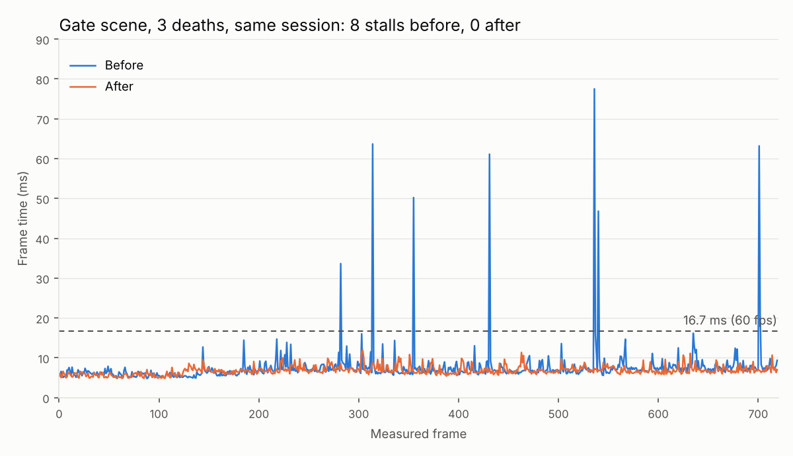
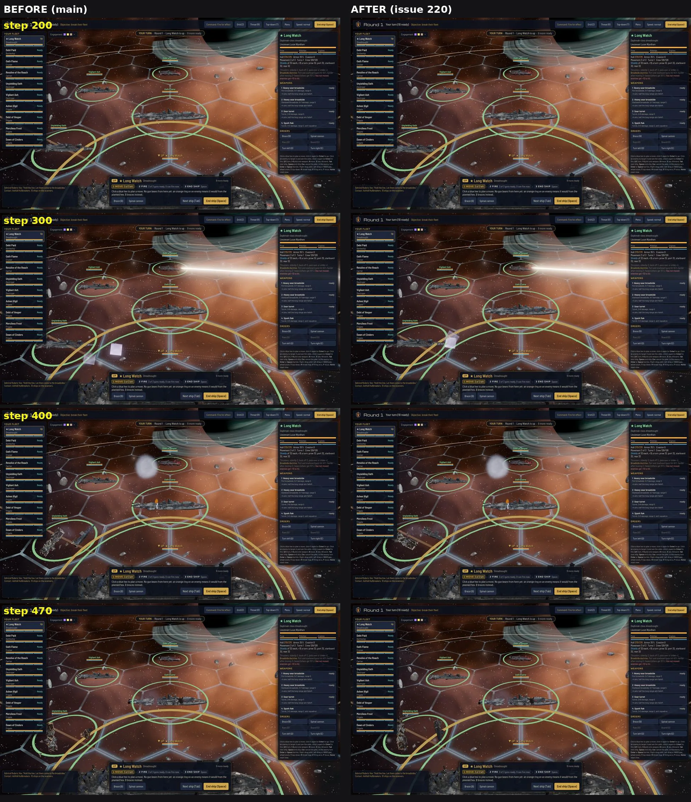

# Issue 220: effects spawn stalls, found and fixed (Nov 7, 2026)

**The answer.** The stutter in battle was the death preparation, not the shots themselves. After a ship's death cut finished on its worker thread, the game built the broken pieces' meshes on the main thread: 20 to 85 ms in one frame, once per ship early in a battle and again after every cut refresh (a damaged ship re-cuts every 6 seconds). Two smaller causes sat beside it: every hull damage rebuild remade each surface's damage shader source in script (5 ms typical, 11 ms worst), and the first torpedo or rocket launch compiled three shaders in the frame it fired (53 to 59 ms, once). All three are fixed with no visible change. On the #207 gate scene at 1080p, **every one of the 12 base and deaths sessions now has a frame p99 under 11 ms (gate: under 16.7 ms) and not one frame over 16.7 ms in 8,640 measured frames** (the worst is 13.2 ms); before, every session had 4 to 11 such frames and the worst reached 94 ms.

## What stalled, with evidence

Per-frame trace on Ryan's RTX 5080 (`scene_gate.gd --trace`): frame, process, physics, render CPU and GPU ms, the effects system's own main-thread steps, new pipeline compiles and the volleys fired, for every measured frame of 3 base and 3 deaths sessions in each of two launches. Main-thread time per step, across all 12 sessions:

| Main-thread step | Before: calls, median, worst ms | After: calls, median, worst ms |
|---|---:|---:|
| death pieces built after a cut (`piece_meshes`) | 58, 53.7, 85.0 | 60, 1.9, 2.8 |
| hull damage rebuild shown (`breach_apply`) | 168, 5.1, 11.1 | 158, 1.6, 3.3 |
| volley fired (`volley`) | 168, 1.1, **59.4** | 156, 1.0, 4.5 |
| ship death started (`death`) | 18, 9.0, 20.0 | 18, 4.7, 7.1 |
| ship breaks up (`break_up`) | 18, 1.0, 1.3 | 18, 1.0, 1.3 |

1. **Death pieces built on the main thread (the big one).** `fx_death._prebuild` turned the finished cut into meshes in one go: `ArrayMesh.add_surface_from_arrays` for 50k to 150k triangles of hull plus a damage material per surface. It was 58 of the 75 frames over 16.7 ms before the fix (render CPU stayed at 1 to 2 ms and no pipeline compiled in those frames); most of the rest were the hull rebuild and the first-torpedo compile below. It was not tied to a death: the cut is prepared ahead, staggered over the battle's first seconds, and redone after hull damage.
2. **Damage shader source rebuilt per surface.** `fx_hull.damage_material` ran a regex and walked the shader source character by character in script for every surface of every hull rebuild, death power-down and death piece, though the result depends only on the hull's own shader source.
3. **First torpedo or rocket compiled shaders mid-fight.** One volley per launch took 53 to 59 ms with 3 new surface pipelines in that frame: the torpedo body's drive glow, the star torpedo body and the casing material were not in the load-screen warm-up.

## The fix (no visible change)

- **Piece geometry on the worker** (`fx_death.precompute`, `_piece_geometry`, `_piece_materials`): the cut's worker task now also uploads the pieces' surfaces, the way the hull damage rebuild already does (`fx_breach.compute`, since r3). The main thread only attaches the same materials. Headless runs keep building everything on the main thread (the headless renderer cannot build meshes on a worker). Same arrays, same materials, same surface order.
- **Damage shader source worked out once per hull shader** (`fx_hull._damage_code`, `_uniforms_of`): the same transform as before, kept in a table keyed by the source, cleared with the shader cache. A check against main's `damage_material` gave identical shader code and parameters on 8 cases, including a material derived twice (the death path).
- **Warm-up covers the projectiles** (`fx.warmup`): the drive glow, star body, weapon burst atlas shader and both casings (in their own vertex format) now draw once on the load screen with the other effect materials.
- Instrumentation kept (cheap, as the F3 note on `fx.prof` says): named timers for volley, death, the first cut, marks and the rebuild's parts, and per-callback timing of deferred steps over 0.3 ms (deferred lambdas are named, `l_*`).

## Gate (R116), after the fix

| Reading | Today | Gate | |
|---|---:|---:|---|
| Frame median at 1080p (base, 6 sessions, 2 launches) | 6.0 ms | 12.5 ms | pass |
| GPU with the 3D at 4K (`res_2160`, 6 sessions) | 5.45 ms | 12.5 ms | pass |
| Frame p99 at 1080p, every base and deaths session | 9.3 to 10.9 ms | under 16.7 ms | pass, 12 of 12 |

The medians match #207 (frame 6.9 ms there on other launches; the frame median moves between launches because it is CPU-bound) and GPU is unchanged (2.4 ms at 1080p, 5.4 ms at 4K): the fix moves work off the main thread, it adds none to the GPU. The before runs here show lower p99 than #207's (12.5 to 21.5 ms against 14 to 53) because the worst stalls land on frames 1 in 100 or rarer and #207's sessions caught more cut refreshes.

## Screenshot verdict

The gate scene's new `--still` mode runs the base battle on a fixed effect clock (1/60 s steps, a volley every 21 steps from one seed, three deaths, every worker job waited for each step) and shoots a wide and a close view at steps 200, 300, 400 and 470. It ran twice on main's effects code and twice on this branch's.

- **No difference beyond run-to-run noise.** Two runs of the same code already differ: the wreck pieces are physics bodies that tumble on real time, and hit reactions drift a little. Mean pixel difference, close view: main against main 2.2 to 3.7, after against after 1.4 to 3.1, main against after 1.9 to 3.3 (wide view 0.3 to 0.7 for all three). Pieces, their glowing torn edges, hull damage marks, shots and bursts look the same; only where the pieces have drifted differs, as it does between two runs of main (`stills_wrecks_noise.webp`: both runs of each, cropped on the wrecks).
- **Flag (on main too, not from this change):** a pale translucent square, an effect sprite drawn without its soft edge, shows near the lower ship at step 300 in every run. Worth a look under #210.

## Files

- `frames.png`: the one-image summary. `tables.md`, `summary.json`: every session, before, after and the gate runs (`contrib/opus/tools/stall220_report.py <out> <this folder>`).
- `raw/t1_*`: before (trace runs, commit 60d8a19, the instrumented code before any fix). `raw/t2_*`: after (dfbb19e). `raw/g1_*`: after, base against the 3D at 4K (1e78c6a; same effects code as dfbb19e). Each holds `scene_gate.json` and the per-frame traces `trace_<mode>_s<n>.json`.
- `stills_sheet.webp`, `stills_wrecks_noise.webp`: the screenshot verdict (stills job at 1e78c6a; `raw/stills_before_diff.txt` shows main's effects code was what ran for "before").
- PC jobs: `tools/pc/jobs/stall220.bat` (set label, modes and extra arguments) and `tools/pc/jobs/stall220_stills.bat`, on Opus's #207 clone in `Downloads\voidsworn_test\opus207\repo`, output in `Downloads\voidsworn_test\opus220\out`.
