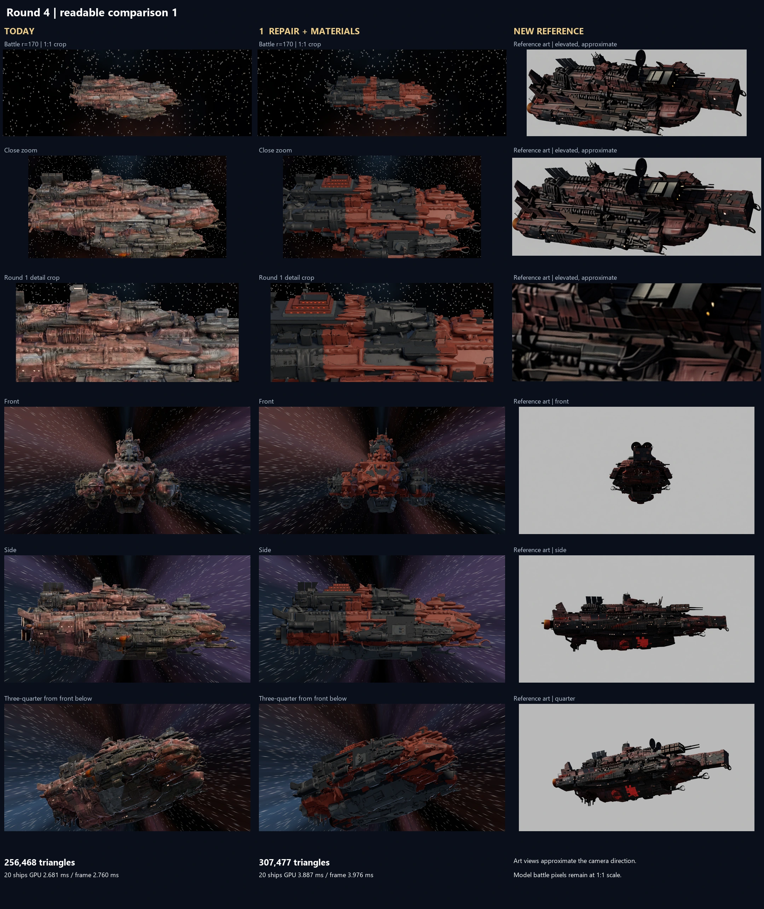

# Pyre-Barge round 4, issue 146

## What each variant is

**V1, repair plus materials:** issue 129 stage 5, retaining its 305,857-triangle repaired hull, hand-built engine, gun pair, bridge and weighted normals. The new material pass adds 1,620 triangles of thin trophy plates, tally markings and recessed running lights. It does not change the primary masses. The old projected concept paint and AI normal map are absent.

**V2, whole-ship regeneration:** one retained full-resolution, four-view Pixal3D generation at the installed 2048 shape cascade, using separate front, side, top and front-below quarter images from the refreshed reference. The untouched native GLB has 13,878,546 triangles. Native QEM decimation targets 300k without remeshing; the cleaned, painted version has 289,047 triangles including its markings and lights. A 4096 tangent normal bake carries fine donor detail. The high-pass filter subtracts blurred deviation from the flat normal, adds the flat normal back and renormalizes. It does not flatten the generated geometry. The raw display retains every generated face, with corrected outward normals, uniform scale and neutral inspection material.

**V3, hand-built from the new reference:** manually traced primary section tables, with no import or measurement of today's AI hull. The established c19 mounting and bevel conventions, round 2 primitives and two `detail_lib.py` passes supply overlapping plates, salvage patches, pipes, open rocket clusters, mounted gun pairs, articulated boarding claws, chain links, dishes, scoops, radiators, pressure cells and open engine bells. The underside includes 397 authored detail objects. Static geometry merges at export. Its 622,570 triangles are about twice V1's count.

All three use the same geometry-driven material recipe: soot and rust plate variation, faded flagship trophy colours, short-distance AO grime, curvature bounded by short-radius bevel wear, scorch, CC0 ambientCG PaintedMetal004 photo microstructure, roughness, metallic wear and emissive lights. These are unique UV bakes of procedural PBR channels. Reference art is never sampled into their paint. The colour distribution is not equally successful: V2 comes out overwhelmingly rust red; V1 still exposes large smooth fused forms; V3 separates parts more clearly but some patches remain too regular. The close material crops also show that visible weathering and photo grain are too subdued on V1 and V3. A working material graph has not yet produced the finished texture richness the brief asks for.

This resumes the cached first run as instructed. The four conditioning references and complete models were reused; an elevated comparison reference was regenerated from the selected quarter after the cached battle study drifted in its primary masses. Studio captures, actual-game captures and PR checks were run again. No shipping asset was replaced. The round 4 tools were restored from `opus/issue-146-run1`; this resume also corrects the normal proof so **both** halves exclude the extra procedural micro-normal, adds annotated references and readable game sheets, and writes the missing verdicts and report. No commit or push was made.

## Sheets and the refreshed reference

| Sheet | What to inspect |
|---|---|
| [New reference master](reference_sheet.webp) | Four conditioning views plus a derived elevated view, faction material values, feature notes and a nominal 41.6-unit scale bar |
| [All models and new reference](comparison.webp) | Today's ship and V1/V2/V3 at the same battle camera, close zoom, round 1 detail crop, front, side and front-below quarter |
| [Readable comparison 1](comparison_1.webp), [comparison 2](comparison_2.webp) | Fewer columns for inspection |
| [Actual game, all routes](ingame.webp) | Real board, HUD, ShipView and lighting, battle distance and close zoom, plus reference art |
| [Readable game 1](ingame_1.webp), [game 2](ingame_2.webp) | Today/V1 and V2/V3 alongside reference art |
| [Actual-game matched crops](ingame_crops.webp) | Battle crops at 1:1 source pixels and the same close crop for all five model routes |
| [Raw and cleanup](raw_and_cleanup.webp) | Raw generation, cleaned generation and reference at three directions |
| [Normal high-pass proof](high_pass_proof.webp) | Identical generated panel, head-on and grazing, with raw versus filtered donor normals |
| [Material crops](material_crops.webp) | A broad panel and the bow on every variant, head-on and grazing under the same lights |

The refreshed target comes from the faction pack's exact Pyre-Barge prompt and negative, anchored to renders of today's packed game ship. Local Qwen-Image-Edit-2511 with Lightning generated candidates; the multiple-angles pass supplied separate side, front and top views after earlier edits repeated the quarter camera. Those four images are the target and the generator inputs. The cached fifth, battle-angle edit kept much more of today's bulky masses. It is retained as a rejected layout study in the review folder. A new elevated view was generated from the selected quarter with explicit invariants on hull masses, parts and colours. It is comparison art made after the builds, not an additional mesh-conditioning input. All candidate prompts/histories are retained. Disconnected background artifacts were removed from the selected quarter, without retouching its hull.

Generation used local ComfyUI, not the built-in image tool or an OpenAI API. The [faction prompt set and model records](reference_references.json), [elevated-view prompt graph](reference_battle_target_prompt.json) and [its generation history](reference_battle_target_history.json) retain the exact instructions and result. The sheet helper now copies images before resizing, so arranging one panel cannot shrink the reference used by later crops or the saved source views.

These are AI reference drawings, not a consistent CAD turnaround. The target views disagree on some fittings. The elevated drawing's camera direction is approximate; it is rigidly rolled level and cropped to its ship bounds for sheet presentation, with the untouched PNG retained. See [presentation transform](reference_presentation.json). Other art columns also approximate camera direction; the four model columns use identical cameras and bounds. Battle crops retain source pixels at 1:1. The source close detail crop is `(600,340)-(1320,660)`, as in round 1. Every model fits hull plus kit to 41.6 game units. The material crops select actual outward-facing broad triangles beyond 55 percent of positive half-width near world X=0 and X=14 with the same area/distance rule. Head-on and grazing cameras use the selected surface's measured normal; exact targets are recorded in `gpu.json`. The normal-filter proof uses that same exterior V2 panel, rather than the earlier occluded centre-of-region target. Different construction means these are comparable surface stations, not the identical authored part across all three routes. Back and underside drawings were not generated; the nominal art scale bar does not claim exact dimensional agreement between views. The [prior selection](reference_selection_before_battle_refresh.json) preserves the resumed V3 build's original reference hash; the four construction/conditioning image names are unchanged.

Research #147 was read at `contrib/muse/research/ship_look_round3_2026_11/synthesis.md`. Adopted: geometry-mask materials, no projected paint, separate generator views, a reference master with values and feature notes, and explicit cleanup costs. Departures: the resumed candidate uses the installed Pixal3D checkpoint and TRELLIS.2 VAE/cascade nodes. Standalone TRELLIS.2 generator weights are absent from the local model folder, so this is **not** a standalone TRELLIS.2 comparison. Its proposed three-seed sweep was not run. V3 was already built in the cached run, before this resume could apply the proposed conditional sequencing. No new model was downloaded. The synthesis's Pixal3D licence flag remains unresolved; these are comparison prototypes, not cleared shipping assets.

## Blob sweeps against the new target

Each sheet contains nine model/reference region pairs and the verdict printed on the cell. These verdicts are newly judged against the refreshed target, rather than copied as acceptance results from the retired concept. Below views receive the same additional inspection fill on every variant; that fill is removed before frame measurements. The side drawing is only a locator for below cells.

| Variant | Top: bow / midship / stern | Side: bow / midship / stern | Below: bow / midship / stern |
|---|---|---|---|
| [V1 sweep](nine_cells_V1.webp) | Rebuild crossed prongs; fused tanks and weapon bases; ragged fittings by bridge | Rebuild rounded hunting gear; wavy flanks and pipe roots; stubs around new engine | Rebuild blended prongs; fused belly machinery; engine-root joins |
| [V2 sweep](nine_cells_V2.webp) | Rebuild fused dishes and weapons; fused machinery; torn exhaust clusters | Rebuild floating blocks and claws; wavy slab and fittings; ragged bells and fragments | Rebuild slab nose; belly bulges and blocks; lumpy engine roots |
| [V3 sweep](nine_cells_V3.webp) | Rebuild dish/scoop scale and bow mass; **clean** separate stacks and racks; **clean** service fittings | Rebuild boxy snout proportions; **clean** mounted parts and panel edges; **clean** bells and manifolds | **Clean** flat armour and separate pipes; **clean** seams and radiators; **clean** engine ribs |

V1 and V2 have no complete clean cell. V3 has seven clean construction cells, with two bow cells still needing work to match the reference. A clean underside cell means the visible model construction is distinct and mounted; hidden reference correspondence is unproven. V3's authored weapon directions and recorded mount contacts pass the numerical checks. The inherited source weapons in V1 and generated weapons in V2 have not all earned that approval. No variant passes the full nine-cell gate, and the shipping queue is not marked complete. Machine-readable verdicts are in [blob_sweeps.json](blob_sweeps.json).

## Counts and frame figures

<!-- performance-start -->
| Model | Triangles per ship | 20 ships GPU ms | Frame median ms | Frame p99 ms |
|---|---:|---:|---:|---:|
| Today | 256,468 | 2.681 | 2.760 | 3.296 |
| V1: repair and materials | 307,477 | 3.887 | 3.976 | 4.683 |
| Raw generation | 13,878,546 | 40.001 | 40.199 | 40.758 |
| V2: regenerated and baked | 289,047 | 3.046 | 3.133 | 3.702 |
| V3: hand-built | 622,570 | 5.250 | 5.523 | 6.071 |
<!-- performance-end -->

Measured on the RTX 5080 with Godot 4.7.2 Forward+, 1920x1080, MSAA 4x, the same G4 studio lights, disabled vsync and compressed mipmapped maps. Every case warms for 100 frames and measures 360. Twenty non-overlapping ships share one mesh and map set in a 5 by 4 layout. These are isolated rendering figures, not full-battle frame rates, a 4K result or a memory test of twenty different assets. Actual-game screenshots are separate. Single-ship, empty-scene, render CPU and draw-call measurements are retained in [gpu.json](gpu.json).

The retained generation plus native cleanup/bake graph ran in 178.5 seconds. Final Blender material/build/export passes took 33.5 seconds for V1, 71.1 for V2 and 50.0 for V3. These are machine execution times, not authoring hours. The high-pass normal's low-frequency RMS deviation falls from 0.1330 to 0.0621, a 53 percent reduction. Its mean normal Z is 0.9546. The grazing proof still exposes the underlying generated surface; a filtered map cannot fix that geometry.

## Hours to roll out to one mid-size mechanical hull

These are planning estimates for focused human/agent work once the tools and useful faction kit exist, not measured production throughput. Script design, reference review, retries, mounting, materials and screenshot corrections count as work; a 50-second build does not make this a one-minute asset.

| Route | Repeatable comparison pass | Estimate to reach nine clean cells | Main cost |
|---|---|---|---|
| V1 | 3 to 6 hours on an already repaired stage 5 hull | 10 to 16 hours from today's source | Keep the useful source, replace remaining fused regions, improve material separation and match new bow features |
| V2 | 4 to 8 hours for one generated candidate, cleanup, bake and review | 10 to 18 hours | Generation is quick; new fused parts and waves need the same repair and fitting work again |
| V3 | 12 to 20 hours | 16 to 24 hours | Trace primary masses, place dense authored parts, tune the bow and materials, then correct captures |

These ranges exclude a new fleet-wide trim/decal library, damage breakup, rotating turret integration and first-time organic faction tooling. They should not be multiplied across all 36 hulls as a committed schedule.

## Pick and validation

**My visual pick is V3 as the next working base for this flagship.** Separate machinery, mounted weapons and readable panel edges survive close zoom, and the new palette reads at battle distance. It still needs a heavier, less boxy bow with larger hunting gear, less regular trophy/patch placement and a stronger match to the reference masses. Its extra 1.4 ms of isolated 20-ship GPU time over V1 is a real cost. This does not make it the fleet default or a finished replacement.

V1 is the cheaper repair route and keeps today's recognisable bulk, but paint alone leaves the fused forms exposed. V2's cleaned draw cost is attractive, but the retained full-ship generation invents detached shapes and fused machinery, and its nearly uniform red distribution fails the soot-and-rust balance. I would not spend another seed merely hoping those problems disappear. Keep today's shipping asset while the owner reviews these sheets.

Checks: all 25 standing checks pass via `node contrib/opus/tools/run_all_checks.js`, run by the restored checks wrapper with Node 22.11.0. The findings suite reports its known baseline failures with no unexpected failures. Headless Godot parity passes all 54 scenarios, three 10,000-draw PRNG cases, math, three threat maps, threads and the hard stop. The experiment verifier checks export/reimport triangle counts and GLB hashes, capture sizes, GPU adapter, route differences, generation bounds, high-pass measurements, authored gun axes and mount contacts, 41.6-unit length and unchanged shipping scene/map hashes. Final results are in [checks.json](checks.json), [verification.json](verification.json), [build records](builds.json) and [config/provenance](config.json). The full parity transcript is saved in the issue review folder; scratch logs and test fixtures stay in TEMP.

The full sheets, this report, all source PNGs, reference candidates/prompts/histories, records, the native generation and four display GLBs are also saved in `C:\Users\rcbai\Downloads\voidsworn_test\board\issue-146\shots`. The double-click runner is [RUN_PYRE_ROUND4.bat](../../../../tools/blender/hull_repair/RUN_PYRE_ROUND4.bat); its phase instructions are in [ROUND4.md](../../../../tools/blender/hull_repair/ROUND4.md).

Not checked or not completed: the standalone TRELLIS.2 and three-seed comparison, back/underside reference generation, full cleanup of failed cells, damage breakup, rotating turrets, multiple maps, 4K performance, distinct-fleet memory and final owner approval. The one-hour resume prioritises the cached three-route evidence and an honest report. No shipping integration, commit or push was performed.
