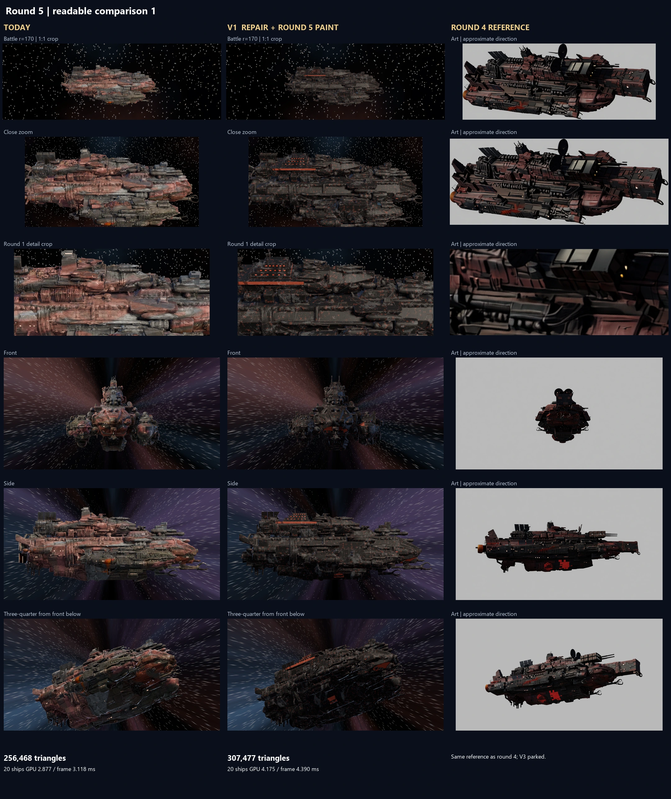

# Pyre-Barge round 5, issue 163

Repaints V1 and V2 with a soot-black coat, patchy rust and limited red trim. Both reuse the round 4 geometry. V1 retains the cached stage 5 repair; V2 imports the retained native low mesh and donor normal without regeneration or remeshing. Triangle-coordinate fingerprints across every exported primitive match round 4. V3 stays parked. No shipping asset was replaced, and no commit or push was made.

**My pick is V1 for the next repair pass.** Its authored engine, gun pair and bridge are useful working parts. V2 still has detached blocks, fused machinery and a slab-like bow. Neither is a finished replacement: both have zero completely clean construction cells, and V1's fresh timing is above the nominal R96 GPU ceiling. Keep today's shipping ship.

The new recipe assigns soot shades to connected surface regions instead of old UV bands or large coordinate blocks. Small bounded regions become trim plates; existing lamps and engine throats alone emit light. Rust breaks up the coat within plates and along real edges. Geometry AO supplies recess grime, bounded convex wear follows real edges, and scorch uses a separate broad field. Grayscale CC0 PaintedMetal004 scratches, displacement and roughness add material detail. Photo repetition is reduced to survive the bake, and V1 packs its UVs more tightly at the same 4K resolution. V2 keeps its native UVs. No concept pixels, projected lighting or AI albedo enter the paint. Roughness remains 0.61 to 0.88; coated metalness is 0.07, rising toward 0.76 on worn edges.

**Screenshots and records**

| Evidence | What to inspect |
|---|---|
| [Full comparison](comparison.webp), [readable V1](comparison_1.webp), [readable V1/V2](comparison_2.webp) | Today, V1, V2 and the unchanged round 4 reference; battle r=170 at 1:1 pixels, close, round 1 detail crop, front, side and front-below quarter |
| [Actual game](ingame.webp), [matched game crops](ingame_crops.webp) | Real board, HUD, ShipView and G4 lighting at battle and close distance |
| [Material crops](material_crops.webp), [round 4 versus round 5](material_change.webp) | Actual exterior panel and bow, head-on and grazing, with the same surface-selection rule as round 4 |
| [Colour balance](colour_balance.webp), [numbers and method](colour_balance.json) | Common colour bins, brightness, round 4 baseline and projected emitting area |
| [Reference master](reference_sheet.webp) | Round 4 target copied unchanged, including palette and material values |
| [V1 sweep](nine_cells_V1.webp), [V2 sweep](nine_cells_V2.webp) | All nine construction cells against the same reference |
| [Build records](builds.json), [integrity checks](verification.json), [PR checks](checks.json), [provenance](config.json) | Counts, hashes, cached mesh source, GPU, export/reimport and unchanged shipping inputs |

**Colour measurement**

The same fixed sRGB anchors and warm-hue gate classify every image. Neutral steel and faded trophy colours join the dark bin. The art's bright-red bin estimates visible light; separate emission masks measure actual emitting texels on V1/V2. The reference is rolled with the unchanged round 4 transform and scaled to V1's projected width, preserving aspect. Model and art use the same crop rectangles and ship-only masks. The art's lighting and camera direction remain approximate. A match here means every colour share is within 10 percentage points; median luma is reported too, so bright neutral paint cannot hide behind a dark-bin label. Full masks and classified PNGs are retained in the issue folder.

<!-- colour-start -->
| Crop | Model | Dark/neutral % | Rust % | Red trim % | Bright red % | Emitting area % | Median luma /255 |
|---|---|---:|---:|---:|---:|---:|---:|
| battle | reference | 85.41 | 13.62 | 0.97 | 0.00 | n/a | 30.07 |
| battle | V1 | 94.76 | 4.67 | 0.53 | 0.05 | 0.373 | 41.63 |
| battle | V2 | 89.49 | 9.99 | 0.52 | 0.00 | 0.468 | 44.26 |
| close | reference | 85.52 | 13.54 | 0.94 | 0.01 | n/a | 28.43 |
| close | V1 | 92.66 | 6.32 | 0.91 | 0.11 | 0.218 | 39.62 |
| close | V2 | 90.76 | 8.57 | 0.66 | 0.01 | 0.189 | 40.48 |

Largest colour gap: 9.35 percentage points. All bins within 10 points: True. Median brightness within 15 levels: True.
<!-- colour-end -->

Three recipes were baked. The first two still spread too much warm rust into the battle view. The retained recipe reduces rust coverage and coat brightness, and improves V1's UV allocation. Draft captures and measurements are retained in the issue folder and remeasured with the final common classifier.

The retained colours meet the chosen 10-point band, with V1 now on its soot-heavy edge: battle rust is about 9 points below the reference. This is a useful calibration, not an exact paint match. Median brightness is still about 11 to 14 levels above the art under the fixed G4 lights.

The close crops now show photo scratches, chipped rust and dark recesses. V1's sampled panel triangle grows from about 670 to 10,525 texture pixels without raising the 4K map size. Its extreme material crop remains visibly texel-limited, and V2's grain still follows a ragged generated surface. Neither result should be called finished texture richness merely because the colour bins pass.

**Counts and performance**

<!-- performance-start -->
| Model | Triangles | 20 ships GPU ms | Frame median ms | Frame p99 ms |
|---|---:|---:|---:|---:|
| today | 256,468 | 2.877 | 3.118 | 3.210 |
| V1 | 307,477 | 4.175 | 4.390 | 4.675 |
| V2 | 289,047 | 3.248 | 3.476 | 3.620 |
<!-- performance-end -->

V1 remains 307,477 triangles, including round 4's existing 1,620 marking/light triangles. This is 1,477 above the rounded 306k reference, with zero added in this job. V2 remains 289,047. The fresh V1 GPU result exceeds 3.9 ms; the contemporaneous round 4 V1 control does too. This test does not clear V1's current performance gate. V2 remains below the GPU ceiling.

The [paired test](paired_gpu.json) alternates old and new materials three times on each unchanged mesh. It separates paint cost from the difference between this session and the old 3.887 ms measurement.

V1's paired median rises by 0.053 ms, about 1.3 percent, with overlapping run ranges. V2 is effectively flat, differing by 0.001 ms. Both old and new V1 are above 3.9 ms in this session.

<!-- paired-start -->
| Material on unchanged mesh | GPU median of 3 runs, ms | GPU range, ms | Frame median of 3, ms |
|---|---:|---:|---:|
| R4V1 | 4.234 | 4.081 to 4.239 | 4.511 |
| V1 | 4.287 | 4.152 to 4.307 | 4.531 |
| R4V2 | 3.216 | 3.208 to 3.246 | 3.447 |
| V2 | 3.215 | 3.208 to 3.232 | 3.444 |
<!-- paired-end -->

RTX 5080, Godot 4.7.2 Forward+, 1920x1080, 4x MSAA, disabled vsync, compressed mipmapped maps, 100 warm-up frames and 360 measured frames per case. Twenty ships share one mesh/map set in the same 5 by 4 layout as round 4. These are isolated rendering figures; actual-game screenshots are separate. Main-run and all paired timings are retained, including above-ceiling results.

**Nine-cell re-score**

| Variant | Top: bow / midship / stern | Side: bow / midship / stern | Below: bow / midship / stern |
|---|---|---|---|
| V1 | Rebuild crossed prongs; fused cylinders and weapon roots; ragged fittings beside the new bridge | Rebuild rounded hunting gear; torn panels and fused mounts; old stubs around clean engine bells | Rebuild blended prongs; fused belly machinery; blended engine roots |
| V2 | Rebuild indistinct dishes/weapons; fused deck machinery; fragmented exhaust cluster | Rebuild floating blocks/claws; wavy slab and merged equipment; torn bells and hanging fragments | Rebuild slab nose; fused belly blocks; lumpy engine roots |

Both score **0/9 clean**, unchanged from round 4 after a fresh region review. V1's authored replacements remain distinct, but the surrounding old mesh fails their cells. Paint makes surfaces easier to distinguish; it does not separate fused parts or repair torn geometry. Below views receive the same inspection fill, removed before timing. No underside reference exists, so below verdicts judge construction, with side art only as a locator. Machine-readable verdicts are in [blob_sweeps.json](blob_sweeps.json). The shipping queue is unchanged.

**Files and validation**

New files under `tools/blender/hull_repair/`: `round5_material.py` and `round5_build.py` for the recipe and assignment; `round5_probe.gd` and `round5_bench.gd` for captures, masks and paired timings; `round5_sheets.py` for measurements, verification and sheets; `round5_run.py`, `RUN_PYRE_ROUND5.bat` and `ROUND5.md` for the cached runner. Results and this report are under `docs/shots/ship_pipeline/pyre_round5/`.

Standing checks run through `node contrib/opus/tools/run_all_checks.js`: 26 pass, with no unexpected findings-suite failures. Headless Godot parity passes 56 scenarios, three 10,000-draw PRNG cases, math, three threat maps, threads and the hard stop. Export/reimport counts, all-primitive triangle fingerprints, source/recipe hashes, capture dimensions, authored V1 gun axes and contacts, 41.6-unit bounds and shipping scene/map hashes are checked. Python parsing and the no-em-dash check are also run. Final machine-readable results are linked above.

All linked evidence, full PNGs, masks, final GLBs, selected drafts and the parity transcript are also saved under `C:\Users\rcbai\Downloads\voidsworn_test\board\issue-163\shots`. Scratch bakes, import caches, saves and logs stay in TEMP. Double-click `tools\blender\hull_repair\RUN_PYRE_ROUND5.bat` to repeat using the retained round 4 cache.

Not checked or completed: new geometry cleanup, V3, V2 regeneration, shipping integration, multiple maps, 4K performance or distinct-fleet memory. Those were outside this paint-only job. Final texture richness still needs Ryan's screenshot judgement; the colour measurement alone is not visual approval.
