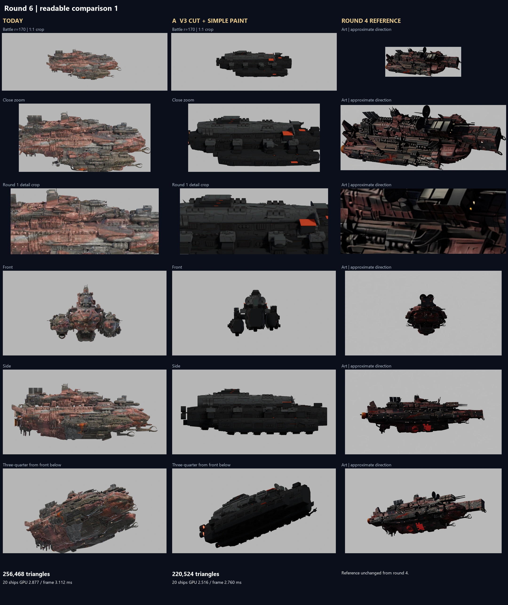

# Pyre-Barge round 6, issue 187

**My pick is V3 as the next working hull. Both paints still fail the full readability test.** Cutting tiny and repeated fittings preserves V3's separate construction at 220,524 triangles, down from round 4's 622,570, inside the performance ceiling. Both variants receive the same simple geometry-driven paint. V1 keeps every round 4 triangle. No shipping asset is replaced. No commit or push is made.

| Evidence | What to inspect |
|---|---|
| [Full comparison](comparison.webp), [V3 page](comparison_1.webp), [V1 page](comparison_2.webp) | Today, both variants and the unchanged round 4 reference; battle r=170 at 1:1, close, round 1 detail crop, front, side and front-below quarter |
| [Actual game](ingame.webp), [matched game crops](ingame_crops.webp) | Real board, HUD, ShipView and G4 lights, at battle and close distance |
| [Blurred greyscale test](value_structure.webp), [4K record](value_structure_4k.webp) | Each variant beside its equal-width reference, before and after the standard's blur |
| [V3 sweep](nine_cells_V3.webp), [V1 sweep](nine_cells_V1.webp), [V3 clay](nine_cells_V3_clay.webp), [V1 clay](nine_cells_V1_clay.webp) | Nine model/reference region pairs, paint and neutral construction inspection |
| [Material crops](material_crops.webp), [reference master](reference_sheet.webp) | Broad panel and bow at head-on and grazing angles; unchanged target |
| [Builds and full removal list](builds.json), [GPU records](gpu.json), [material import](game_material_import.json), [integrity](verification.json), [PR checks](checks.json), [provenance](config.json) | Counts, hashes, contacts, axes, cameras and unchanged shipping inputs |
| [Colour measures](colour_balance.json), [4K colour measures](colour_balance_4k.json), [blur measures](value_structure.json) | The unchanged round 5 classifier, median brightness and descriptive blur statistics |

V3 replays the original `round4_hand.py` construction to recover named parts before they merge. Before the cut and markings it matches the old build's 620,950 triangles. Whole-object removal targets the second scatter pass, fittings smaller than half a game unit, long pipes whose diameter is below that size, and sub-pixel weld/rivet rows. No collapse decimator runs. Large plates, all primary masses, open bells, rocket racks, guns, dishes, scoops, claws and chains remain. The marked export contains 402,046 fewer triangles, a 64.6 percent reduction. Static geometry merges into one export. The retained V3 has no authored internal decks to trim; this pass does not invent or claim damage interiors.

| Removed group | Objects | Triangles |
|---|---:|---:|
| Second detail scatter | 556 | 112,740 |
| Fittings below half a game unit | 629 | 113,470 |
| Thin pipes and unions | 342 | 81,576 |
| Weld bead and rivet rows | 240 | 94,260 |

The paint uses three coat values, AO inside actual recesses, and narrow rust on real edges. Small V3 fittings inherit their nearest hull surface's tone; small V1 surface patches inherit a nearby major plane. Red stays on trim plates and markings. Tiny running lamps become non-emitting trim; only the stern engine banks emit. Photo grain, procedural mottling, interior rust speckle, broad scorch and donor normals are absent. No concept art or generated albedo enters the paint. All four PBR maps bake to unique UVs at 4K and load with compressed mipmaps. The soot coat uses a weak dielectric reflection, exported through glTF's specular material extension and recorded again after Godot imports it. Close material crops are judged separately; the intentionally simple recipe does not claim finished close-range material richness.

**Prototype import note:** this runtime GLB path loaded the coat at specular 0.5 even though the file exported `KHR_materials_specular.specularFactor = 0.24`, equivalent to the authored coat level of 0.12. The private studio and game adapters apply 0.12 to the prototypes after import; today's ship retains its own materials. Both raw and applied values are recorded and verified. Lighting, camera and game source stay unchanged. Direct GLB import without this material setting will look different; any later shipping conversion must carry the setting too.

The [readable-paint standard](https://github.com/rcbailey12/voidsworn/blob/main/contrib/muse/research/readable_paint_2026_11/synthesis.md) merged during this run as PR #191. Its full synthesis and the R105 adoption were read from main. The comparison applies its three-tone limit, large-zone inheritance, geometry-bound wear, sparse trim, 1080p judgement and exact blur procedure. The binding battle crops stay at native pixels. Rec.709 greyscale is blurred at sigma 7.5 pixels; actual 3840x2160 captures use sigma 15. Art keeps the round 4 roll/crop and is resized to each model's projected width with aspect preserved. A neutral background replaces the sky and art backdrop. Exposure and histograms are not matched. The art's camera and painted lighting remain approximate.

<!-- value-start -->
| Binding 1080p measure | V3 | V1 | Reference |
|---|---:|---:|---:|
| Median luma /255 | 26.14 | 25.35 | 30.20 / 30.07 |
| Difference from its reference | -4.06 | -4.72 | 0 |
| Classified rust % | 0.33 | 0.22 | 13.66 / 13.62 |
| Classified red trim % | 1.03 | 0.10 | 0.96 / 0.97 |

Both meet S10's preferred median band of five levels and S8's two-percent trim maximum. V3 lands near the one-percent trim target. Both miss S6's 5 to 15 percent rust working band: this run keeps the brief's edge-only rust instead of adding large rust fields. These appearance bins use the unchanged round 5 classifier, not semantic material IDs.

My blur verdict is **FAIL for both**. V3 removes the noisy patchwork, and its upper mass and side pods remain distinct, but the upper value becomes one long band. The bow and rear fitting breaks are weaker than the reference's separate value clusters. V1 loses still more separation: fused gear merges into the dark hull. Under S12 that is a geometry failure first. Neither result earns every required large-area and form-break condition merely by passing median brightness. Close crops remain plain beside the art. [readability_review.json](readability_review.json) records these judgements separately from automated evidence integrity.
<!-- value-end -->

<!-- performance-start -->
| Model | Triangles | 20 ships GPU ms | Frame median ms | Frame p99 ms |
|---|---:|---:|---:|---:|
| today | 256,468 | 2.877 | 3.112 | 3.299 |
| V3 | 220,524 | 2.516 | 2.760 | 3.091 |
| V1 | 307,477 | 4.172 | 4.381 | 4.704 |
<!-- performance-end -->

RTX 5080, Godot 4.7.2 Forward+, 1920x1080, 4x MSAA, disabled vsync, compressed mipmapped maps, 100 warm-up frames and 360 measured frames. The same twenty shared ships occupy the round 4 5 by 4 layout. These are isolated rendering figures, not full-battle frame rates. The 4K captures are a visual record only. Above-ceiling results remain in the records.

| Variant | Top: bow / midship / stern | Side: bow / midship / stern | Below: bow / midship / stern |
|---|---|---|---|
| V3 | Rebuild dish/scoop scale and blunt bow; clean racks and chains; clean service fittings | Rebuild boxy snout; clean mounts and plate stacks; clean bells and banks | Clean forward armour; clean covers and chines; clean belly housings |
| V1 | Rebuild merged prongs; fused tanks and weapon roots; ragged fittings by bridge | Rebuild rounded gear; torn panels and fused mounts; old engine stubs | Rebuild blended prongs; fused belly machinery; blended engine roots |

V3 retains **7/9 clean construction cells**. Its two bow cells still miss the reference's massing and equipment scale. V1 remains **0/9 clean**; the clearer coat exposes the fused geometry rather than repairing it. The latest standard's seven-cell paint sign-off floor does not waive the pipeline's full nine-cell shipping gate. The neutral clay sheets expose construction hidden by the dark coat and are judged alongside the paint sheets. Below views use the same inspection fill, removed before timing, with side art as a locator only. Authored mount contacts and gun axes pass numerical checks; those checks cover the recorded mounts and authored weapons, not every inherited V1 fitting.

New tools are `round6_build.py`, `round6_material.py`, `round6_probe.gd`, `round6_game.gd`, `round6_sheets.py`, `round6_run.py`, `RUN_PYRE_ROUND6.bat` and `ROUND6.md` under `tools/blender/hull_repair/`. Results and this report live under `docs/shots/ship_pipeline/pyre_round6/`. Double-click `tools\blender\hull_repair\RUN_PYRE_ROUND6.bat` in this checkout to reproduce the cached comparison; `ROUND6.md` in that folder explains the phases.

<!-- checks-start -->
PR checks run through `node contrib/opus/tools/run_all_checks.js`: **26 pass**, with no unexpected findings-suite failures. Headless Godot parity passes **56 scenarios**, three 10,000-draw PRNG cases, math, three threat maps, threads and the hard stop. Both complete PR-check runs passed. Later material-only calibration reused those results on the unchanged game and test code.

The final evidence verifier passes export/reimport counts, V1 all-primitive triangle fingerprints, source and map hashes, reference identity, authored gun axes and mount contacts, 41.6-unit bounds, 1080p/4K image sizes, actual imported material values in studio and game, capture-script hashes and unchanged shipping inputs. Python parsing, new-script Godot parsing and the no-em-dash/whitespace checks pass. Final frame figures are in the table above; V1 fails both the strict 306,000-triangle check and the 3.9 ms ceiling. Integrity PASS does not mean visual approval.
<!-- checks-end -->

All linked sheets and records, full studio/game/4K PNGs, silhouette and emission masks, reference images, final GLBs and the parity transcript are also saved under `C:\Users\rcbai\Downloads\voidsworn_test\board\issue-187\shots`. Logs, bakes, working files and private imports/saves stay in TEMP.

Effort: this cached comparison completed in **one Codex run; one Ryan screenshot review round is pending**. That scope is supported by the board's cached resumes for issue 146 (02:37 to 03:20 CST) and issue 163 (15:28 to 16:25 CST), both of which delivered comparison evidence after earlier stopped work. Here the drivers are two variants, repeated material bakes after the import fix, camera captures and two full PR-check runs. A bow repair and breakable-ship integration are separate work after Ryan chooses a hull; this report does not turn the old human-hour estimates into a fleet schedule.

Not checked or completed: shipping integration, bow redesign, authored break pieces/interiors/damage textures, rotating turrets, multiple maps, 4K timing, distinct-fleet memory or finished close-range paint. R98 and R99 interiors remain a next-hull task after selection, rather than being added to this comparison. Today's shipping ship stays in place for Ryan's review.
