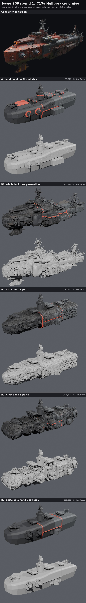

# Issue 209 round 1: build-route comparison on the C15s Hullbreaker cruiser

**Round 2 is in [round2/README.md](round2/README.md).** Found there: this round's B0 sat about 20 degrees off the ship axis (the turn was silently dropped on import), which also smeared the station table Arm A was lofted from.

**Pick: B3 (generated parts on a hand-built core) climbs the ladder next, with Arm A beside it.** Sectioned generation (B1, B2) came back as generic crates that do not join into one hull, and the whole-hull control (B0) carries the concept's naval tells and melted surfaces. Ryan judges the sheets; there are no pass bars.

| Sheet | What to look at |
|---|---|
| [overview.jpg](overview.jpg) | The concept, then every cell at the concept's angle, paint and clay |
| [battle.jpg](battle.jpg) | Battle distance: 1:1 crop at about 180 px of ship, 2x zoom, blurred greyscale |
| [close_top.jpg](close_top.jpg), [close_side.jpg](close_side.jpg), [close_below.jpg](close_below.jpg) | The nine cells (bow, midship, stern from top, side and below), paint row then clay row per cell |
| [break.jpg](break.jpg) | The four break pieces pulled apart, from the bow quarter and the stern quarter |
| [refs.jpg](refs.jpg) | The image references (Qwen-Image-Edit) and every input image the generator got |
| [design_c15s.md](design_c15s.md) | The subject, its station table, hard points, break lines and paint |

## The cells

All five cells share the same subject, hard points, break structure (two cross lines, one lengthwise, skin, bulkheads, rim bands, decks), paint (round 6 recipe, PR #196), lights, exposure and cameras. Only the build route changes.

| Cell | Route | Generated | Hand-built |
|---|---|---|---|
| A | hand build on AI massing underlay | nothing in the model (the B0 mesh and the Qwen views were measured for the station table) | hull loft, every part, modest detail (big plates, a few fittings) |
| B0 | whole hull, one TRELLIS.2 generation (the control) | everything | nothing |
| B1 | 3 bare sections + parts | 3 sections, 5 part types | tower, sensor array, radiators |
| B2 | 6 bare sections + parts | 6 sections, 5 part types | tower, sensor array, radiators, 3 seam collars |
| B3 | parts on a hand-built core | 5 part types | Arm A's hull loft without its detail, tower, sensor array, radiators |

Generator: TRELLIS.2 4B (local, free), 1536 cascade where it fit in memory, texture off. Arm B sits at one scale: 300,000 generated triangles per unit of ship length for hull, 12,000 to 25,000 per part. Arm A is the first rung of its ladder (modest detail).

## Numbers per cell

| Cell | Triangles | Of which hull skin | Draw calls (merged = surfaces) | Generated pieces placed | Parts off the hull | Parts across a break line | Section ragged, line 1 / line 2 |
|---|---:|---:|---:|---|---:|---|---|
| A | 95,570 | 11,040 | 6 | none | 0 | 0 | 0.015 / 0.015 |
| B0 | 1,113,172 | 810,381 | 5 | 1 (whole hull) | 0 | 0 | 0.041 / 0.042 |
| B1 | 1,462,450 | 960,668 | 5 | 14 (3 sections, 11 parts) | 0 | 0 | 0.012 / 0.013 |
| B2 | 1,536,166 | 1,032,474 | 5 | 17 (6 sections, 11 parts) | 0 | 2 (seam collars cross the lengthwise line) | 0.034 / 0.012 |
| B3 | 223,862 | 11,040 | 5 | 11 (parts) | 0 | 0 | 0.015 / 0.015 |

Per-cell records (audit, break fit, every generation with its raw and final triangle count and stretch): `cells/*.json`. A has one more surface than the B cells because its hand-built engine bells carry the glow material; the generated stern block has its own nozzles and no glow discs.

Triangles include the hull skin (thickness), bulkheads, decks and rim bands. Draw calls are for the cell exported as one merged mesh, one surface per material. "Section ragged" is how jagged the hull's own cross-section is where the break line cuts it (the 90th percentile radius jump between neighbouring rays, ship units; lower is cleaner).

Not measured this round: the protocol-scene cost (twenty copies) and the R116 gate deltas. The cells have no game export yet; round 2 adds the Godot import with the level-of-detail work the board added to this issue (Nov 8 addendum).

## What each cell showed

- **A (hand build).** Clean and light: the hull loft is about 11,000 triangles (22,000 with its skin), the parts about 67,000. The cleanest break pieces of any cell: bulkheads match the loft, rim bands run unbroken. Up close it reads plain, close to a toy: rung 1's detail (big plates, a few fittings) is too thin, and the concept's character (rust-red hull, clutter, junk) is not there under the round 6 coat. At battle distance it has the clearest light-and-dark structure in the blur, but the red glacis plate is the loudest thing on the ship (red trim used on too big an area).
- **B0 (whole hull, control).** Closest to the concept's mass and clutter, but it keeps every naval tell (two lattice masts with stays, the chin fin), lumpy melted surfaces and a lopsided hull. Its break sections are the most ragged (0.04). Giving a generated hull real thickness nearly quadruples its cost (300,000 to 1.1 million triangles), because the generated surface is full of open edges and the skin adds a rim along every one.
- **B1 (3 sections + parts).** The bow section kept the concept's prow and one of its casemates; the midship and stern sections came back as generic octagonal crates, because the image redraw step (Qwen) made "a section module" and dropped the concept's features. The three sections do not share an outline or surface language, and the bow's own casemate doubles up with the added casemate part. The joints sit on the break lines, so the rim bands hide them well.
- **B2 (6 sections + parts).** Six small modules read as a string of different pods, not one hull. The bow came back as a rounded capsule. Every joint needs a collar, and the rim bands vanish into the lumpy surfaces. The most triangles of any cell.
- **B3 (parts on a hand-built core).** The generated parts are the best generated content in the round: the casemates, drum racks and bow guns read crisp and on-model up close and sit cleanly on their mounts. Two parts failed: the cargo container came back as thin open panels, and the stern block is a cluttered engine cluster. The hand core is clean but plain (the same plain hull as A without A's plates). Light (224,000 triangles) with clean break pieces.
- **The granularity hypothesis** (#193 Supplement 2: 2 to 3 bare sections plus parts) is not supported by this round: sections made from the concept do not come back bare or consistent with each other, and more sections made it worse. Parts did work. One open question: B1 and B2 used Qwen redraws of the concept crops as inputs; generating straight from the raw crops was cut for GPU time.
- **For #193 (Tripo per part):** the part-level use is the one that held up here, so #193's per-part question stays live; its section-level premise weakens.
- **Paint.** The round 6 coat is the same on every cell. On the hand-built hulls it reads as flat grey with red trim; on the generated hulls it reads darker and busier because their lumps catch the cavity shading. None of the cells look like the concept's rust-red Hullbreaker; that is a paint job (#198), not a build-route result.

## Effort in agent terms

Counted from this run's own logs (Nov 8 to 9, 23:37 to about 02:10 UTC), not estimated.

| Step | Runs | Unattended time on the PC | Notes |
|---|---:|---|---|
| Qwen-Image-Edit references and redraws | 1 | 18 min | 36 images (4 reference views, 9 section and 5 part redraws, 2 seeds each); inputs picked by eye |
| TRELLIS.2 generations | 6 passes | about 1 h 47 min of GPU time | 14 new meshes, 3 to 4 min each when they worked; B0 reused from the Oct 26 fleet bake. Lost to failures: two process crashes, out of GPU memory on the drum rack and the stern block at both resolutions (both made later at 1024 with a lower cap in a fresh process, the stern block from its second seed), and one pass where system memory ran out and all six B2 sections failed (rerun one process per section) |
| Cell builds | 1 | A 9 s, B0 9 s, B1 107 s, B2 145 s, B3 95 s | |
| Renders | 1 | about 1.5 min a cell | 11 shots per cell on the 5080 |

- Arm A authoring: about 8 build iterations in the cloud sandbox (10 to 15 s each) and 3 preview renders; no GPU generation of its own.
- Arm B assembly cleanup: 5 per-generation turn fixes found by eye (the casemate took two tries), 3 placement rules written (bow section nose forward; other sections laid lengthwise or crosswise, whichever squashes them least; parts seated on each cell's own deck and flank), 2 hand-built fallbacks written in case a part never generated (not needed in the end).
- Owner review: this sheet set is the first round.

## What round 2 should climb

**My pick: climb B3 and A one rung each (about double the detail), and stop B1 and B2 here.** B3 keeps the generated parts that worked and puts them on a hull that breaks cleanly and costs little; A is the reference for how far hand detail alone goes. Round 2 also carries the board's Nov 8 addendum: Godot import, automatic LOD on and off, the twenty-copy protocol scene and the R116 gate deltas, so the first cost numbers in ms land with the next sheets. B0 stays as the control image only.

## Files

- Tools: `tools/blender/r209/` (README there). Generation scripts and job files: `gen/` here.
- PC working folder: `Downloads\voidsworn_test\opus209\` (generations in `gen\3d\`, blends and full-size renders in `out\cells\`).
