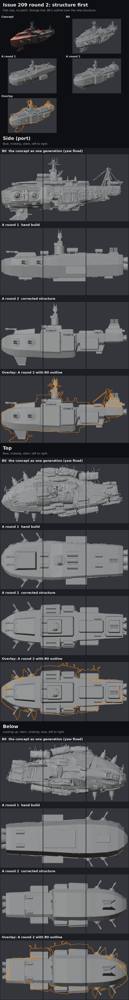

# Issue 209 round 2: structure first, then one detail rung, a bake cell and the Godot costs

**Pick for round 3: climb Ab (the corrected hand-built hull and hand parts, with the generated hull's surface detail baked into normal and AO maps), add a hand-made LOD chain at its top rung, and stop B3.** Ab carries the concept's structure and a lot of B0's surface variety for 41,000 triangles; twenty copies cost 0.68 ms of GPU at 4K. B3's generated parts look best up close, but they made the ship about 4 times A2's triangles and 3 times its GPU cost, and Godot's automatic LOD cannot simplify them at all.

Ryan's round 1 note (FINDINGS R140): "the hand built shape doesn't actually fully align. There's so much less variety in the shape and structure of it, so it's not just adding but almost removal." Round 2 fixed the structure first and showed it before any detail.

## Root cause found on the way: B0 was turned the wrong way in round 1

Round 1 meant to turn the whole-hull generation (B0) about 20 degrees so its long axis lay along the ship's axis. The turn was silently dropped (Blender's glTF import uses quaternion rotation, and the script set the Euler angle), so B0 sat about 20 degrees off the axis. Everything measured from it in round 1 was smeared: the station table that Arm A's hull was lofted from averaged the bow, the side blocks and the stern into one smooth tube. That is a big part of why A came out plain. Fixed in `tools/blender/r209/common.py` (the mesh itself is turned now); the yaw that lines B0 up best is 22 degrees. Round 1's B0 sheets show the skewed ship; round 2's B0 is the corrected one.

## 1. Structure compare (the first deliverable)

[structure.jpg](structure.jpg): flat clay, no paint, the concept and the nine fixed views (bow, midship, stern from the top, side and below) for B0 (corrected), round 1's A and round 2's structure, plus an overlay row with B0's outline in orange over the new structure.

What the new structure carries, traced block by block from the corrected B0 and the concept:

| Concept feature | Round 1 | Round 2 structure |
|---|---|---|
| Deep, blunt bow block | one smooth loft, shallow | deep bow (belly 0.17 below the deck line), blunt rounded nose |
| Raised glacis with the twin bow guns | low plate | raised centre deck, sloped front face, guns on its front |
| Tall dark side block at midship | none | tall sponsons each side, top above the bow deck, rounded leading edge |
| Lower module blocks behind it | none | lower module blocks each side, a step down from the sponsons |
| Tiered superstructure | tower on a flat deck | deckhouse tier, upper tier, tower, bridge, sensor array |
| Low aft body | same height as the bow | lower aft deck with a dorsal spine |
| Dark underside spines | none | twin ventral rails with the channel between them |
| Flank cargo blocks | one box | module blocks on both flanks, deeper |
| Stacked stern modules | none | full-width lower stern block and a raised upper module (radiators on top) |
| Chin fin | cut | twin canted ventral fins with sensor pods (two fins, no keel line) |
| Lattice masts, railings | sensor array, radiators | same (naval tells stay out) |

The overlay shows the remaining differences: B0's fin hangs further forward and deeper, its masts and railings stand above the deck (dropped on purpose), and B0 is lopsided (its bow leans to port) while the hand build is symmetric.

## 2. The sheets

| Sheet | What to look at |
|---|---|
| [overview.jpg](overview.jpg) | The concept, then every cell at the concept's angle, paint and clay |
| [battle.jpg](battle.jpg) | Battle distance: 1:1 at about 180 px of ship, 2x, blurred greyscale |
| [close_top.jpg](close_top.jpg), [close_side.jpg](close_side.jpg), [close_below.jpg](close_below.jpg) | The nine cells, paint row then clay row per cell |
| [break.jpg](break.jpg) | The four break pieces pulled apart, bow quarter and stern quarter |
| [lod.jpg](lod.jpg) | Godot: LOD switch distances and stills with LOD on and off |
| [bake_maps.jpg](bake_maps.jpg) | Ab's baked normal map and AO map (4096) |

Same paint (round 6 recipe), lights, exposure and cameras as round 1. Round 1's A and B3 sit beside their round 2 versions. The clay rows show shape only, so Ab's clay row cannot show its baked detail; judge Ab on its paint rows.

## The cells

| Cell | What it is | Triangles | Surfaces | Hull blocks |
|---|---|---:|---:|---:|
| A round 1 | hand build, rung 1 | 95,570 | 6 | 1 loft |
| A2 | corrected structure, rung 2 (about double round 1's detail: 2x the plates and accents, sponson seams and vents, module hatches, rail plates, pipe runs, bolted casemates, drum nose rings and lugs) | 151,474 | 6 | 13 |
| B3 round 1 | generated parts on round 1's plain core | 223,862 | 5 | 1 loft |
| B3r2 | generated parts at double round 1's budget, on A2's structure with A2's hull detail (so only the parts differ from A2) | 637,187 | 5 | 13 |
| Ab | A2's structure and hand parts, no hand plating; B0's surface baked into a 4096 normal map and AO map | 41,092 | 9 | 13, joined |
| B0 | whole generation, yaw fixed (the control and the bake source) | 1,113,164 | 5 | 1 |

Of A2's triangles, the hull blocks with their skin are about 9,000; the rest is parts and detail. B3r2's 11 generated parts are 514,000 of its 637,000 (casemates 30,000 each, drum racks 40,000 each, six racks). Every cell passed the audit: no floating parts, no part across a break line, no gun aimed backward. Per-cell records: `cells/*.json`.

Break structure: round 2 moves the break lines onto the structure's own joints (bow block to midship at x = +0.178, midship to aft body at x = -0.125, the midship split lengthwise at z = -0.045). All hand-built cells take the rim bands, bulkheads and decks cleanly; the section jag reads 0.017 (round 1: 0.015) because the sections now have real steps (sponsons, rails), not because they are ragged. B0's sections stay the most ragged (0.025 and 0.032).

## What each cell showed

- **A2.** The structure now reads as the concept's ship: deep bow, raised glacis, the sponson step, the low aft body on its rails, the stacked stern. Detail is still plain plates and fittings, cleaner and more regular than the concept's clutter. The red trim reads better because it now follows real joints.
- **B3r2.** The generated casemates, drum racks and bow guns are the richest parts on any cell up close, and they sit well on the new structure. The cargo blocks (thin open panels) and the stern block (a cluttered engine cluster) failed again, as in round 1. The cost is the problem: about four times A2's triangles for parts that cover a small share of the ship, and Godot cannot reduce them (below).
- **Ab.** The baked map puts B0's panel lines, grilles, vents and ribs onto the clean hand hull: the aft modules picked up B0's ribbed cargo grille, the flanks its hatches and frames. From the top it also shows the bake's limit: the decks carry ghost imprints of B0's own drums, tower ring and mast feet next to the hand-built ones (doubled features), and the aft deck carries B0's melted surface. Where B0's shape departs from the hand hull by more than the ray reach, the map stays flat. A bake source with those parts cut away would fix the doubling. Ray reach and AO reach were tuned in four small test bakes (the first reach left rays starting inside B0 and baked black AO). The baked detail is surface only: it does not change the silhouette, and it carries a little of B0's melt.
- **B0 (corrected).** Unchanged as a build; the corrected turn makes it a fair underlay and bake source.

## Godot: cost and LOD (the LOD addendum)

Each cell exported to one glb (modifiers applied, one surface per material; flat game colours, because the round 6 paint is a Blender procedural with no game export yet; Ab keeps its normal and AO maps). Loaded at runtime in Godot 4.7.2 on the RTX 5080 and measured the round 4 studio way: twenty copies, 5 by 4, battle camera, MSAA 4x, shadows, SSAO and SSIL, 100 warm-up and 360 measured frames, two alternating repeats. Ship length 14.5 world units (the cruiser's game length). Figures are net of the empty studio (GPU 0.39 ms at 1080p, 1.42 ms at 4K).

| Cell | Triangles | GPU ms, 1080p, LOD off / on | GPU ms, 3D at 4K, LOD off / on | Frame ms, 1080p, LOD off / on | Draw calls, 20 ships, off / on |
|---|---:|---|---|---|---|
| A round 1 | 95,570 | 0.78 / 0.29 | 1.19 / 0.49 | 0.89 / 0.30 | 60 / 75 |
| A2 structure only | 27,264 | 0.28 / 0.20 | 0.48 / 0.40 | 0.29 / 0.20 | 60 / 60 |
| **A2** | 151,474 | 1.20 / 0.53 | 1.69 / 0.93 | 1.40 / 0.64 | 60 / 83 |
| B3 round 1 | 223,862 | 1.93 / 1.92 | 2.19 / 2.18 | 2.08 / 2.07 | 50 / 50 |
| **B3r2** | 637,187 | 4.97 / 5.04 | 5.63 / 5.55 | 5.12 / 5.22 | 50 / 50 |
| **Ab** | 41,092 | 0.41 / 0.31 | 0.68 / 0.54 | 0.47 / 0.31 | 90 / 98 |
| B0 | 1,113,164 | 12.53 / 12.56 | 13.03 / 13.05 | 12.62 / 12.60 | 50 / 50 |

Against the R116 gate (12.5 ms on the gate scene's frame median at 1080p, today 6.9 ms, room 5.6 ms; and on its GPU ms at 4K, today 5.4 ms, room 7.1 ms): these are studio readings, not a rerun of the gate scene, so read them as "twenty of this hull on screen". Twenty A2s take 1.7 ms of GPU at 4K with LOD off (24 percent of the room) and 0.9 ms with LOD on; twenty Ab take 0.7 ms (10 percent); twenty B3r2 take 5.6 ms (79 percent); twenty B0 take 13 ms, past the room on its own. The gate scene itself was not rerun this round: no cell is a game ship yet.

**LOD findings** ([lod.jpg](lod.jpg)):

- **Godot's automatic LOD works on the hand-built hulls and does nothing on generated geometry.** On A2 it cuts what the GPU draws from 757,000 triangles (all passes, shadows included) to about 280,000 at the battle crop and 126,000 at 139 px; GPU cost falls by 45 percent. On B3r2, B3 and B0 it never switches: the simplifier's first LOD of a generated surface already carries an error of about a third of the part's size (lumpy, open surfaces cannot be simplified cleanly), so Godot rightly never picks it. Generated parts would need their own reduction (offline decimation or a hand LOD chain).
- **A2's switch distances** (ship length on a 1080p screen): first switch at about 745 px (1.7 ship lengths away), then 596, 533, 273 and 139 px, and small steps beyond. The steps at 4.8, 9.4 and 22.9 ship lengths in every cell, LOD on or off, are the shadow splits changing, not LOD. In the stills with LOD on and off at 1.2, 3, 8 and 16 ship lengths I see no pop on A2 or Ab; Ryan judges.
- LOD on adds draw calls on the hand-built cells (A2: 60 to 83 for twenty ships; cause not traced this round). Still far below the gate scene's 447 + 294.
- Ab's 9 surfaces (hull materials with maps, part materials without) cost 30 more draw calls than A2 for twenty ships; merging the hull and part materials would bring it back to 6.

Raw results: [bench209.json](bench209.json) (every repeat, the LOD triangle counts and error sizes per surface, the distance sweeps).

## Effort in agent terms

Counted from this run's logs (Nov 9, 02:42 to about 03:45 UTC), not estimated.

| Step | Runs | Unattended time | Notes |
|---|---:|---|---|
| Study and yaw fix (cloud sandbox) | 4 | under 2 min | B0 views and height maps by ray cast; found the dropped turn |
| A2 structure (sandbox) | 3 builds | about 7 s each | flat-shaded compares between builds; 6 numbers moved after the first compare (nose, rails, cargo depth) |
| A2 detail rung (sandbox) | 2 builds | about 85 s each | one fix: cargo ribs placed off the block |
| B3r2 (sandbox) | 1 build, 1 part check | 3.5 min | drum orientation checked by render, no fix needed |
| Ab bake tests (sandbox, CPU, 256 px) | 4 | about 40 s each | AO came out black until the ray reach grew; normal recalculation tried and reverted |
| PC run (5080) | 1 | 11 min 45 s | builds 3 min 45 s (B3r2 2 min 15 s; Ab 37 s including a 22.5 s 4096 bake on OptiX), renders 5 min 26 s (4 cells), exports 9 s, Godot bench 2 min 23 s |

No GPU generation this round: every generated input is round 1's. Owner review: this sheet set.

## The question for Ryan

Round 3: climb Ab (hand structure and hand parts, generated surface detail baked in, plus a hand-made LOD chain at the top rung) and stop B3? **My pick: yes.** Ab gets much of B0's surface richness at about 40 percent of A2's GPU cost (a quarter of its triangles) and keeps the clean break pieces; B3's parts are the best-looking parts but cost three to four times A2 and cannot use Godot's LOD. Round 3 would also cut B0's own drums, tower and masts out of the bake source, so they stop showing as ghost imprints on the decks. If B3's part look is what you want, the next test is baking the generated parts onto hand-built part shapes the same way.

## Files

- Tools: `tools/blender/r209/` (README there): `armA2.py` (structure and detail rung), `armB2.py` (B0 corrected, B3r2), `bakeAb.py` (the bake cell), `export_glb.py`, `godot/bench209.gd`, `flat_views.py` and `massing_sheet.py` (the structure compare), `sheets2.py`, `pc/r2_run.bat`.
- PC working folder: `Downloads\voidsworn_test\opus209\out2\` (blends, full-size renders in `r\`, glbs in `glb\`, Godot stills and results in `godot\`).
