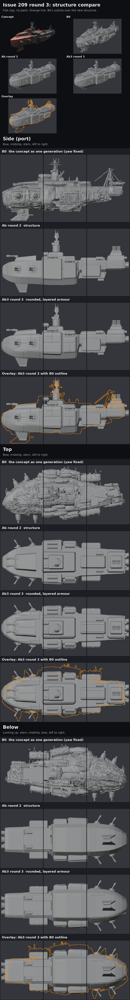
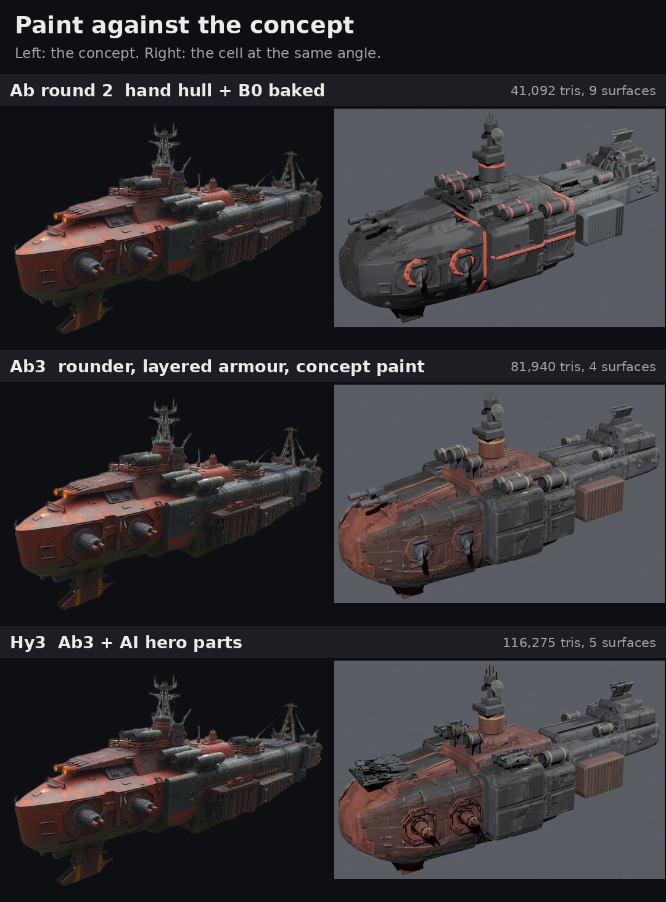

# Issue 209 round 3: Ab climbs a rung, and the hybrid

**Pick for round 4: take the hybrid (Hy3) forward with the hand LOD chain, keep the generated casemates and drum racks, go back to hand-built bow guns, and put it in the real game scene for the first true gate reading.** Its generated casemates are the closest thing to the concept on any cell so far, and twenty of it cost 1.05 ms of GPU at 4K with the hand chain (15 percent of the room under the R116 gate). Ab3 is the safe fallback: same hull and paint, about a third cheaper, plainer guns.

Ryan's round 2 ruling (Nov 8, 21:40 CST): Ab climbs with the board's two fixes (softer layered plating so the hull reads less boxy, paint matched to the concept), plus a hybrid cell with AI-generated hero parts only where they read best. B3 as a full cell stopped.

## 1. Structure compare (first, as R140 asks)

[structure.jpg](structure.jpg): flat clay, the concept and the nine fixed views, B0 (the generation), round 2's Ab structure and round 3's, plus B0's outline over the new one. What changed in the shape, block by block:

| Where | Round 2 | Round 3 |
|---|---|---|
| Bow block | flat-sided loft, small bevel | rolled deck shoulders (the roll grows toward the bow), chamfered chine and belly corner, domed nose |
| Bow flank | one surface | three belts of big armour plates (shoulder, flank, chine), lapped like scales |
| Glacis and bow deck | flat top | rounded edges, plates either side of the centreline and on the deck strips |
| Sponsons and modules | boxes with small chamfers | rounded outer corners, upper and lower plate belts split at the lengthwise break line |
| Deckhouse tier, stern block | flat sides | rounded corners, side plates |
| Spine, rails, stern tower | boxes | rounded corners |

The plates are real geometry: 46 of them (15,800 triangles), each ray-cast onto its block, with real thickness, a chamfered edge and a stand-off that alternates between neighbours, so one plate's edge laps over the next and the uncovered seams sit as grooves with depth. None crosses a break line. The parts now seat on the plated surface by ray cast.

## 2. The sheets

| Sheet | What to look at |
|---|---|
| [paint.jpg](paint.jpg) | The concept beside each cell at the same angle |
| [overview.jpg](overview.jpg) | The concept, then every cell at the concept's angle, paint and clay |
| [battle.jpg](battle.jpg) | Battle distance: 1:1 at about 180 px of ship, 2x, blurred greyscale |
| [close_top.jpg](close_top.jpg), [close_side.jpg](close_side.jpg), [close_below.jpg](close_below.jpg) | The nine cells, paint row then clay row per cell |
| [break.jpg](break.jpg) | The four break pieces pulled apart |
| [lod.jpg](lod.jpg) | Godot: triangles drawn by distance for LOD off, Godot's auto LOD and the hand chain; the hand chain just before and after each switch |
| [maps.jpg](maps.jpg) | Ab3's baked maps: everything the game draws for the paint |

Same lights, exposure and cameras as rounds 1 and 2. Round 2's Ab sits beside the round 3 cells.

## The cells

| Cell | What it is | Triangles | Surfaces |
|---|---|---:|---:|
| Ab (round 2) | corrected hand hull and hand parts, B0's surface baked in, round 6 paint | 41,092 | 9 |
| **Ab3** | round 3 hull (rounded, 46 armour plates), round 2's hand parts, B0's detail baked in, concept paint baked to textures | 81,940 | 4 |
| **Hy3** | Ab3 with generated hero parts in seven slots: the four gun casemates, the twin bow guns, the two sponson drum racks | 116,275 | 5 |

Of Ab3's triangles: hull blocks 7,900, plates 15,800 (both doubled by the hull skin), parts and break structure the rest. Hy3's generated parts are 48,000 (casemates 6,000 each, bow guns 8,000, drum racks 8,000 each; round 2's B3r2 used 30,000, 24,000 and 40,000). Every cell passed the audit: no floating parts, no part or plate across a break line, no gun aimed backward. Break fit as round 2 (section jag 0.017 on both lines). Records: `cells/*.json`.

## What changed in the bake and paint

- **B0's ghost parts are gone.** The bake source is trimmed to a shell round the hand hull (every B0 face more than 0.010 outside it is cut), so B0's own drums, tower and masts no longer print copies on the decks.
- **Only B0's detail is baked, not its shape.** B0's normals are baked twice, from the trimmed generation and from a smoothed copy (12,000 faces), and the smooth one is taken out of the sharp one. B0's panel lines, grilles and ribs stay; its lopsided, melted large shape goes, and the plate chamfers keep their own shading. Mean tilt of the baked normals fell from 27 degrees (raw, as round 2 baked it) to 6.7. About 9 percent of texels came back inverted (rays meeting B0 edge-on or from behind) and are set flat; 6 percent are clamped at 40 degrees.
- **The concept paint, baked.** Still the R96 route: procedural materials driven by masks from the ship's own geometry (ambient occlusion for grime in corners, a bevel edge mask for worn bare metal, vertical streaks on side faces, B0's cavity map on the hull). Bands follow the concept: rust-red forward hull, glacis, deck tiers and tower with a few broad lighter rust patches; gunmetal sponsons, modules, aft body and stern; dark red-brown cargo blocks; near-black belly; faded ochre bands on the drums. The red trim stripes of rounds 1 and 2 are gone (the concept has none). The graph is baked to an albedo map and an ORM map (occlusion, roughness, metal) per atlas: hull 4096, hand parts 2048, generated parts 2048. The sheets render those textures, and Godot draws the same files, so there is no procedural shader at run time.
- **Generated parts get their own atlas.** On the first PC run they shared the hand parts' atlas and baked black: their thousands of tiny UV islands shrank every island below a texel. The second run gave them their own 2048 atlas (one more surface). The hand parts the hybrid keeps hidden for its far LODs then baked dark in a second pass into the shared atlas, so the third run gave them a small atlas of their own too (1024; only LOD2 and LOD3 draw it).

## Godot: cost and LOD

Loaded at runtime in Godot 4.7.2 on the RTX 5080, round 4 studio protocol as in round 2 (twenty copies 5 by 4, battle camera at 8 ship lengths, MSAA 4x, shadows, SSAO and SSIL, 100 warm-up and 360 measured frames, two alternating repeats that agreed within 0.05 ms). Textures got mipmaps and VRAM compression on load, as the importer would give them. Figures are net of the empty studio (GPU 0.39 ms at 1080p, 1.42 ms at 4K).

| Cell | LOD | Triangles drawn, 20 ships, all passes | GPU ms 1080p | GPU ms, 3D at 4K | Frame ms 1080p | Draw calls |
|---|---|---:|---:|---:|---:|---:|
| Ab (round 2) | off | 3,081,900 | 0.39 | 0.64 | 0.45 | 90 |
| Ab (round 2) | Godot auto | 2,077,310 | 0.30 | 0.53 | 0.33 | 98 |
| **Ab3** | off | 6,145,500 | 0.75 | 1.25 | 0.83 | 40 |
| **Ab3** | Godot auto | 2,885,010 | 0.41 | 0.67 | 0.51 | 45 |
| **Ab3** | hand chain | 3,190,100 | 0.45 | 0.69 | 0.55 | 54 |
| **Hy3** | off | 8,720,625 | 1.06 | 1.59 | 1.22 | 50 |
| **Hy3** | Godot auto | 5,972,535 | 0.76 | 1.25 | 0.87 | 55 |
| **Hy3** | hand chain | 4,736,300 | 0.63 | 1.05 | 0.74 | 72 |

Against the R116 gate (12.5 ms on the gate scene's frame median at 1080p and on its GPU ms with the 3D at 4K; the latest readings, R118, are 6.0 ms and 5.45 ms, so the room is 6.5 ms and 7.05 ms): twenty Hy3 with the hand chain take 15 percent of the 4K GPU room and 11 percent of the 1080p frame room; twenty Ab3 take 10 and 8 percent. These are studio readings ("twenty of this hull on screen"), not a rerun of the gate scene: no cell is a game ship yet. Packing the paint into textures cut draw calls by more than half against round 2's Ab (Ab3 4 surfaces, Hy3 5, against 9).

**The hand LOD chain** (both cells; all LODs share the cell's texture atlases, so a lower LOD costs no extra texture memory):

| LOD | From (ship lengths away) | Ship on a 1080p screen | Ab3 triangles | Hy3 triangles | What goes |
|---|---:|---:|---:|---:|---|
| 0 | 0 | everything closer than 434 px | 81,940 | 116,275 | nothing |
| 1 | 3 | 434 px | 49,796 | 88,451 | the break structure inside and the hull skin (only seen once the ship breaks), parts under 1.2 percent of the ship's length (bolts, lugs, slats) |
| 2 | 8 | 162 px | 34,236 | 34,236 | parts under 2.8 percent, the rest halved, hull halved; in Hy3 the generated parts give way to the hand parts of the same slots |
| 3 | 18 | 72 px | 11,864 | 11,864 | parts under 5 percent, the rest to 30 percent, hull to 20 percent |

At 4K the ship is twice as many pixels at each switch. In the stills before and after each switch ([lod.jpg](lod.jpg)) I see no pop at LOD1 and LOD3; at LOD2 Hy3's casemates and drum racks swap to the hand-built ones, visible if you look for it at 162 px. Ryan judges.

**Findings:**

- **Godot's auto LOD now works on the hybrid.** Round 2's B3r2 never switched (its generated parts were separate, open surfaces). Here the generated parts are reduced to a fixed budget and drawn in one surface, and auto LOD cuts Hy3's cost by 20 percent at 4K.
- **On Ab3, Godot's auto LOD is as good as the hand chain** (0.67 against 0.69 ms at 4K). On Hy3 the hand chain is cheaper (1.05 against 1.25 ms), because it can swap the generated parts for hand parts, which the simplifier cannot do.
- **Generated parts barely reduce offline.** Blender's decimation stopped at about 70 percent on them (their UV islands are tiny), and pushing it threw spikes, so the chain keeps them whole at LOD1 and swaps them at LOD2.
- The shadow splits still change the triangle count at 4.8, 9.4 and 22.9 ship lengths in every mode, as in round 2.

Raw results: [bench209.json](bench209.json).

## What each cell showed

- **Ab3.** Reads much closer to the concept than Ab: the bow is a rounded, plated block, not a box; the red-forward, gunmetal-aft split matches; the drums read as gunmetal with faded rings. Still plainer than the concept up close: the casemates are small plates with a ball and two thin barrels, and the decks between parts are bare.
- **Hy3.** The generated casemates are the best part on any cell so far: big octagonal plates, heavy turret bodies, twin barrels, exactly the concept's look. The drum racks read well. The generated bow guns do not: squeezed into their slot they read as a flat cluttered plate, and the hand-built bow guns look better.
- **Effort per part.** The paint bake is the slow step: 11 minutes for Ab3's parts atlas on the 5080 because Blender bakes each of the 300 part objects separately (the hull atlas takes 16 seconds). Joining the parts before the bake should cut that to under a minute.

## Effort in agent terms

Counted from this run's logs (Nov 9, 03:50 to about 06:50 UTC), not estimated.

| Step | Runs | Unattended time | Notes |
|---|---:|---|---|
| Round 3 structure and plates (cloud sandbox) | 4 builds | about 4 s each | one fix: a module plate and the module hatches crossed the lengthwise break line |
| B0 detail bake method (sandbox, CPU, 512 to 1024 px) | 6 test bakes | about 20 s each | found that B0's mixed triangle winding made round 2's raw bake print many normals inverted; kept the generator's stored normals, took out the smooth shape, clamped the outliers |
| Paint (sandbox) | 3 tunings | about 3 min each (CPU bake at 512) | first pass too light and pink under the round 1 lights; darkened |
| Hybrid and LOD export (sandbox) | 3 | 5 min, 5 s | the hand parts in the hero slots kept as hidden proxies for LOD2 and LOD3 |
| Godot bench logic (sandbox, software renderer) | 1 | about 25 min | quick mode only, no numbers |
| PC run 1 (5080) | 1 | 30 min | Ab3 12.3 min (parts bake 11 min), Hy3 13.9 min, renders 2.6 min, export 6 s, Godot 1.4 min; Hy3's generated parts baked black |
| PC run 2 (5080) | 1 | 16 min | Hy3 with its own atlas 13.3 min, renders 1.3 min, export 3 s, Godot 1.3 min; the hidden hand parts (LOD2 and LOD3) baked dark |
| PC run 3 (5080) | 1 | 14 min | Hy3 11.4 min, renders 1.3 min, export 3 s, Godot 1.3 min; the Godot numbers and the Hy3 sheets come from this run |

No GPU generation: every generated input is round 1's. Owner review: this sheet set.

## The question for Ryan

Round 4: take the hybrid forward and put it in the game? **My pick: yes, Hy3 with the hand LOD chain,** keeping the generated casemates and drum racks and going back to hand-built bow guns. Round 4 would put it into the real gate scene as the C15s (the first true gate reading, not a studio one), check the paint under the game's own lights (Godot draws it darker than the Blender sheets), fill the bare deck areas with a few more hand-built fittings, and join the parts before the paint bake so a full cell rebuilds in a few minutes. If you would rather keep every part hand-built, Ab3 is the fallback at 0.7 ms for twenty.

## Files

- Tools: `tools/blender/r209/` (README there): `armA3.py` (round 3 structure, armour plates, parts, hybrid slots), `paint3.py` (the concept paint and its bake), `bakeAb3.py` (the cell build: trim, detail bake, paint bake), `export3.py` (the hand LOD chain to one glb), `godot/bench209r3.gd` (the cost run with three LOD modes), `sheets3.py`, `report3.py`, `massing_sheet.py` (structure compare), `pc/r3_run.bat`, `pc/r3b_run.bat` and `pc/r3c_run.bat`.
- PC working folders: `Downloads\voidsworn_test\opus209\out3\` (Ab3, first run), `out3b\` (second run) and `out3c\` (Hy3 and the final Godot run: blends, maps, full-size renders in `r\`, glbs with the LOD chains in `glb\`, Godot stills and results in `godot\`).
