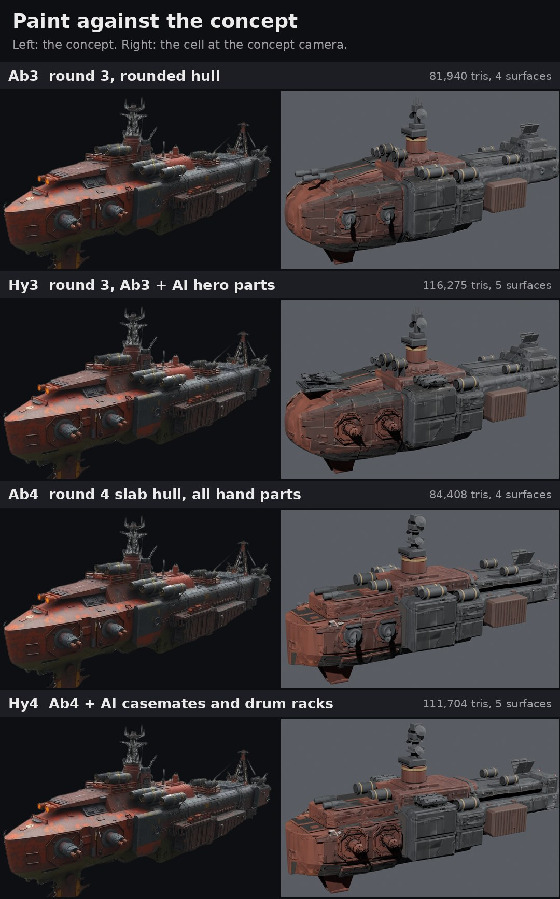
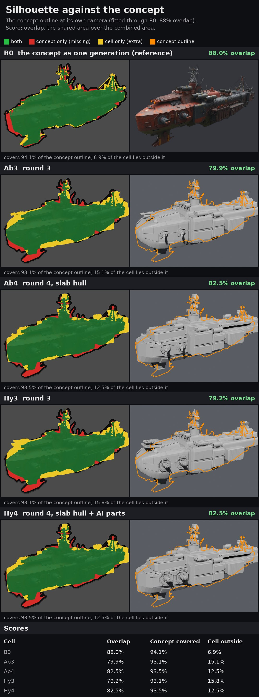
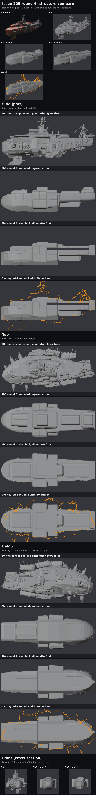

# Issue 209 round 4: silhouette first

**Pick: Hy4 goes forward.** Both round 4 cells now match the concept's outline better than any round 3 cell (82.5 percent overlap against 79.9 and 79.2), and the hull is a slab now, not a tube: flat deck, sharp deck edge, slab sides, a straight tuck to a flat belly, a blunt overhanging bow. Hy4 keeps the generated casemates, which still read closest to the concept's gun pods; Ab4 is the fallback at the same outline, all hand-built and a fifth cheaper.

Ryan's ruling (Nov 9 07:08 CST, R145): "Hy3 and ab3" both go forward, and "the actual ship itself doesn't look like the concept. It looks like a basic submarine instead."

## 1. The silhouette score

**The concept's own camera.** B0 (TRELLIS.2's whole-hull generation made from the concept image) was projected through a pinhole camera, and the camera was fitted so B0's outline matches the concept's outline best (`silhouette4.py fit`, started from round 3's hero camera). The fitted camera: azimuth 56.3 degrees, elevation 16.2, roll 1.8, distance 2.29 ship lengths (`concept_camera.json`). Round 3's hero camera sat at 53.0 and 21.8 degrees, a little high: B0 overlaps the concept 75 percent there and 88 percent at the fitted camera. The camera is then fixed: every cell is scored through it with no per-cell fitting, and `render.py` now renders a `concept` view from it, 1024 px square, so a render lies pixel for pixel over the concept (checked: a Blender render and the scorer's own outline agree to 99.6 percent).

| Cell | Overlap | Concept outline covered | Cell outside the concept |
|---|---:|---:|---:|
| B0 (the generation, reference) | 88.0% | 94.1% | 6.9% |
| Ab3, round 3 | 79.9% | 93.1% | 15.1% |
| Hy3, round 3 | 79.2% | 93.1% | 15.8% |
| **Ab4**, round 4 | **82.5%** | 93.5% | 12.5% |
| **Hy4**, round 4 | **82.5%** | 93.5% | 12.5% |

Overlap is the shared area over the combined area of the two filled outlines at 1024 px. Overlays per cell: `sil/sil_*.jpg` (green both, red concept only, yellow cell only).

**Reading it honestly.** The outline gain is real but modest: at this angle the outline was never round 3's main fault, since a tube and a slab cast similar shadows. What changed most is inside the outline (the cross-section and the deck edge, below and in `structure.jpg`). What is still off:

- **Red (missing):** the concept's chin fin under the bow (round 1 replaced it with two canted fins, because a single deep fin reads as a boat keel; the pair is smaller), the lattice mast's wide arms, and a strip along the bow's lower front.
- **Yellow (extra):** the stern engines and the stern block's end (the concept does not show the stern), drums standing proud of the deck line, and the antenna head (wider than the concept's lattice top).
- B0 itself only reaches 88 percent, so about 12 points are the generator's own error and the AI concept's loose perspective, not something a hand build can close.

## 2. Deck plan and cross-section, derived from the concept

Read off the concept through the fitted camera (`silhouette4.py look`: a cell drawn over the concept with a ruler along the ship) and B0's sections, then tuned on the score (`tune4.py`: 24 shape numbers, each held to a range that keeps the design; two passes, 11 minutes on the sandbox CPU, 76.5 to 83.3 percent at 512 px). Ship frame: length 1.0.

| | Round 3 (Ab3) | Round 4 (Ab4, Hy4) | B0 |
|---|---|---|---|
| Deck | z 0.028 amidships, sloping down to -0.030 at a domed nose | flat, z 0.004, a slight sheer to -0.010 at the nose | 0.0 to 0.03, rolled |
| Deck edge | rolled shoulder, radius 0.012 amidships to 0.032 at the bow | sharp (0.0025 chamfer) | rolled |
| Deck half-width | 0.130 | 0.124 amidships, round in plan from x 0.255 to a 0.020 blunt nose | 0.128 to 0.143 |
| Side | curved flank | vertical slab to the chine at z -0.104 | near vertical |
| Belly | half-width 0.100 at z -0.177, chamfered corner | flat armoured belly, half-width 0.094 at z -0.152; straight tuck from the chine at 34 degrees | 0.09 to 0.10 |
| Deck width over belly width | 1.3 | 1.32 | about 1.3 |
| Bow | domed, belly corner rounded up | overhang: the chine runs 0.016 and the belly line 0.030 behind the deck edge | melted |
| Superstructure tops (above the deck) | glacis 0.04, tiers 0.03 and 0.07, spine 0.02, stern 0.07 | raised forward deck 0.046, deckhouse 0.074, tower tier 0.086, hump 0.069, long aft body 0.046 with rounded top, stern block 0.058 | |
| Tower | drum, bridge, antenna array on top | drum, bridge, a tapered octagonal pylon with two sensor rings, dishes and pods, the antenna array on top | lattice mast |
| Gun pods | plate radius 0.036, ball 0.017 | plate radius 0.043, ball 0.022, longer barrels | |

The tune wanted the deck narrower still (half-width 0.108); I kept 0.124, nearer B0, for 0.2 points of score, and kept the belly level where the tune wanted it deeper at the nose. The tune also lowered every superstructure top a little: the concept's tiers are lower than rounds 1 to 3 built them.

`structure.jpg`: flat clay at the concept camera (concept, B0, Ab3, Ab4, then Ab4 with B0's outline), the nine fixed views, and a new last row: the cross-section from ahead of the bow. That row is the submarine fix: round 3 is a rounded tube; round 4 is a slab with a deck edge and a tucked belly.

## 3. The sheets

| Sheet | What to look at |
|---|---|
| [silhouette.jpg](silhouette.jpg) | The concept outline over each cell, with the score, round 3 against round 4 |
| [paint.jpg](paint.jpg) | The concept beside each cell at the concept's own camera |
| [overview.jpg](overview.jpg) | The concept, then each cell in paint and clay at the concept camera |
| [structure.jpg](structure.jpg) | Flat clay: B0, Ab3, Ab4, the nine views, the cross-section |
| [battle.jpg](battle.jpg) | Battle distance: 1:1 at about 180 px of ship, 2x, blurred greyscale |
| [close_top.jpg](close_top.jpg), [close_side.jpg](close_side.jpg), [close_below.jpg](close_below.jpg) | The nine cells, paint row then clay row per cell |
| [break.jpg](break.jpg) | The four break pieces pulled apart |
| [lod.jpg](lod.jpg) | Godot: triangles drawn by distance, LOD off, auto LOD and the hand chain; stills before and after each switch |
| [maps.jpg](maps.jpg) | Ab4's baked maps |

Same lights and exposure as rounds 1 to 3; the round 3 cells were re-rendered at the concept camera from their round 3 blends.

## The cells

| Cell | What it is | Triangles | Surfaces |
|---|---|---:|---:|
| **Ab4** | round 4 slab hull (58 armour plates), round 3's hand parts re-seated, bigger gun pods, the antenna tower, a few deck fittings (hatch blocks, vents, aft grating, pipes), B0 detail and concept paint baked | 84,408 | 4 |
| **Hy4** | Ab4 with Hy3's generated casemates (4) and drum racks (2); bow guns hand-built | 111,704 | 5 |

Both passed the audit: no floating parts, no part or plate across a break line, no gun aimed backward (records: `cells/*.json`). Break fit: section jag 0.019 and 0.030.

**One bake fix this round.** The slab hull sits away from B0's melted surface in places (the deck is lower, the edges sharp), so B0's cavity bake came back black there: the first PC run printed those as dark smears. The second run takes texels darker than 0.25 as misses (no cavity, flat detail normal there) and keeps the rest at 60 percent. B0's surface detail now covers about two thirds of the hull; the rest carries the plating and paint only. Every sheet is from the second run.

## Godot: cost and LOD

Same studio protocol as round 3 (twenty copies, battle camera at 8 ship lengths, MSAA 4x, shadows, SSAO and SSIL, 1080p and 3D at 4K; net of the empty studio, GPU 0.38 ms at 1080p and 1.37 ms at 4K). All four cells in one session, so they compare directly (round 3's own figures came from a different session and differ by up to 0.2 ms).

| Cell | LOD | Triangles drawn, 20 ships | GPU ms 1080p | GPU ms, 3D at 4K | Frame ms 1080p | Draw calls | Share of the 4K GPU room |
|---|---|---:|---:|---:|---:|---:|---:|
| Ab3 | hand chain | 3,190,100 | 0.45 | 0.68 | 0.46 | 54 | 10% |
| Hy3 | hand chain | 4,736,300 | 0.63 | 0.88 | 0.64 | 72 | 13% |
| **Ab4** | off | 6,330,600 | 0.74 | 1.05 | 0.75 | 40 | 15% |
| **Ab4** | Godot auto | 2,787,130 | 0.41 | 0.66 | 0.41 | 48 | 9% |
| **Ab4** | hand chain | 3,366,910 | 0.45 | 0.68 | 0.45 | 54 | 10% |
| **Hy4** | off | 8,377,800 | 0.99 | 1.31 | 0.99 | 50 | 19% |
| **Hy4** | Godot auto | 5,310,730 | 0.68 | 0.97 | 0.69 | 58 | 14% |
| **Hy4** | hand chain | 4,631,550 | 0.60 | 0.84 | 0.60 | 72 | 12% |

Room under the R116 gate as round 3 (12.5 ms; latest gate readings 6.0 ms frame and 5.45 ms 4K GPU): twenty Hy4 with the hand chain take 12 percent of the 4K GPU room, twenty Ab4 10 percent. The Godot run used the first PC run's glbs (the same geometry except two drum tails, moved 0.008 of the ship length off the break line; the second run otherwise changed only the cavity texture).

Hand LOD chain, triangles: Ab4 84,408 / 52,132 / 36,618 / 12,842; Hy4 111,704 / 83,748 / 36,618 / 12,842 (switches at 3, 8 and 18 ship lengths, as round 3).

## What each cell showed

- **Ab4.** The submarine is gone: the bow is a blunt slab block with a deck edge, the sides are walls, the belly tucks in. The red-forward, gunmetal-aft split holds. Still off against the concept: less deck shows ahead of the raised deck than in the concept (the deck sits low against it), the tower is shorter and plainer than the concept's lattice, the casemates are hand-built balls and barrels.
- **Hy4.** Same hull; the generated casemates sit on the bigger round 4 plates and read like the concept's heavy pods, and the drum racks still read well. The hand bow guns are cleaner than the generated ones were.

## Not done this round: the scene gate (step 5)

The real battle scene loads each hull through the game's ship manifest as an imported scene with hard points (`hp_*`), skin patches and a damage model. The cell glbs carry none of those yet, so putting Hy4 in the gate scene needs an export to the game's ship format first (hard points, the damage glb, the import step on the PC). That did not fit in this run. It is the first job of round 5.

## Effort in agent terms

From this run's logs (Nov 9, 13:35 to 15:30 UTC).

| Step | Runs | Unattended time | Notes |
|---|---:|---|---|
| Concept camera fit (sandbox) | 1 | 32 s | B0 overlap 75 to 88 percent |
| Structure (sandbox) | about 12 builds | about 5 s each | |
| Silhouette tune (sandbox CPU) | 1 | 11 min | 24 numbers, 2 passes, about 120 builds |
| Bake smoke tests (sandbox CPU, 256 and 512 px) | 3 | 3 to 4 min each | found the cavity misses' cause (and that the dark lines under the gun pods are the barrels' shadows, not paint) |
| PC run 1 (5080) | 1 | 31 min | Ab4 13.6 min, Hy4 12.6 min, renders 2.6 min, export 6 s, Godot 2 min; the cavity smears |
| PC run 2 (5080) | 1 | 28 min | cavity fix; Ab4 13.3 min, Hy4 12.2 min, renders 2.6 min |
| Round 3 cells at the concept camera (5080) | 1 | about 1.5 min | |

## The question for Ryan

Take Hy4 into the game for the scene gate? **My pick: yes, Hy4 with the hand LOD chain.** Round 5 would export it in the game's ship format and read the real gate scene, and, if you want, close the two gaps that still show at the concept camera: more deck visible ahead of the raised deck, and a taller, more open antenna tower.

## Files

- Tools: `tools/blender/r209/` (README there, round 4 section): `silhouette4.py`, `sil_dump.py`, `armA4.py`, `tune4.py`, `bakeAb4.py`, `sheets4.py`, `silsheet4.py`; `render.py`, `flat_views.py` and `massing_sheet.py` gained the concept view; PC jobs `pc/r4_queue.bat`, `pc/r4_run.bat`, `pc/r4b_queue.bat`, `pc/r4b_run.bat`, `pc/r4_r3concept.bat`.
- Records here: `concept_camera.json`, `sil/` (scores, overlays, the tune log), `cells/`, `bench209.json`.
- PC working folders: `Downloads\voidsworn_test\opus209\out4\` (first run, Godot results in `godot\`) and `out4b\` (second run: blends, maps, renders in `r\`, glbs in `glb\`; round 3 at the concept camera in `r3\`).
