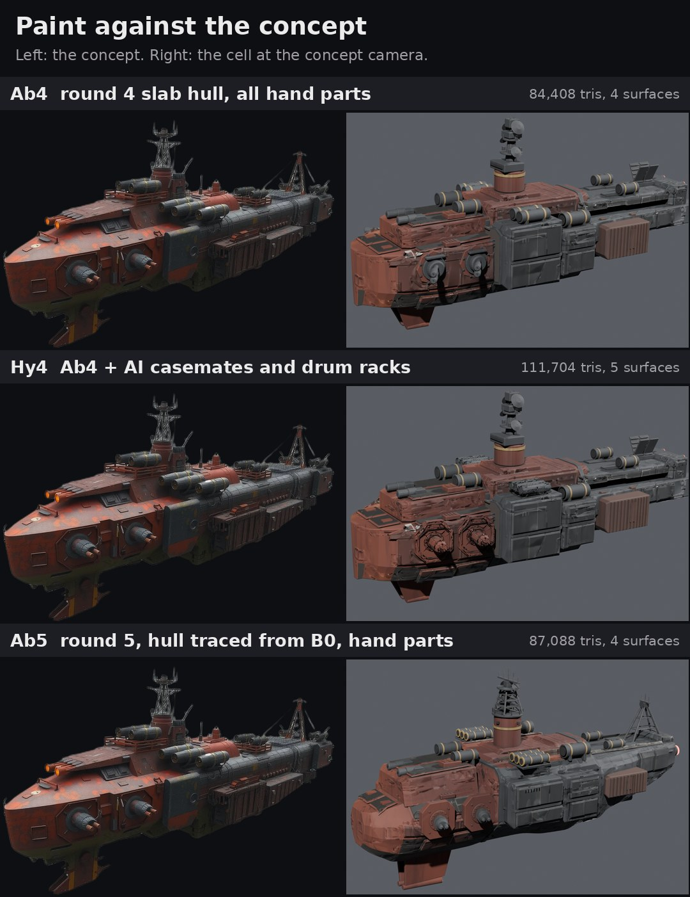
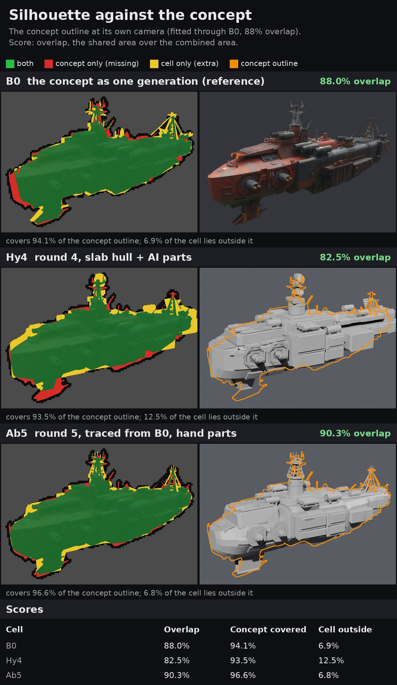
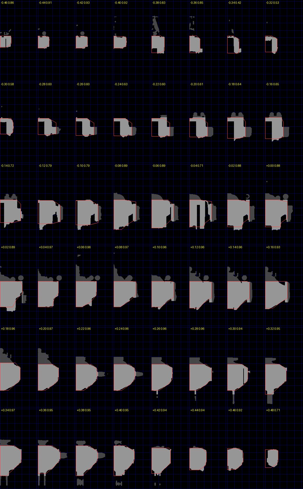
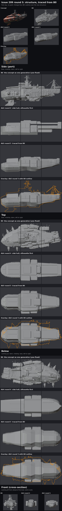
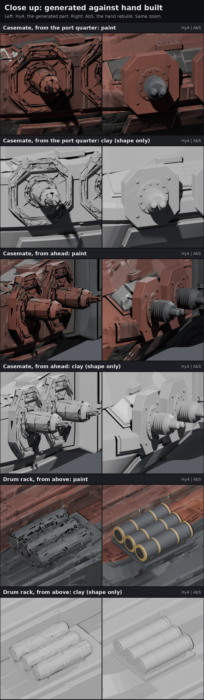

# Issue 209 round 5: the hull traced from B0

**Pick: Ab5 goes forward.** It is the first hand build to beat B0 at the concept camera: 90.3 percent outline overlap against B0's 88.0 and Hy4's 82.5, and the hull, casemates and drum racks are all hand built, crisp, with no AI surface left on the parts. It is lower and longer than round 4, with the tall antenna tower and the aft sensor mast now on it.

Ryan's ruling (Nov 9 09:47 CST, R147): round 4 "too tall and chunky", blunt bow, no tall tower; "you can see some of that waviness issues with the ai hulls too, even some of the parts look wavy or oversharpened". Round 5: trace the hand hull from B0's own shape, 90 percent overlap before detail, the tower and mast as space parts, the casemates and drum racks rebuilt by hand at the generated parts' proportions.

## 1. The gate: silhouette at the concept camera

Same scorer, same fitted camera and same 1024 px as round 4 (`silhouette4.py`, `round4/concept_camera.json`). Ab5 is scored from the glb the PC exported (lod0).

| Cell | Overlap | Concept outline covered | Cell outside the concept |
|---|---:|---:|---:|
| B0 (the generation, shape reference) | 88.0% | 94.1% | 6.9% |
| Hy4, round 4 | 82.5% | 93.5% | 12.5% |
| **Ab5**, round 5 | **90.3%** | 96.6% | 6.8% |
| Ab5 hull blocks only (no tower, mast, pylons, casemates, drums, plates) | 84.0% | 86.5% | 3.2% |
| Ab4 hull blocks only, for comparison | 80.1% | 86.6% | 8.5% |

The gate was passed on geometry alone (blocks, the silhouette parts and the plates, flat grey, sandbox CPU) before the bake: 90.4 percent on the sandbox build, then 90.3 on the PC's exported, painted ship. The blocks-only line shows the hull's own share: only 3.2 percent of it lies outside the concept; the rest of the outline is the tower, mast and pylons, which the concept counts as outline.

## 2. How the hull was traced

1. **Slices** (`b0trace.py`). B0 cut every 0.02 of the ship's length (48 slices), each slice filled and cut down to the main body (the side blocks, cargo pods and the chin struts are separate parts). One clean half-section fitted to each slice: flat deck, sharp deck edge, a chamfered shoulder, a slab side, a two-facet tuck, a flat belly (7 points). Overlap of fit and slice: mostly 0.86 to 0.97 in the bow and midship, 0.4 to 0.65 between x -0.34 and -0.16 (B0's aft hull is an open shell there, so those knots lean on B0's top and side outlines instead). The sheet above shows every fit (red) on its slice (grey).
2. **Knots** (`armA5.HK`). The fits, smoothed and squared up by hand into 20 stations: the hull is a loft through them with a smooth monotone cubic, so no creases at the knots and no overshoot. B0 is never shipped: it is the shape reference and the bake source for surface grime only, as in round 4.
3. **Tune** (`tune5.py`). Coordinate descent on the concept outline plus a small prior that keeps B0's own outline from the side, from above and from ahead (so what the concept camera cannot see stays B0's). It moves grouped numbers only: per region (aft, midship, bow) a deck lift, a belly drop and a width change; the bow rake and shoulder; the stern length; the superstructure, side block and pylon numbers. Four runs, about 10 to 12 minutes each on the sandbox CPU. What it found: the bow block sits lower than the midship (the concept's dark midship block stands above the bow deck), the midship deck higher, the bow a little narrower, the superstructure tiers lower (as round 4's tune found).
4. **Squared up by hand.** The tune left a ripple in the midship's lower side and belly (B0's own lumps). Those knots were made one straight side line and a gentle belly curve, and the bow knots made monotone to the nose. Cost: 0.1 points. Two parts were moved on the score afterwards: the casemate pairs to x 0.346 and 0.232 (the starboard forward casemate stood out past the bow's outline at the concept camera, 0.3 points), and the aft drum pair to x -0.25.
5. **Tower and mast fixed by measurement, not tuned.** The outline score alone shortens any thin structure, so the tune would have made the tower short. Their heights are read off the concept with a ruler up the tower axis through the fitted camera: the red tower drum to 0.15, the truss to 0.218, the head to 0.237, the whips to 0.25; the aft A-frame apex at 0.13.

`structure.jpg`: flat clay, B0, Ab4 and Ab5 at the concept camera and the nine fixed views, with B0's outline in orange over Ab5, and the cross-sections from ahead.

## 3. Parts

- **Casemates, hand rebuilt at the generated part's proportions** (`casemate5`): p_casemate.glb was measured as a reference (plate 0.94 by 1.0 by 0.18 of its own size, ring, turret drum, ribbed band, tapered nose, twin barrels) and rebuilt at round 4's slot size: an octagonal plate 0.088 by 0.090 standing 0.016 proud, a riveted ring, a turret drum with five ribs and a tapered nose, twin barrels aimed out to the side and 15 degrees forward. Two matched pairs.
- **Drum racks, hand rebuilt** (`drum_rack`): three drums on saddles over a base frame, rims and two bands each, at the generated rack's proportions. One matched pair on the sponsons.
- `close_parts.jpg` sets Hy4's generated parts beside Ab5's at the same zoom and lights, paint and clay, from the port quarter, from ahead and from above. The generated parts' crinkled, melted surface (the waviness Ryan saw) is gone; the hand parts are clean bevelled solids.
- **Tall antenna tower** (space part, no yards): the red tower drum with a railed platform, a tapered four-leg truss pylon with ring frames and diagonals, a sensor ring with pods, a platform with two dishes, a sensor head and a flat antenna boom with five whips.
- **Aft sensor mast** (the concept's A-frame): four tapered legs splayed fore and aft, two ring frames, a sensor housing with a dish and an antenna boom. No rigging.
- **Bow guns**: twin, hand built, aimed straight ahead, shorter barrels than round 4.
- **Ventral pylons**: the twin struts B0 has under the bow, each with a sensor pod at its foot (the concept's chin fin, never a single keel).
- Round 4's plating (56 plates, lapped and chamfered), the round 3 recipe paint, the break lines (x 0.178, x -0.125, z -0.045), internal decks and bulkheads carry over. Audit: no floating parts, no part or plate across a break line, no gun aimed backward (`cells/Ab5.json`). Break fit: section jag 0.011 and 0.011.

## 4. The sheets

| Sheet | What to look at |
|---|---|
| [silhouette.jpg](silhouette.jpg) | The concept outline over B0, Hy4 and Ab5, with the scores |
| [paint.jpg](paint.jpg) | The concept beside Ab4, Hy4 and Ab5 at the concept's own camera |
| [close_parts.jpg](close_parts.jpg) | Casemate and drum rack: Hy4 generated against Ab5 hand built |
| [overview.jpg](overview.jpg) | Each cell in paint and clay at the concept camera |
| [structure.jpg](structure.jpg) | Flat clay: B0, Ab4, Ab5, the nine views, the cross-section |
| [b0trace.jpg](b0trace.jpg) | Every B0 slice with its fitted section |
| [battle.jpg](battle.jpg) | Battle distance: 1:1, 2x, blurred greyscale |
| [close_top.jpg](close_top.jpg), [close_side.jpg](close_side.jpg), [close_below.jpg](close_below.jpg) | The nine cells, paint and clay |
| [break.jpg](break.jpg) | The four break pieces pulled apart |
| [lod.jpg](lod.jpg) | Godot: triangles drawn by distance, LOD off, auto and the hand chain |
| [maps.jpg](maps.jpg) | Ab5's baked maps |

## 5. Godot: cost and LOD

Round 4's studio protocol (twenty copies, battle camera at 8 ship lengths, MSAA 4x, shadows, SSAO and SSIL, 1080p and 3D at 4K; net of the empty studio, 0.39 ms and 1.52 ms). Ab4 and Hy4 ran in the same session (round 4's glbs), so the three compare directly.

| Cell | LOD | Triangles drawn, 20 ships | GPU ms 1080p | GPU ms, 3D at 4K | Frame ms 1080p | Draw calls | Share of the 4K GPU room |
|---|---|---:|---:|---:|---:|---:|---:|
| Ab4 | hand chain | 3,366,910 | 0.48 | 0.62 | 0.57 | 54 | 9% |
| Hy4 | hand chain | 4,631,550 | 0.62 | 0.90 | 0.73 | 72 | 13% |
| **Ab5** | off | 6,531,600 | 0.81 | 1.25 | 0.94 | 40 | 18% |
| **Ab5** | Godot auto | 3,191,742 | 0.48 | 0.70 | 0.58 | 44 | 10% |
| **Ab5** | hand chain | 3,721,200 | 0.53 | 0.83 | 0.63 | 54 | 12% |

R116 gate 12.5 ms; latest gate readings 6.0 ms frame and 5.45 ms 4K GPU: twenty Ab5 with the hand chain take 12 percent of the 4K GPU room, less than Hy4. Hand LOD chain, triangles: 87,088 / 58,520 / 39,440 / 10,984 (switches at 3, 8 and 18 ship lengths). Ab5: 87,088 triangles, 4 surfaces.

## 6. Not done this round: the scene gate (step 7)

The real battle scene loads a ship through `godot/assets/ships/manifest.json` in the A4 ship format: one mesh and one material, hard points (`hp_w*`, `hp_eng_*`, `hp_breach_*`, `hp_core`), a wreck glb, a damage glb and a 2048 map set. Ab5's glb carries none of those, and the A4 export chain (`tools/blender/a4/`) has not been run on a route 209 cell yet. That is a job of its own (export plus the import step on the PC), so the R116 scene gate reading is still open. The studio bench above is the cost read for now.

## Effort in agent terms

From this run's logs (Nov 9, 15:50 to 18:35 UTC).

| Step | Runs | Unattended time | Notes |
|---|---:|---|---|
| B0 slices and section fits (sandbox) | 1 | about 10 s | 48 slices |
| Tune (sandbox CPU) | 4 | about 10 to 12 min each | concept 81.5 to 89.9 percent |
| Part placement checks on the score (sandbox) | about 60 builds | about 5 s each | casemates, aft drums, pylons, a boom tried and dropped |
| Bake smoke test (sandbox, 256 px) | 1 | 5 min | |
| PC run 1 (5080) | 1 | 34 min | bake 22 min (the parts paint bake is most of it), renders, close-ups, Godot; showed torn bow plates (the tuned bow deck sat below the plate rays) and ripples |
| PC run 2 (5080) | 1 | 24 min | plates follow the tuned hull, knots squared up; every sheet here is from this run |

## The question for Ryan

Take Ab5 as the C15s hull and move on to the game export and the scene gate? **My pick: yes.** It beats B0's outline, has no AI surface on the parts, and costs less than Hy4. The open items are the paint (the round 3 recipe, flatter than the concept's rust), the ventral pylons (plain slabs), and the game export.

## Files

- Tools: `tools/blender/r209/` (README there, round 5 section): `b0trace.py`, `armA5.py`, `tune5.py`, `tune5_P.json` (the tuned and squared-up numbers, with the raw tune), `bakeAb5.py`, `close5.py`, `sheets5.py`; PC jobs `pc/r5_queue.bat`, `pc/r5_run.bat`, `pc/r5b_queue.bat`, `pc/r5b_run.bat`.
- Records here: `sil/` (scores, overlays, the last tune's log), `cells/Ab5.json`, `bench209.json`.
- PC working folders: `Downloads\voidsworn_test\opus209\out5\` (first run; Hy4's close-ups in `close\`) and `out5b\` (second run: blend, maps, renders in `r\`, close-ups in `close\`, glbs in `glb\`, Godot in `godot\`).
