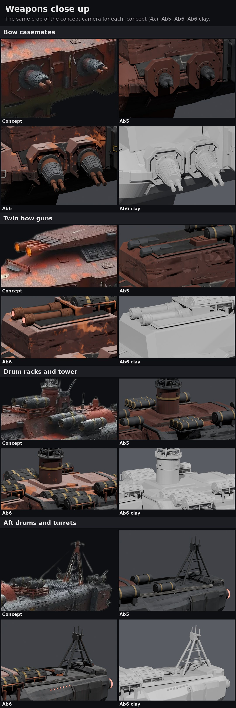
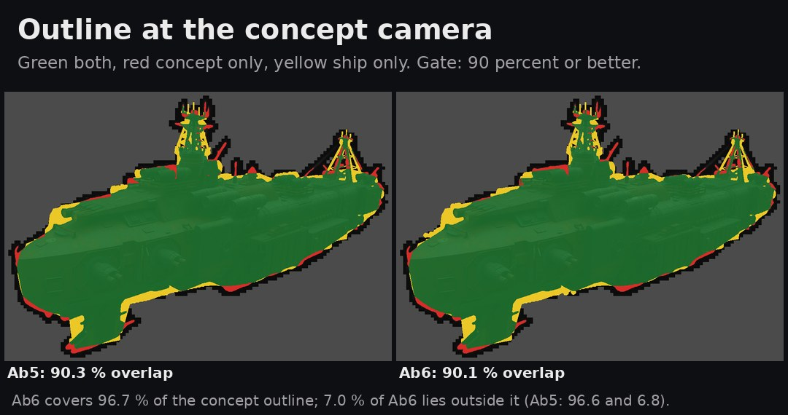
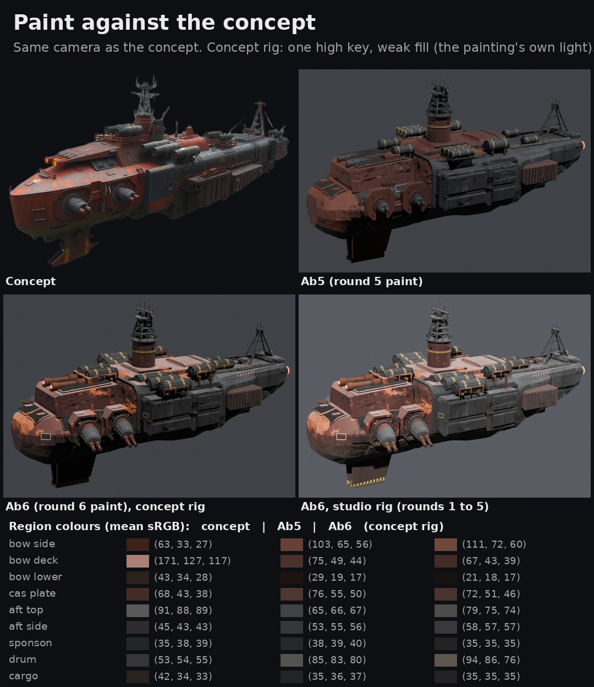

# Issue 209 round 6: weapons and paint on Ab5, the Hullbreaker kit, the recipe

**Pick: take Ab6's weapons as the Hullbreaker kit's first set and keep going on paint.** The weapons are now the concept's weapons:
the big octagonal casemates with quilted mantlet sleeves and twin copper barrels, the long orange-muzzled bow guns under a slatted
hood, strapped drum launchers with ochre bands in welded cradles, all crisp, junky and mismatched on purpose. The paint is much
closer (red forward, gunmetal aft, orange rust blooms, grime toward the belly, worn edges, markings) but still reads lighter and
pinker on the bow sides than the painted concept. The outline gate holds: 90.1 percent (Ab5 90.3).

Ryan's rulings (R150, R151): "weapons and paint first. Let's ensure it actually looks good"; "there are still some gaps in the
detail or approach with the weapons"; every faction gets its own parts kit, only invisible plumbing is shared, Hullbreakers
scavenge; the recipe first, proven on Ab5.

## 1. Weapons: what the concept has, and what Ab6 has now

Studied close up first (concept crops at 2x), then measured: each weapon's pixel in the concept cast onto a plane through the
fitted concept camera (`round4/concept_camera.json`) to read its x, y, z and size in the ship frame.

| Weapon | In the concept | Ab5 | Ab6 (Hullbreaker kit) |
|---|---|---|---|
| Bow casemates, 2 a side | octagonal armour plates about 0.10 wide and 0.10 tall (x 0.39 and 0.23, z -0.05), framed, corner braces; a large dark collar disc; a copper mantlet drum; a dark quilted (padded, strapped) tapered sleeve; twin thick copper barrels aimed forward and out | octagon 0.088 proud of the hull, a small drum turret, thin short barrels | `casemate`: octagonal housing 0.098 and 0.096 wide (buried behind, so it seats on the curved bow), raised frame and recessed field, ten frame bolts, four corner braces, patch plates and weld beads that differ on every casemate; dark collar disc with a bolt ring; copper ball and mantlet ring; quilted sleeve (five ring straps, fourteen lengthwise); front cap; twin copper barrels with fat recoil sleeves, clamp rings, muzzle rings and bores. Aimed 15 degrees forward of the beam, 9 degrees down |
| Twin bow guns | two long thick barrels lying on the raised forward deck, glowing orange muzzles at its front edge, under a slatted (louvred) deck front | two short stubs | `bow_battery`: breech blocks under a slatted armour hood with cheek plates and a weld; ribbed recoil sleeves; barrels 0.08 long to the raised deck's front edge; ribbed muzzle shrouds; glowing bores; welded braces to the deck |
| Drum launchers | big black drums (radius about 0.02, length about 0.1) with a woven or quilted skin, two faded yellow bands, a framed front with a dark launch mouth: a pair forward of the tower, a rack of three on each sponson, a pair aft on a railed platform | small plain drums (radius 0.011 to 0.017) | `drum_rack` / `drum`: strapped and ribbed body, two ochre bands, framed front with recessed launch mouth, tapered tail; drums in one rack deliberately mismatched (a slipped band and a patch; a shorter one with a salvaged conical nose); welded pipe cradles with cross beams, saddles, legs cut to the deck and a low cradle rail (the concept's red railings, kept as a rack frame, not a naval railing). Fore pair (r 0.017), a rack of three on each sponson (r 0.019), a waist drum each side, an aft pair |
| Top turrets | small drum turrets with a barrel on the aft deck by the mast | none | `turret`: a squat welded Hullbreaker turret (sloped plate, patch, one heavy copper barrel) and a borrowed one (a clean faceted dome turret from another navy on a crude ten-sided adapter ring, blue-grey), both on the centreline, aimed forward |
| Markings | rectangular stencil frames on the bow flank, yellow tags between the casemates, a white disc on the bow deck, a row of amber lamps on the aft body, yellow and black stripes on the ventral pylon feet | none | `marking`: the same, as thin decal plates baked into the parts atlas; hazard stripes in the paint |

Audit (shared one-pass audit, `kits/shared/plumbing.py`): 1,207 parts, nothing floating, nothing across a break line, 12 barrels, none
aimed backward or into the ship. Matched pairs mirror exactly in place, size and aim; their salvage detail differs.

### The outline gate

| Cell | Overlap | Concept outline covered | Cell outside the concept |
|---|---:|---:|---:|
| Ab5 (round 5) | 90.3% | 96.6% | 6.8% |
| **Ab6** | **90.1%** | 96.7% | 7.0% |

Scored from the PC's exported glb (lod0), same scorer and camera as rounds 4 and 5. The bigger weapons first cost the gate (88.2):
the starboard casemates and racks, hidden in the concept, stood out past the bow and over the deck line at the concept camera. What
brought it back: the forward casemates 0.05 aft of the concept's spot (x 0.338), their barrels shorter than the aft pair's, all four aimed a little lower, the racks at the
concept's measured heights, the waist drums Ab5 had (they fill the concept's outline by the tower), the aft turrets on the
centreline. A tall angled gun by the tower (the concept's angled shape there) was tried and dropped: it cost more than it covered.

## 2. Paint

The Hullbreaker paint (`kits/hullbreakers/paint.py`) is round 3's route (procedural masks from the ship's own geometry, baked to
albedo and ORM atlases), retuned to colour samples of the concept: dark oxide red forward with bright orange rust blooms on the
decks and upper sides; dusty light decks; dark gunmetal aft with rust run-off; drums dark steel with ochre bands; copper barrels with
bright worn edges; grime toward the belly (the concept's dark olive lower hull) and in corners; worn bare edges broken up by noise
and only in some areas; hazard stripes on the pylon feet; the borrowed turret barely weathered.

The sheet adds a second light rig for this comparison only, the concept painting's own light (one high key, a weak fill). The
studio rig every earlier round used is beside it, and all other sheets use it. The region table samples the same pixels of each
image. Where it stands:

- Closer than Ab5: the red-forward and gunmetal-aft split, rust blooms, edge wear, streaks, markings, the dark keel line.
- Still off: the bow sides read lighter and pinker than the concept (111, 72, 60 against 63, 33, 27); the concept's bow deck is a
  much lighter pink-grey than ours (the dust shows on the flat decks but Ab6's bow top is mostly the raised deck's sloped faces);
  the lower hull is darker than the concept's olive. Two retunes moved these only a little; the gap is partly the painting's own
  dark side lighting. Next paint step: a hand-painted dark band along the bow's slab side and a lighter deck coat by face, read off
  the concept, rather than more global tuning.

At battle distance (`battle.jpg`) the casemate barrels now read as guns pointing out of the bow, and the decks read light like the
concept's.

## 3. The recipe and the kits

- `docs/ship_pipeline/RECIPE.md`: seven stages, one double-click file each in `tools/recipe/` (concept in, AI shape reference,
  traced hull with the outline gate, faction parts kit, paint bake, LOD, export), the per-ship data, and what is generic now and what
  is not yet (the hull module's block table is still per-ship Python; the A4 game-format export is not automated).
- `tools/recipe/ships/C15s_23.json`: the worked example (faction, hull module, tune, concept camera, gate, every weapon socket).
- `tools/blender/kits/`: `shared/plumbing.py` (frame and scale rules, sockets and seating, the gun rule, tags, audit; no shapes, no
  paint) and `hullbreakers/` (`kit.py`, `paint.py`, README with the shape language). Other factions get their own folder.

## 4. Sheets

| Sheet | What to look at |
|---|---|
| [weapons.jpg](weapons.jpg) | each weapon group: concept, Ab5, Ab6 and Ab6 clay at the same crop of the concept camera |
| [paint.jpg](paint.jpg) | concept, Ab5, Ab6 at the concept camera, concept rig and studio rig, region colours |
| [overview.jpg](overview.jpg) | Ab6 paint and clay: concept camera, side, top, below |
| [battle.jpg](battle.jpg) | Ab5 and Ab6 at battle distance: 1:1, 2x, blurred greyscale |
| [silhouette.jpg](silhouette.jpg) | the concept outline over Ab5 and Ab6 with the scores |

## 5. Cost (Godot, round 4's studio protocol)

Twenty copies, battle camera at 8 ship lengths, net of the empty studio; same session for both cells.

| Cell | LOD | Triangles drawn, 20 ships | GPU ms 1080p | GPU ms, 3D at 4K | Frame ms 1080p | Draw calls | Share of the 4K GPU room |
|---|---|---:|---:|---:|---:|---:|---:|
| Ab5 | hand chain | 3,721,200 | 0.52 | 0.82 | 0.63 | 54 | 12% |
| **Ab6** | off | 9,421,200 | 1.09 | 1.58 | 1.26 | 40 | 22% |
| **Ab6** | Godot auto | 4,609,392 | 0.59 | 1.10 | 0.72 | 44 | 16% |
| **Ab6** | hand chain | 5,695,380 | 0.70 | 1.15 | 0.80 | 54 | 16% |

Ab6: 125,616 triangles, 4 surfaces; hand LOD chain 125,616 / 89,888 / 59,996 / 24,868. The kit adds about 38,500 triangles over Ab5
(the quilted sleeves and drum straps are most of it). Reported, not capped (R111); twenty Ab6 take 16 percent of the 4K GPU room
(R116 gate 12.5 ms).

## Effort in agent terms

| Step | Runs | Unattended time | Notes |
|---|---:|---|---|
| Concept study and measurement (sandbox) | 1 | minutes | projector through the fitted camera |
| Kit build and preview loop (sandbox CPU) | about 15 | 20 s to 5 min each | weapons, paint, markings |
| Outline gate loop (sandbox) | 12 | about 1.5 min each | 88.2 to 90.1 percent |
| PC run 1 | 1 | stopped after 35 min | the parts bake re-synced the whole scene once per part (1,200 parts, hours); fixed by baking one joined copy (16 min to 17 s) |
| PC run 2 (5080) | 1 | 8 min | bake 2 min, renders, close-ups, export, Godot |
| PC run 3 (5080) | 1 | 7 min | paint retune; every sheet here is from this run |

## The question for Ryan

Do the weapons now look right, and is the paint direction right? **My pick: yes to the weapons as the Hullbreaker kit's first set;
paint gets one more focused pass** (the bow sides darker and redder, the bow deck lighter, read off the concept face by face), then
Ab6 goes to the game export and the scene gate.

## Files

- Tools: `tools/blender/kits/` (shared plumbing, Hullbreaker kit and paint), `tools/recipe/` (stage files, `ship.py`, `audit.py`,
  `ships/C15s_23.json`, `ships/_template.json`), `tools/blender/r209/`: `armA6.py`, `bakeAb6.py`, `close6.py`, `preview6.py`
  (sandbox preview), `sheets6.py`, `render.py` (`--light=concept`), PC jobs `pc/r6*_queue.bat`, `pc/r6*_run.bat`.
- Records here: `cells/Ab6.json` (build, audit, sockets), `bench209.json`, `silhouette_scores.json`, `paint_regions.json`.
- PC: `Downloads\voidsworn_test\opus209\out6c\` (blend, maps, renders `r\`, close-ups `close\`, glbs `glb\`, Godot `godot\`); `out6b`
  is the run before the paint retune; `out6` holds the stopped first run's hull maps and Ab5's concept-rig renders.
