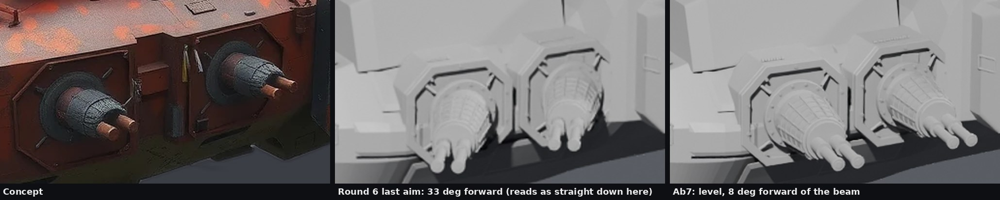
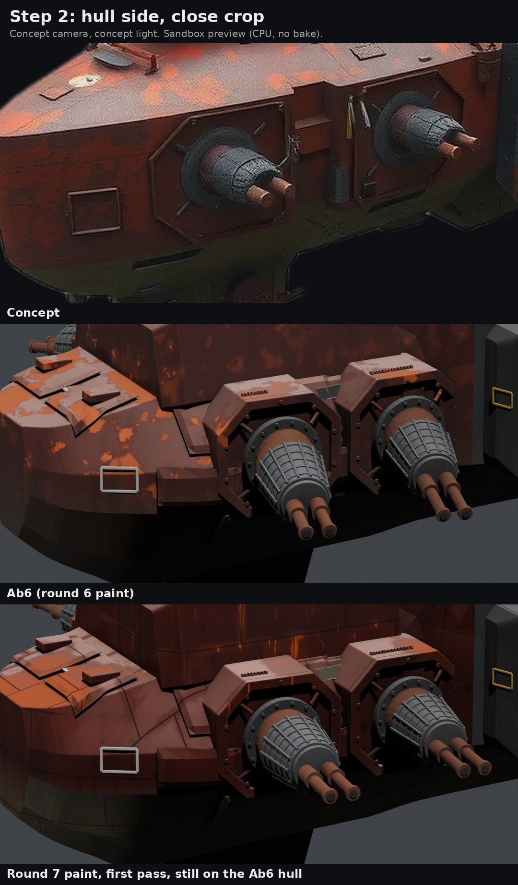

# Issue 209 round 7: Ab6 becomes Ab7 (work in progress)

Ryan on round 6 (Nov 9 2026, 18:16 CST, FINDINGS R156): "I agree with all of your takes. The front is still very much off from the
concept but the rest looks pretty good today with details. Now it's a texture and paint pass it seems."

This file grows one step at a time; each step is pushed on its own so partial work can be reviewed.

## Step 1: the casemate barrels are level

**Outline score with the level barrels: 90.1 percent** (the gate is 90; Ab6 with lowered barrels was 90.1).

The barrels now point out to the side and 8 degrees forward of the beam, dead level (`aim` 0.14, 0.99, 0.0 in
`tools/recipe/ships/C15s_23.json`). How that number was picked: in the concept the barrels run to the right and about 23 degrees
below level on screen. Through the fitted concept camera that is what a level, straight-out-to-the-side gun looks like (the camera
sits forward of the ship and above it). Round 6's last commit set them 33 degrees forward of the beam; that is level too, but at the
concept camera a gun aimed that far forward draws as pointing straight down the screen, so it would still have read as "down". No
gun is aimed aft of the beam (owner rule); 8 degrees forward keeps a margin.

| Casemate aim | Outline overlap | Concept covered | Ship outside the concept |
|---|---:|---:|---:|
| Ab6, lowered 9 degrees (round 6 sheets) | 90.1% | 96.6% | 7.0% |
| 33 degrees forward, level (round 6 last commit) | 89.8% | 96.6% | 7.3% |
| **Ab7: 8 degrees forward, level** | **90.1%** | 96.6% | 7.0% |

Scored in the sandbox from the built geometry, same scorer and camera as rounds 4 to 6 (round 6's 90.1 from the PC glb reproduces
here). The guns were not bent to the score: the aim comes from the concept, and the score happens to hold.

## Step 2: texture and paint pass (first pass, on the Ab6 hull)

This is the paint code landing before the bow pass, so it can be reviewed on its own; the final paint sheets come after step 3,
because the bow shape decides how the paint reads (see below). What changed in `tools/blender/kits/hullbreakers/paint.py`:

- **Plate lines and panel breaks.** The hull (not the bolt-on parts) is cut into painted plates at the concept's scale: long plates
  on the sides, smaller ones on the decks, big ones on the lower hull. A dark seam line between them, every plate its own tone and
  sheen, each side plate a little darker toward its lower edge. The layout wraps round the bow and differs port to starboard.
- **Rust as a gradient, not specks.** On the sides it is strongest under the deck edge, runs down in long thin streaks, gathers
  under each plate seam and creeps out of the seams in broken stretches, and is gone by the lower hull. On the decks it sits in
  soft plate-shaped patches. The even orange specks of round 6 are down to a trace.
- **Dark olive lower hull.** The tuck under the slab side and the belly are olive, no longer near black.
- **Bow sides darker and redder.** The pink read was a grey sheen on dark red. The red paint now carries more metalness (0.70,
  was 0.38) with a brighter base, so the sheen takes the paint's own red.
- **Grit.** Fine mottle, broad stains and sparse dark chips on the big surfaces, so no panel is one flat tone.
- **Drums darker and cooler**, their ochre bands thinner and duller, as the concept's.

All of it is baked into the same albedo and ORM atlases as before (seams also go into the occlusion channel, plate sheen into the
roughness), so the bake, LOD and export steps are unchanged.
