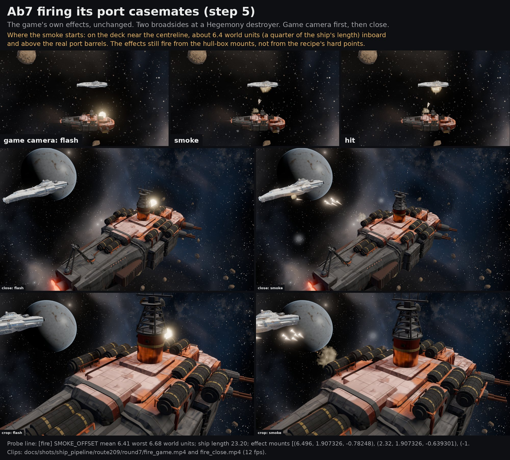

# Issue 209 round 7: Ab6 becomes Ab7

Ryan on round 6 (Nov 9 2026, 18:16 CST, FINDINGS R156): "I agree with all of your takes. The front is still very much off from the
concept but the rest looks pretty good today with details. Now it's a texture and paint pass it seems."

Each step was pushed on its own. Sheets lead with the battle camera (outside audit pass 2, finding 4).

## The short read

- **The front is not closer by the numbers, and only partly closer by eye.** The bow now has the concept's flat deck with a hard
  edge, slab sides, framed casemates and the bow gun hood in front, but its nose still stands too tall and blunt: the concept's bow
  is a long, low, rounded wedge. Bow-third outline 90.3 (Ab6 91.0); bow inner edges within 6 px of the concept's 40.6 percent (Ab6
  44.6). The whole ship reads 89.7, under the 90 gate.
- **Paint:** plate lines, panel breaks, the darker red and the olive lower hull are there close up and on the far side and the belly.
  At the battle camera none of the plate lines or the rust gradient read; what reads is a two-tone ship (orange-red front, grey
  back), as the concept does. Two things are wrong at every distance: the bow deck is olive where the concept is red, and the
  midship top deck reads pale salmon pink in the game's light.
- **Step 5 ran:** Ab7 is in the game with 28 hard points and fires; the smoke starts on the deck near the centreline, a quarter of a
  ship length from the real port barrels, because the game's effects still use the hull-box mounts (no effect code was changed).

## Step 1: the casemate barrels are level

**Outline score with the level barrels: 90.1 percent** (the gate is 90; Ab6 with lowered barrels was 90.1).

The barrels now point out to the side and 8 degrees forward of the beam, dead level (`aim` 0.14, 0.99, 0.0 in
`tools/recipe/ships/C15s_23.json`). How that number was picked: in the concept the barrels run to the right and about 23 degrees
below level on screen. Through the fitted concept camera that is what a level, straight-out-to-the-side gun looks like (the camera
sits forward of the ship and above it). Round 6's last commit set them 33 degrees forward of the beam; that is level too, but at the
concept camera a gun aimed that far forward draws as pointing straight down the screen, so it would still have read as "down". No
gun is aimed aft of the beam (owner rule); 8 degrees forward keeps a margin.

| Casemate aim | Outline overlap | Concept covered | Ship outside the concept |
|---|---:|---:|---:|
| Ab6, lowered 9 degrees (round 6 sheets) | 90.1% | 96.6% | 7.0% |
| 33 degrees forward, level (round 6 last commit) | 89.8% | 96.6% | 7.3% |
| **Ab7: 8 degrees forward, level** | **90.1%** | 96.6% | 7.0% |

Scored in the sandbox from the built geometry, same scorer and camera as rounds 4 to 6 (round 6's 90.1 from the PC glb reproduces
here). The guns were not bent to the score: the aim comes from the concept, and the score happens to hold.

## Step 2: texture and paint pass (first pass, on the Ab6 hull)

This is the paint code landing before the bow pass, so it can be reviewed on its own; the final paint sheets come after step 3,
because the bow shape decides how the paint reads (see below). What changed in `tools/blender/kits/hullbreakers/paint.py`:

- **Plate lines and panel breaks.** The hull (not the bolt-on parts) is cut into painted plates at the concept's scale: long plates
  on the sides, smaller ones on the decks, big ones on the lower hull. A dark seam line between them, every plate its own tone and
  sheen, each side plate a little darker toward its lower edge. The layout wraps round the bow and differs port to starboard.
- **Rust as a gradient, not specks.** On the sides it is strongest under the deck edge, runs down in long thin streaks, gathers
  under each plate seam and creeps out of the seams in broken stretches, and is gone by the lower hull. On the decks it sits in
  soft plate-shaped patches. The even orange specks of round 6 are down to a trace.
- **Dark olive lower hull.** The tuck under the slab side and the belly are olive, no longer near black.
- **Bow sides darker and redder.** The pink read was a grey sheen on dark red. The red paint now carries more metalness (0.70,
  was 0.38) with a brighter base, so the sheen takes the paint's own red.
- **Grit.** Fine mottle, broad stains and sparse dark chips on the big surfaces, so no panel is one flat tone.
- **Drums darker and cooler**, their ochre bands thinner and duller, as the concept's.

All of it is baked into the same albedo and ORM atlases as before (seams also go into the occlusion channel, plate sheen into the
roughness), so the bake, LOD and export steps are unchanged.

Note on the casemate aim: merging round 6's last commit into this branch brought back its 15 degree aim (`aim` 0.25, 0.968, 0.0 in
`tools/recipe/ships/C15s_23.json`) over step 1's 8 degrees, and the PC run baked that. The guns are level and about 15 degrees
forward of the beam: still out to the side and never aft, so the owner rule holds, and the step 1 table above is for 8 degrees.
Left as it is (a change needs a rebake); the Board can pick 8 or 15.

## Step 3: one bounded bow pass (armA7)

`tools/blender/r209/armA7.py`: round 5's traced hull with a new bow. A flat full-width bow deck with a sharp edge, slab sides to
carry the casemates, the bow gun hood with the twin guns in front of it, bow plates and fittings. The casemates sit flat on the new
slab at the concept's spacing (the forward pair back to x 0.356). The paint is retuned for the new bow. The kits register every
muzzle and engine exit for the export. The stage 4 audit reads the build's own break lines.

The outline gate, scored in the sandbox from the PC glbs (`outline_thirds.py`, same concept camera as rounds 4 to 6), split into
thirds and with the inner edge check that audit pass 2 finding 13 asked for:

| | Whole | Bow third | Midship | Stern | Bow edges within 6 px (model to concept) | Bow concept edges matched |
|---|---:|---:|---:|---:|---:|---:|
| Ab6 | 90.0 | 91.0 | 90.7 | 85.1 | 44.6% (median 7.3 px) | 61.0% |
| **Ab7** | **89.7** | **90.3** | 90.7 | 85.1 | 40.6% (median 8.5 px) | 54.9% |
| Ab7 game export (stage 7) | 89.6 | | | | | |

How the thirds and edges are made: every pixel of the concept frame is labelled bow, midship or stern from the model's own
triangles (x above +1/6 or below -1/6 of the length), and the overlap is scored inside each. The edges are automatic: the
concept's luminance edges against the model's edges in a flat-shaded render through the same camera (so paint does not count),
measured both ways. The deck edge, the chine, the bow profile and the casemate frames are among them; they are not hand-traced
named lines. What the overlays show (bow.jpg): Ab7's nose pokes out ahead of the concept and its bow deck edge sits higher than the
concept's long sloping deck line (yellow at the nose and along the top); the concept's step from the low prow up to the
forecastle is still missing. The stern third has been the weakest all along (85.1) and the bow pass did not touch it.

Not done: the second outline camera R160 asks for (the battle camera); the bow blink is at the concept camera only.

## Step 4: recipe stage 7, the game export

`tools/recipe/7_export.bat`, `export7.py`, `check_export.py`, `check_export_selftest.py`; described in full in
`docs/ship_pipeline/RECIPE.md` (stage 7). From the PC run (out7, Nov 10 04:48 to 05:14 UTC):

- Export: **102,072 triangles**, maps at 2048, hard points **18 gun, 3 engine, 6 breach, 1 core** (28). Weapon slots from
  `data.js` (`c_marauder`): slot 0 scatter port 4 points, slot 1 scatter starboard 4, slot 2 torpedoes forward 8, slot 3 flak 2.
- Check: **PASS** ("every weapon slot has its hard points and every hard point is on the mesh").
- Self-test: **PASS**, the check refused all three broken copies (a slot with no points; a point 0.066 off the mesh; a gun turned
  aft).
- The game's own asset build loaded it: `check C15s_23 loads=true hardpoints=28 hull_meshes=1 holes=0 wreck_chunks=0` (no wreck or
  damage glb yet, the list in RECIPE.md).

Cost, Godot bench on the 5080, twenty copies at the battle camera, net of the empty studio, same session for both:

| Cell | LOD | Triangles drawn, 20 ships | GPU ms 1080p | GPU ms, 3D at 4K | Frame ms 1080p | Draw calls |
|---|---|---:|---:|---:|---:|---:|
| Ab6 | off | 9,421,200 | 1.07 | 1.58 | 1.66 | 40 |
| Ab6 | Godot auto | 4,609,392 | 0.58 | 1.03 | 1.16 | 44 |
| Ab6 | hand chain | 5,695,380 | 0.71 | 1.14 | 1.19 | 54 |
| **Ab7** | off | 9,539,100 | 1.07 | 1.58 | 1.67 | 40 |
| **Ab7** | Godot auto | 4,664,532 | 0.60 | 1.06 | 1.19 | 44 |
| **Ab7** | hand chain | 5,738,170 | 0.70 | 1.13 | 1.18 | 54 |

Ab7 lod0 127,188 triangles (Ab6 125,616); hand chain 127,188 / 91,068 / 59,870 / 25,068. The bow pass costs nothing measurable.
Reported, not capped (R111).

## Step 5: the battle capture

The first PC run did not parse (`ship_fire_probe.gd` line 31: an untyped hard point list) and its clip step needed Pillow, which
Blender's python on the PC does not have. The repair (one PC run, `tools/blender/r209/pc/r7b_run.bat`, 23:38 to 23:39 CST): the
probe types the list, writes JPEG frames, and adds the game's own default camera (r 170 at 1920x1080, so the ship is drawn at its
played size); the clip and the strip are built in the cloud sandbox (`fire_clip.py`). The run reused round 7's build: the game's
generated files were still there and the ship glb in the game matched out7's export byte for byte, so nothing was rebuilt. Before
queueing, the probe was parsed with Godot 4.7.2 headless in the sandbox.

Result: `VENT_DONE`, 45 frames per camera, no stray spawns. Ab7 loads as an A4 ship (`a4=true`) with its 4 port hard points.
**Where the smoke starts:** on the deck near the centreline, 6.1 to 6.7 world units from the port barrels (mean 6.41, a quarter of
the 23.2 unit ship length; `fire_report.txt`). The effect mounts come from the hull's box (outside audit pass 1, finding 6), so the
flash and smoke sit inboard and above the casemates. The hard points the recipe wrote are where the barrels are; the effects do not
read them yet. No effect code was changed. Clips: `fire_game.mp4` (game camera) and `fire_close.mp4`.

## The sheets

| Sheet | What to look at |
|---|---|
| [battle.jpg](battle.jpg) | **first**: Ab7 in the game at the default camera, true pixel size over the real sky, then Ab6 and Ab7 at the studio battle camera (1:1, 2x, blurred grey) |
| [paint.jpg](paint.jpg) | concept, Ab6, Ab7 at the concept camera (concept rig) and Ab7 under the studio rig; then region by region with mean colours (`paint_regions.json`) |
| [hull_side.jpg](hull_side.jpg) | the bow hull side close: concept, Ab6, Ab7 (both rigs), then the 4x close-up renders |
| [bow.jpg](bow.jpg) | the bow at the concept camera (paint, clay, the bow guns 4x) and from the side; the outline per third and the inner edges |
| [bow_blink.gif](bow_blink.gif) | concept and Ab7 at the concept camera, alternating |
| [far_side.jpg](far_side.jpg) | starboard quarter and starboard side (new views, `render.py --views=side_s,hero_s`, one PC run), top and below; Ab6 and Ab7 |
| [weapons.jpg](weapons.jpg) | each weapon group at the same crop of the concept camera: concept, Ab6, Ab7, Ab7 clay |
| [overview.jpg](overview.jpg) | Ab7 paint and clay: concept camera, hero, side, top, below |
| [fire.jpg](fire.jpg) | the battle capture (step 5) |

Built by `tools/blender/r209/sheets7pc.py` from the PC renders (out7 Ab7, out6f Ab6, out7b the capture, out7c the starboard views).

## What I see, honestly

- **Battle distance (the game camera):** about 180 px of ship. It reads as an orange-red front half and a dark grey back half,
  which matches the concept's big read. No plate line, rust streak or the olive lower hull is visible at that size; the top deck
  reads salmon. Ab6 and Ab7 are hard to tell apart at the studio battle camera except that Ab7's bow top is darker and greener.
- **Paint close up:** better than round 6. Plate lines and panel breaks are on every big surface, the bow side is a deeper red
  (region mean 50, 23, 20 against the concept's 63, 33, 28; Ab6 was 92, 56, 47), the lower hull is olive with plates (29, 25, 20
  against 43, 35, 29; Ab6 near black), the drums are closer. But the rust is now too little: the concept's bow is covered in big
  orange blotches, Ab7 has thin streaks. The bow deck is olive (55, 41, 35) where the concept's lit deck is a pale rusty red
  (172, 127, 118). The midship top deck reads pale pink in the game.
- **Far side and belly:** the starboard paint matches the port side (red bow plates, olive lower hull, grey aft); it is darker
  only because the studio key is on the port side. The belly is olive-brown with plate lines instead of round 6's near black.
- **The front:** see step 3. Closer in parts (the hood, the slab, the framed casemates), not closer in shape.
- **Not yet done on paint (audit pass 2, finding 3):** the paint is still computed (masks, plates, rust) on a faction colour; the
  concept's own paint is not projected, no CC0 material textures under it, no light map, no big markings that read from far away.
  This pass did not start that layered approach; it is the next paint step.

## What is still off

1. The bow shape: too tall and blunt at the nose, no step from the low prow to the forecastle. Bow third 90.3, whole 89.7.
2. Bow deck colour olive instead of red; midship top deck reads pink under the game's light.
3. Rust too light on the bow sides against the concept's blotches.
4. Nothing of the paint detail reads at the battle camera; the layered paint from the concept (finding 3) has not started.
5. The game fires from the hull-box mounts, a quarter ship length from the barrels; the hard points are written but unread.
6. No wreck or damage glb for the recipe ship (`wreck_chunks=0`).
7. The stern third outline (85.1) has been the weakest since round 4.
8. The casemate aim is 15 degrees (round 6's), not step 1's 8 (note above).

## Effort in agent terms

| Step | PC runs | Notes |
|---|---:|---|
| Steps 1 to 4 (earlier worker) | 1 (out7, 26 min on the 5080) | bake, renders, close-ups, LOD, bench, export, check, asset build (11 min); step 5 failed to parse |
| Step 5 repair | 1 (out7b, about 1 min) | one of the three runs budgeted; reused the build |
| Far side stills | 1 (out7c, 1 min) | starboard views for R160 |
| Sheets, scores, audit work | sandbox | Godot 4.7.2 headless parse check; bpy 4.5 in the sandbox to build Ab7 and run the audit and its self-test |

## Files

- Sheets and data: this folder (`outline_thirds.json`, `silhouette_scores.json` with `pc_` rows, `paint_regions.json`,
  `fire_report.txt`, the two clips).
- Tools: `tools/blender/r209/sheets7pc.py`, `outline_thirds.py`, `fire_clip.py`, `render.py` (starboard views),
  `godot/fx/test/ship_fire_probe.gd`, `tools/blender/r209/pc/r7b_*.bat` and `r7c_*.bat`.
- Recipe: `tools/recipe/` (audit, audit self-test, every stage stops on failure), `docs/ship_pipeline/RECIPE.md`.
