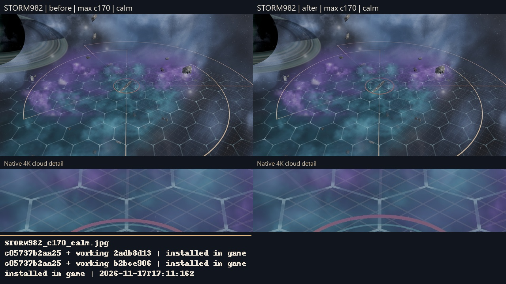
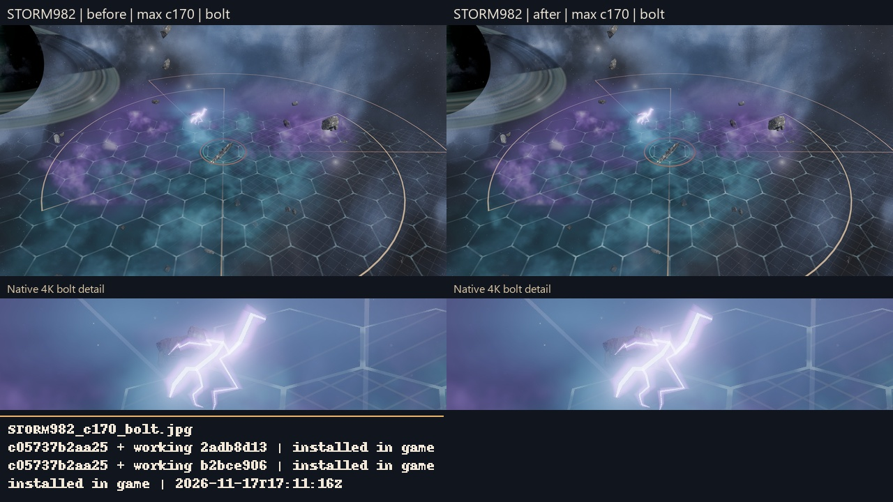
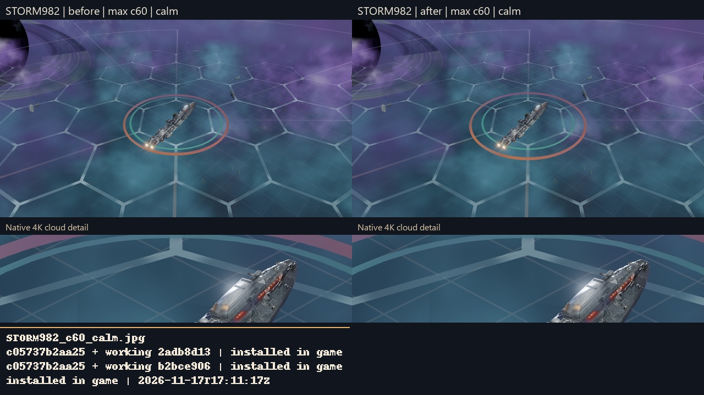
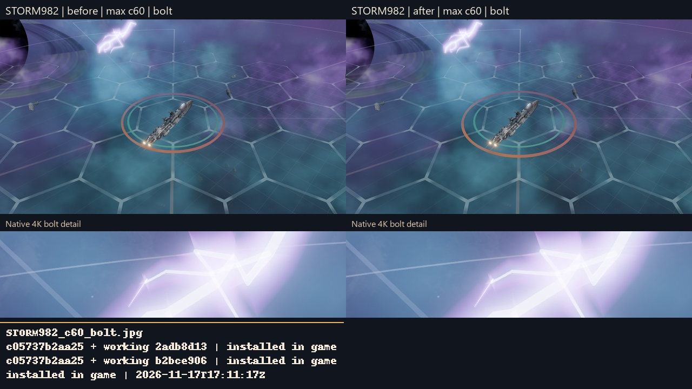
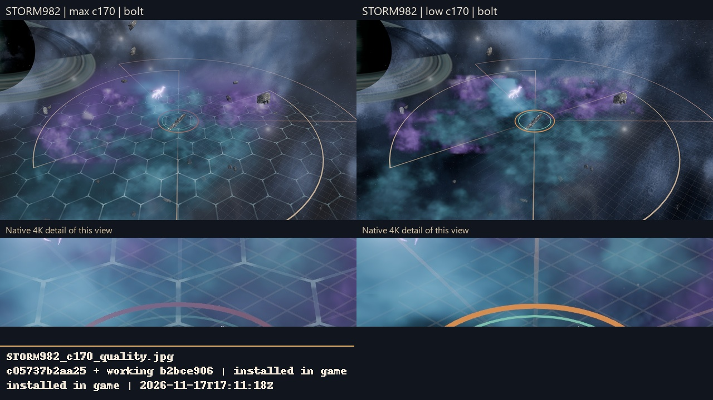
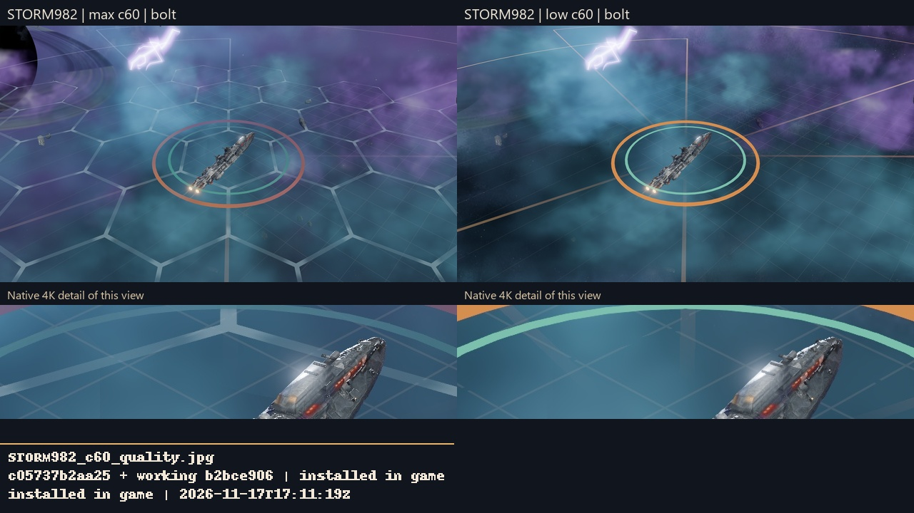

# Issue 982: before and after frame times

RTX 5080, Godot 4.7.2 Forward+, vsync off, solo watchdog claims. Three sessions per source. Storm rows use the real seed-4103 terrain generator with its nebula condition: 31 storm and 28 nebula hexes, c170 beta 0.98, idle battle, HUD hidden. Each session warms 180 frames before each of two passes, measures at least 720 frames and 8 seconds, and retains pass 2. 4K draws 3840x2160 through 2x 3D scaling in a 1920x1080 viewport. Time and weather stay live.

| Storm tier | Resolution | Before GPU median ms | After GPU median ms | After frame median ms | After GPU session medians ms |
|---|---|---:|---:|---:|---|
| max | 1080p | 4.737 | 2.294 | 3.956 | 2.289, 2.294, 2.307 |
| max | 4K | 17.808 | 7.269 | 7.777 | 7.334, 7.256, 7.269 |
| low | 1080p | 5.885 | 1.878 | 2.405 | 1.869, 1.882, 1.878 |
| low | 4K | 23.019 | 6.991 | 7.463 | 6.973, 7.026, 6.991 |

All table values are medians of three session medians. Raw JSON retains both storm passes, p95, maxima, render CPU time, live tree counts, source SHA256 and adapter identity.

## Scene 207

Unmodified production gate, 20 ships across six factions, real volleys and HUD, max quality and MSAA 4x. Each batch has two launches, each with three sessions and alternating mode order; retain the second launch. Each mode settles 2.5 seconds, warms 180 frames and measures 720. The 1080p gate uses frame median; the 4K gate uses GPU median, taking the median across sessions. The after values below are the confirmation batch run after the standing suite ended. The initial after batch and its CPU timing exception are preserved in validation.md.

| Mode | Before frame median ms | After frame median ms | Before GPU median ms | After GPU median ms | After binding session medians ms |
|---|---:|---:|---:|---:|---|
| base | 8.100 | 9.292 | 3.041 | 2.651 | 8.250, 10.683, 9.292 |
| res_2160 | 8.397 | 9.349 | 7.231 | 5.946 | 5.870, 5.946, 5.951 |

## Evidence

[Before attribution](profile_before.md), [before storm](before_storm.json), [after storm](after_storm.json), [before gate](before_gate_keep.json), [after gate](after_gate_keep.json), [checks and timing exception](validation.md). The discarded gate launches are kept as before_gate_warm.json and after_gate_warm.json. GPU state snapshots are before_gpu.csv, after_gpu.csv and after_gate_repeat_gpu.csv.

The approved PR 717 storm shader is unchanged in ion_storm.gd. The max route retains the same card transforms, density, fog, noise, colors, heights, bolt geometry, timing and four lights, including two fog injectors. Early support rejection avoids noise only where the original density was zero. It hoists the accepted shader declarations, keeping layer dimensions and falloffs in one place. Low drops the dim bottom puffs first, keeping the middle cores, upper puffs, broad veils and color ramps. The live low tree falls from 196 gas cards to 137; max stays at 137.

Fixed-pose native 4K captures use presentation time 0.08, with calm and peak-strike pairs. Comparison sheets are 1280x720, with matching native-pixel detail crops, code names and revision/stage provenance. Whole-scene pixel equality is not claimed: distant rock spin and small idle effects can differ between launches.

Reproduce on the PC with the installed gen cache and matching ship textures, after a successful headless import: run `docs/shots/storm_cost/run.bat before` on the original source and `run.bat after` on the changed source. The batch uses tmo.bat and solo GPU claims for every invocation, respects gpu_go.txt, stops on command failure and keeps logs in TEMP. measure.gd is derived from the PR 976 capture adapter. compose.py preserves input provenance and builds the sheets; report.py rebuilds these tables from raw results. [Approved-source hashes](approved_source.json) verify the baseline gas and lightning against PR 717 commit ee2e21d9.

Checks derived from the retained data:

- PASS: storm_max_4K_under_12_5_each_session
- PASS: low_cheaper_1080p_each_session
- PASS: low_cheaper_4K_each_session
- PASS: gate_base_median_of_sessions_under_12_5
- PASS: gate_res_2160_median_of_sessions_under_12_5
