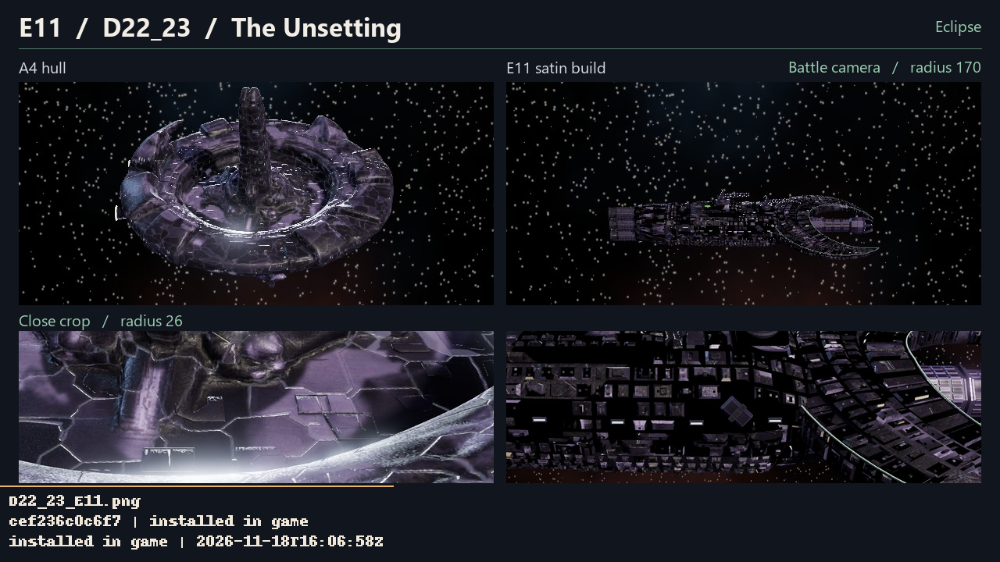
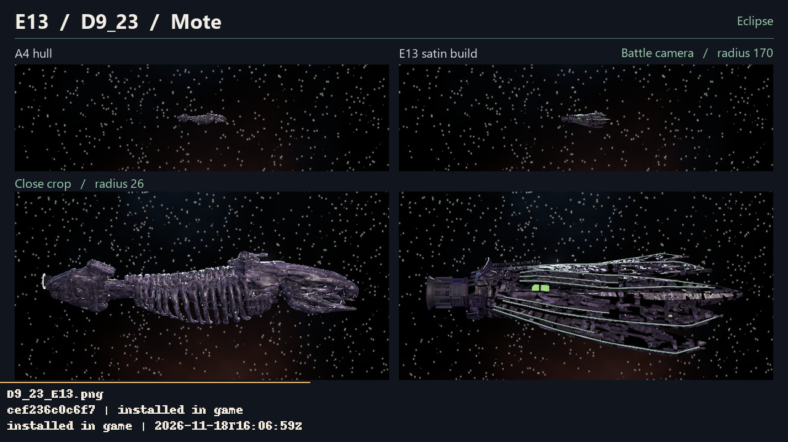
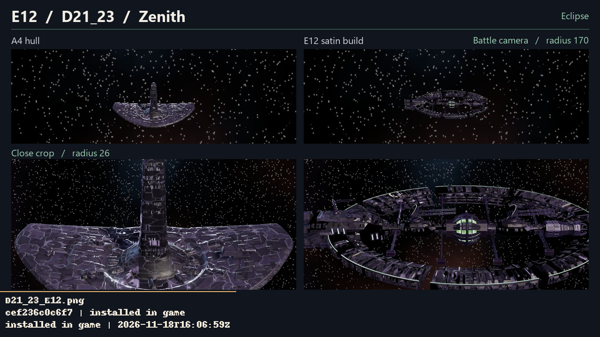
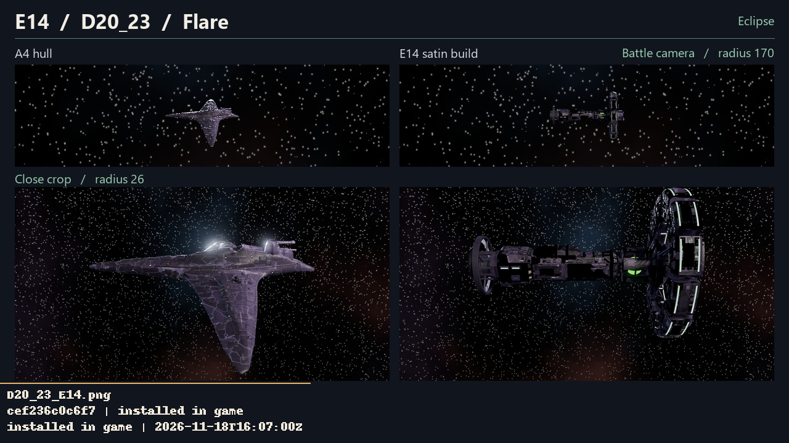

# Eclipse ship swap

Refs #1057.

Stage 7 installed D22_23, D9_23, D21_23, D20_23 in the shared PC build.
It refreshed the ship cache and read each successful hull back through ShipView.
The original ship folders, including A4 damage and wreck exports, and their cached scenes are in `sync_old\ships_swap_eclipse_1118`.
The playtest manifest check printed `MANIFEST OK` for all 259 files against the branch manifest.

## Checked exports

The accepted sheets supplied the geometry and parts, including E12's issue 877 armoured core and E14's upright null lance.
Stage 5 used the Eclipse satin stack at 4096 pixels and 64 OptiX samples. Each intact hull showed zero exposed room or bare surface pixels in six views.
Stage 6 ran the LOD bench. Stage 7 exported the 2048-pixel game maps, checked hard points and ran readback in an isolated copy of the shared build.
The installed-damage probe used an authored breach point and exercised every authored break. The wreck check uses the repo's death_seam_check.gd plating test with the ship loaded through ShipView. It checks for split machines and room triangles beyond their wreck plating, with one cut step of tolerance.

[Paint stack](../../../tools/blender/kits/eclipse/stack.py) · [Ship recipe](../../ship_pipeline/RECIPE.md) · [Ship manifest](../../../godot/assets/ships/manifest.json)

| Build sheet | Game code | Triangles | Surfaces | Stage 6 draw calls | Damage check | Shared build |
| --- | --- | ---: | ---: | ---: | --- | --- |
| [E11](../../ship_pipeline/build_sheets/deathless_E11/README.md) | `D22_23` | 117,298 | 18 | 12 | PASS | New hull installed |
| [E13](../../ship_pipeline/build_sheets/deathless_E13/README.md) | `D9_23` | 20,660 | 13 | 20 | PASS | New hull installed |
| [E12](../../ship_pipeline/build_sheets/deathless_E12/README.md) | `D21_23` | 55,006 | 17 | 16 | PASS | New hull installed |
| [E14](../../ship_pipeline/build_sheets/deathless_E14/README.md) | `D20_23` | 48,152 | 11 | 16 | PASS | New hull installed |

Draw calls are the measured one-ship stage 6 studio count. Triangles and surfaces come from the game mesh including turrets and room surfaces.

| Game code | Exterior surfaces changed by wound | Authored breaks read | Main wreck pieces | Wreck interior triangles | Stray triangles | Machines split |
| --- | ---: | ---: | ---: | ---: | ---: | ---: |
| `D22_23` | 11 | 4/4 | 5 | 7,930 | 0 | 0/11 |
| `D9_23` | 2 | 1/1 | 2 | 1,886 | 0 | 0/6 |
| `D21_23` | 3 | 2/2 | 3 | 2,346 | 0 | 0/11 |
| `D20_23` | 4 | 2/2 | 3 | 3,285 | 0 | 0/6 |

E14's board clearance measured 0.289 units at rest and 0.039 at the bottom of its idle bob, with the existing 5.15-unit lift.

E11's initial vertex assignment probe flagged 19 vertices. The repo's plating check found zero protruding room triangles and zero split machines on the same wreck.

## Scene 207

The stock scene ran twice in Forward+ on the RTX 5080 with a solo GPU claim. The second run's 1080p frame median was **8.63 ms** against the **12.5 ms** limit.
The three session medians were 8.63, 4.04, 11.65 ms. The second run's median 4K GPU time was **5.27 ms**.
The stock Eclipse slots are D21_23, D20_23. The stock scene cycles preset faction weapon effects. Stage 6 measured each candidate on its own, and stage 7 verified the E14 null lance hard point.

## Comparison sheets

Each 1280 x 720 sheet uses matching battle light and camera settings. Radius 170 shows the native battle pixels and radius 26 shows a close crop.

## Eclipse variants

- `d_scythe_s` needs a satin bake of the Sentinel build, its own stage 6 and checked stage 7 export, a manifest entry and an in-game variant and damage check.
- `d_jackal_h` needs the current upright null lance and Guard spire, satin, a checked export and its own manifest row and in-game board clearance and damage checks.
- `d_harvester_t` needs the issue 877 armoured core with its turreted loadout, satin, a checked export and its own manifest row and in-game turret and damage checks.
