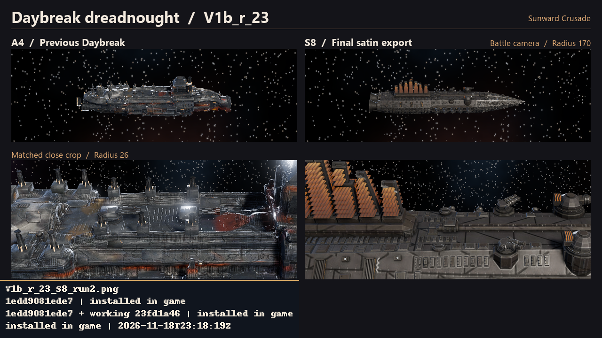

# Sunward Daybreak S8 swap

Refs #1059. The shared PC build now draws S8 as Daybreak (`V1b_r_23`). Stage 7 archived the previous A4 assets and rebuilt the ship cache. The shared build passed installed readback and both wreck runs, and the playtest check printed `MANIFEST OK` for all 260 files against the branch manifest. [Ship manifest](../../../godot/assets/ships/manifest.json)

The isolated build reads the current atlas bytes beside the GLB. The matched timing uses the issue 1070 baseline. [Issue 1082 cache finding](../eclipse_fault_1118/README.md) · [Issue 1070 baseline](../../../contrib/codex/perf_1118/README.md)

## Run 2 build and damage checks

The S8 sheet sets the decks, frames and Roll hall back from the two ends of B-3 and relieves the liner around the tears. The shell rooms and hoists remain in the gun galleries. The exported hull uses the R320 Sunward satin stack, baked at 4096 with 64 OptiX samples and exported with 2048 maps. [R254 build sheet](../../ship_pipeline/build_sheets/voidsworn_S8/README.md) · [Sunward paint stack](../../../tools/blender/kits/voidsworn/stack.py) · [Ship manifest](../../../godot/assets/ships/manifest.json)

- Fit, weapon match, sheet contract, stage 4 audit, and the audit self-test passed. The regenerated outline reference returned 49.2% overlap at its fitted camera and 41.5% at the game battle camera. The visual comparison above uses the approved S8 hull in ShipView.
- The six-view paint surface check found zero pixels of exposed room colour and zero unpainted pixels. Stage 6 passed with 48 draws for one ship with LOD off. Stage 7 and its hard-point self-test passed. The finished GLB has 115,546 triangles and 23 surfaces, including the four turning turrets.
- The isolated production cache passed readback with 41 nodes. The authored damage check retained the rooms through a wound and made five main pieces from four seams. The standard wreck seed and the scene 207 Daybreak seed each passed with zero protruding interior triangles and zero split machines out of 20. The candidate manifest verified all 260 files.
- Standing checks returned 69 passes and two known baselines.

## Matched scene 207 comparison

Each hull ran three fresh Forward+ Max sessions with the RTX 5080 held solo, fitted shields, full detail and the rest of the fleet held fixed. Each sample followed the 2.5-second settle and 180 warm-up frames, then measured at least 720 frames and eight seconds. The second session reversed the resolution order.

| Daybreak export | 1080p frame medians for the three sessions | 1080p GPU median | 4K GPU median | Hull triangles | Hull surfaces | Visible draws / shadow draws | Transparent hull surfaces |
| --- | ---: | ---: | ---: | ---: | ---: | ---: | ---: |
| A4 | 6.300, 6.574, 5.711 ms | 2.510 ms | 5.494 ms | 166,249 | 22 | 22 / 22 | 0 |
| S8 from run 1 | 6.297, 5.693, 6.033 ms | 2.475 ms | 5.393 ms | 115,226 | 23 | 23 / 23 | 0 |
| Final S8 | 3.308, 3.736, 3.170 ms | 2.612 ms | 5.661 ms | 115,546 | 23 | 23 / 23 | 0 |

The draw counts come from masking the Daybreak alone in the same battle and confirming the counts returned after restoring it. Both S8 exports add one visible submission and one shadow submission, with about 51,000 fewer triangles. The earlier frame-time increase did not reproduce with the matched fleet and cache. The measured rendering cost did not call for a change to the exterior mesh or paint.

The stock scene 207 gate also passed with the final S8 and the branch code. Across three sessions the 1080p frame medians were 3.619, 3.604 and 3.122 ms. The 4K GPU medians were 5.650, 5.666 and 5.624 ms. Both medians across sessions passed the 12.5 ms limit.

## Run 1 archive

The shared PC build kept the A4 Daybreak (`V1b_r_23`) after run 1. That S8 candidate failed the wreck plating and frame-time checks in the isolated build.

### Build method

The R254 build sheet supplies the hull, weapons, machinery and four seams. The port and starboard galleries now carry their
shell rooms and hoist drives above B-3. Three midship breach anchors moved to clear plating below the broadside guns so stage 7
could place them. The intact hull's fit check found zero vertices outside the inner skin across 48 interior objects.
[S8 build sheet](../../ship_pipeline/build_sheets/voidsworn_S8/README.md) · [Ship recipe](../../ship_pipeline/RECIPE.md) ·
[Sunward satin stack](../../../tools/blender/kits/voidsworn/stack.py)

### Checks

The sheet contract and stage 4 geometry audit passed. The stage 7 export and hard-point checks passed with 16 muzzles,
four turret pivots, two engine exits and eight breach anchors. Stage 7 refreshed the isolated cache and
`installed_ship_check.gd` read back 41 nodes. The authored damage check changed 10 exterior surfaces in a wound, kept its
room surfaces and produced five main wreck pieces at the four authored seams.

The death seam check used the repo's plating test with ShipView loading the isolated Daybreak as a Sunward dreadnought.
It found **46 interior triangles past their wreck plating** and zero split machines out of 20. The unpainted diagnostic
found the same count and located 28 on the front of the gun deck and 18 on the inner liner around the B-3 tear.
The shell room move leaves a separate deck and liner clearance problem.

Stage 5 baked the Sunward satin stack at 4096 pixels and 64 OptiX samples. Its six exterior views contained zero exposed room
pixels and zero unpainted pixels. Radiator paint detail coverage measured 61% of hull coverage. The stage 6 LOD bench passed.

| Export triangles, including rooms and turrets | Installed surfaces | Stage 6 draw calls, one ship with LOD off |
| ---: | ---: | ---: |
| 115,226 | 23 | 48 |

The standing checks returned 67 passes and two known baselines. The shared A4 Daybreak passed installed readback.
The shared build's playtest check printed `MANIFEST OK` for all 259 files against the branch manifest, including the four
Eclipse replacements. The isolated build printed `MANIFEST OK` for 260 files against its candidate manifest.
[Ship manifest](../../../godot/assets/ships/manifest.json)

The first export and its candidate manifest entry are archived with the job. That run left the shared manifest on A4.

### Scene 207

The stock Forward+ scene drew S8 in both runs on the RTX 5080, with the GPU held solo. The second run measured a
**16.327 ms** median frame at 1080p against the **12.5 ms** limit. Its three session medians were 15.125, 17.778 and 16.327 ms.
The 4K GPU median was 5.651 ms.

### Comparison

Both columns use the same camera and lighting. The top row uses native pixels at radius 170. The bottom row crops the
radius 26 views. S8's pointed bow and seven orange spires read at battle distance. The close crop shows very dark patches
on parts of the forward deck and below the spires.

