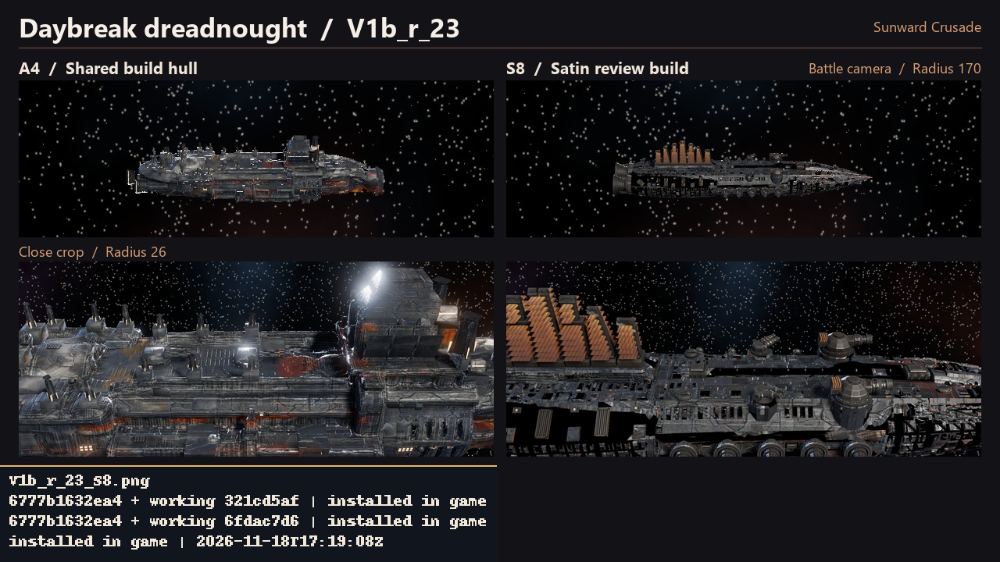

# Sunward Daybreak S8 swap

Refs #1059. The shared PC build keeps the A4 Daybreak (`V1b_r_23`). The S8 candidate failed the wreck plating and frame-time checks in the isolated build.

## Build method

The R254 build sheet supplies the hull, weapons, machinery and four seams. The port and starboard galleries now carry their
shell rooms and hoist drives above B-3. Three midship breach anchors moved to clear plating below the broadside guns so stage 7
could place them. The intact hull's fit check found zero vertices outside the inner skin across 48 interior objects.
[S8 build sheet](../../ship_pipeline/build_sheets/voidsworn_S8/README.md) · [Ship recipe](../../ship_pipeline/RECIPE.md) ·
[Sunward satin stack](../../../tools/blender/kits/voidsworn/stack.py)

## Checks

The sheet contract and stage 4 geometry audit passed. The stage 7 export and hard-point checks passed with 16 muzzles,
four turret pivots, two engine exits and eight breach anchors. Stage 7 refreshed the isolated cache and
`installed_ship_check.gd` read back 41 nodes. The authored damage check changed 10 exterior surfaces in a wound, kept its
room surfaces and produced five main wreck pieces at the four authored seams.

The death seam check used the repo's plating test with ShipView loading the isolated Daybreak as a Sunward dreadnought.
It found **46 interior triangles past their wreck plating** and zero split machines out of 20. The unpainted diagnostic
found the same count and located 28 on the front of the gun deck and 18 on the inner liner around the B-3 tear.
The shell room move leaves a separate deck and liner clearance problem.

Stage 5 baked the Sunward satin stack at 4096 pixels and 64 OptiX samples. Its six exterior views contained zero exposed room
pixels and zero unpainted pixels. Radiator paint detail coverage measured 61% of hull coverage. The stage 6 LOD bench passed.

| Export triangles, including rooms and turrets | Installed surfaces | Stage 6 draw calls, one ship with LOD off |
| ---: | ---: | ---: |
| 115,226 | 23 | 48 |

The standing checks returned 67 passes and two known baselines. The shared A4 Daybreak passed installed readback.
The shared build's playtest check printed `MANIFEST OK` for all 259 files against the branch manifest, including the four
Eclipse replacements. The isolated build printed `MANIFEST OK` for 260 files against its candidate manifest.
[Ship manifest](../../../godot/assets/ships/manifest.json)

The finished export and its candidate manifest entry are archived with the job. The shared manifest still points to A4.

## Scene 207

The stock Forward+ scene drew S8 in both runs on the RTX 5080, with the GPU held solo. The second run measured a
**16.327 ms** median frame at 1080p against the **12.5 ms** limit. Its three session medians were 15.125, 17.778 and 16.327 ms.
The 4K GPU median was 5.651 ms.

## Comparison

Both columns use the same camera and lighting. The top row uses native pixels at radius 170. The bottom row crops the
radius 26 views. S8's pointed bow and seven orange spires read at battle distance. The close crop shows very dark patches
on parts of the forward deck and below the spires.

